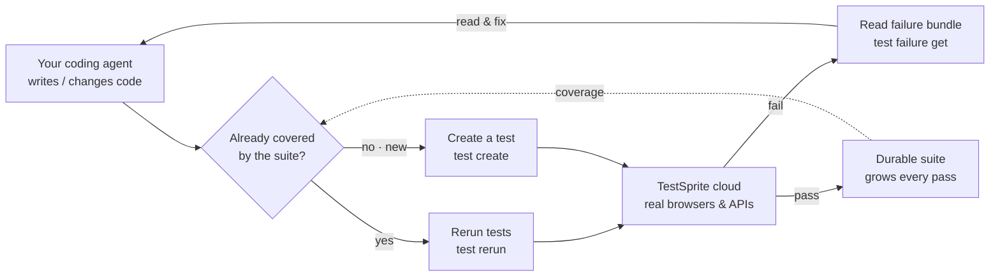

Verification should be a loop your coding agent runs continuously, not a gate at the end. Each time the agent changes code, it verifies the behavior it touched and banks the result.

<Card>

</Card>

<Steps>
  <Step title="Not covered → create">
    Describe the behavior as a plan file (frontend) or code (backend), then create and run it:

    ```bash
    testsprite test create \
      --project proj_8f0f6 --type frontend \
      --plan-from ./checkout-flow.plan.json \
      --run --wait --output json
    ```

    `--run --wait` chains create, trigger, and poll. Exit 0 means the test passed and is banked.
  </Step>
  <Step title="Already covered → rerun">
    ```bash
    testsprite test rerun --all --project proj_8f0f6 --wait
    ```

    A frontend rerun has [auto-heal](/cli/core/rerun-and-auto-heal) on by default: if the app changed, the test is repaired and the repaired version saved. For a strict regression gate that replays the saved script exactly, add `--no-auto-heal`. A rerun is billed the same as a fresh run, so rerun the relevant suite after every significant change.
  </Step>
  <Step title="Failed → read the bundle, fix, rerun">
    On exit 1, pull the [failure bundle](/cli/concepts/key-terms#failure-bundle), fix the code, and rerun:

    ```bash
    mkdir -p .testsprite
    testsprite test failure get test_3a9f21c7 --out ./.testsprite/failure
    testsprite test rerun test_3a9f21c7 --wait
    ```

    A test that has never passed, or has only run with `--local`, has no saved code, so there is no bundle (exit 4, reason `no_code`). Use `testsprite test steps <test-id> --run-id <run-id>` and `testsprite test failure summary <test-id>` instead.
  </Step>
</Steps>

## Why this design works

<AccordionGroup>
<Accordion title="One self-consistent bundle" icon="layer-group">
Every artifact from `test failure get` and `test artifact get` shares one `snapshotId`, and the CLI refuses to stitch data across runs or code versions. The agent never "fixes" the wrong thing from mixed context.
</Accordion>

<Accordion title="Coverage compounds" icon="chart-line">
Every passing test joins a durable suite, so "already covered?" is answered by replayable tests rather than the agent's memory, and regressions are caught on the next run.
</Accordion>

<Accordion title="Real browsers and APIs" icon="cloud">
Tests run against your live product, with nothing to install on your side. A run uses the project's Default environment unless you pass `--env <name>`. To test an app on your machine, see [Environments](/cli/core/local-apps).
</Accordion>

<Accordion title="Machine-readable contract" icon="code">
`--output json` and stable exit codes let the agent branch without defensive parsing. See [Output & Scripting](/cli/reference/output-and-scripting#the-json-contract).
</Accordion>

<Accordion title="Safe retries" icon="rotate">
`project create`, `test create`, `test run`, and `test rerun` carry an idempotency key (random per invocation), so retrying never duplicates a project, test, or run. Pin your own with `--idempotency-key my-agent-step-42`. Replacing backend code is guarded by a `codeVersion` token; see [Editing & Deleting Tests](/cli/core/editing-tests#editing-a-test).
</Accordion>

<Accordion title="Run-scoped vs latest" icon="code-branch">
`test failure get` follows the *latest* failing run, which can shift if a Portal or scheduled run lands mid-loop; `test artifact get <run-id>` is pinned to one run. In agent loops and CI, capture the `runId` from `--output json` and use `test artifact get`. See [Reading Results](/cli/core/reading-results#pinning-to-a-specific-run).
</Accordion>
</AccordionGroup>

## Where the CLI fits

The CLI is one of three surfaces over the same backend; see [One Platform, Three Surfaces](/cli/getting-started/overview#one-platform-three-surfaces). It covers the test lifecycle, schedules, and test lists (subject to your plan). Billing, site discovery, and per-step regeneration stay in the Web Portal.

## Where to Go Next

<Columns cols={2}>
  <Card title="Key Terms" href="/cli/concepts/key-terms" icon="square-code">
    Core concepts defined
  </Card>
  <Card title="Quickstart" href="/cli/getting-started/quickstart" icon="play">
    Your first test end to end
  </Card>
  <Card title="Running Tests" href="/cli/core/running-tests" icon="list-check">
    Triggering runs and handling exit codes
  </Card>
  <Card title="Agent Integration" href="/cli/core/agent-integration" icon="robot">
    Let your coding agent drive the loop
  </Card>
</Columns>
