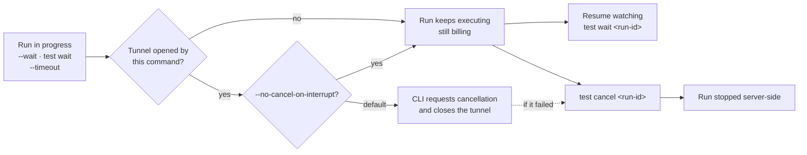

<Card>

</Card>

With `--tunnel-client <id>` (a tunnel started separately with `testsprite tunnel start`), the run behaves like an ordinary one. If that process stops or its credential is revoked while the original `test run` waits, the run is cancelled by default and the command exits `10`; `--no-cancel-on-interrupt` skips the cancellation. A resumed `test wait` does not monitor the borrowed tunnel and has no such flag.

## Ctrl-C detaches

Ctrl-C during `test run --wait`, `test wait`, `test rerun --wait`, or `test flaky` stops the *watching*, not the *run*. For an ordinary run the CLI says so:

```text
Interrupted (SIGINT). Run run_5c1d9a2b is still executing on the server and will keep running (and billing) until it finishes.
  Re-attach with: testsprite test wait run_5c1d9a2b
  Cancel with:    testsprite test cancel run_5c1d9a2b
```

Like a `--timeout` expiry, it prints a partial `{ "runId": "...", "status": "running" }` to stdout so scripts keep the `runId` (a fallback, not a fresh server observation). The exit code is `130` for SIGINT, `143` for SIGTERM, `129` for SIGHUP. A second Ctrl-C exits immediately without cleanup.

With `--output json`, stderr carries an envelope instead (`error.code` `INTERRUPTED`, with `nextAction` and `details.signal`).

Interrupting a batch (`test run --all --wait`, multi-id `test wait` / `test rerun`) prints a partial listing of dispatched runs. A local batch also lists `not-run` tests that never started, and Ctrl-C cancels unfinished runs on its own tunnel by default.

### A self-minted `--local` run cancels by default

```text
Interrupted by SIGINT. Run run_5c1d9a2b was reaching your machine through a tunnel that closes with this process, so it was cancelled (exit 130). ...
```

On success the partial status is `cancelled`, with no `test wait` hint, since re-attaching cannot revive the closed tunnel. If cancellation failed or was skipped, use `testsprite test cancel <run-id>`; if the run already finished, its verdict stands. Start a new run with `testsprite test run <test-id> --local <port>`. Automatic cancellation uses the same endpoint and refund rules as `test cancel`.

### `--no-cancel-on-interrupt`

No cancel is sent and the partial status is `running`. Check the verdict with `testsprite test result <test-id>` or `testsprite test wait <run-id>` (waiting does not reopen the tunnel), or stop it with `testsprite test cancel <run-id>`.

## Stopping a run

```bash
testsprite test cancel run_5c1d9a2b
```

```text
runId       run_5c1d9a2b
testId      test_3a9f21c7
status      cancelled
createdAt   2026-07-10T02:11:04Z
startedAt   2026-07-10T02:11:09Z
failureKind user_cancel
```

- **The test is immediately re-runnable**, with no "run already in flight" conflict.
- **The last verdict is untouched.** A test that was <kbd>passed</kbd> stays <kbd>passed</kbd>.
- **Refunds (frontend).** If cancellation wins before any terminal verdict, the backend attempts to refund the recorded charge. The response's `refund.status` is `refunded`, `not_charged`, or `failed` (the refund failed, cancellation still succeeded). Check it; cancellation success alone does not confirm a refund. A run whose verdict already landed is never refunded (exit `6`). Backend tests keep their no-refund behavior.
- **Background work is discarded.** The engine may finish, but its result never overwrites <kbd>cancelled</kbd>.

## Idempotent by design

Cancelling the same run twice exits `0` with `[advisory] run run_5c1d9a2b was already cancelled`, so it is safe in retries and cleanup traps. Business refusals:

| Situation | Exit |
| :--- | :--- |
| Run already <kbd>passed</kbd> / <kbd>failed</kbd> / <kbd>blocked</kbd> | 6 |
| Run ID unknown (or another tenant's) | 4 |

## Cancelling several runs

`test cancel` accepts several IDs and prints a summary:

```bash
testsprite test cancel run_5c1d9a2b run_7f2e1c04 run_9a01b3e5
```

```json
{
  "cancelled": ["run_5c1d9a2b", "run_7f2e1c04"],
  "alreadyCancelled": [],
  "conflicts": [{ "runId": "run_9a01b3e5", "status": "unknown" }],
  "notFound": [],
  "errors": []
}
```

The exit code reports the worst outcome: any `notFound` gives `4`, else any transport/auth `errors` gives `1`, else any `conflicts` gives `6`, else `0`.

## CI cleanup pattern

```bash
RUN_ID=$(testsprite test run test_3a9f21c7 --output json | jq -r '.runId')
trap 'testsprite test cancel "$RUN_ID"' INT TERM
testsprite test wait "$RUN_ID"
```

## Where to Go Next

<Columns cols={2}>
  <Card title="Running Tests" href="/cli/core/running-tests" icon="play">
    Triggering runs, waiting for verdicts, and resuming
  </Card>
  <Card title="Exit Codes" href="/cli/reference/exit-codes" icon="list-ol">
    The full exit-code and signal contract
  </Card>
  <Card title="Reading Results" href="/cli/core/reading-results" icon="list-check">
    Run history, steps, and failure bundles
  </Card>
  <Card title="CI/CD Integration" href="/cli/integrations/ci-cd" icon="github">
    Wire the CLI into GitHub Actions or any pipeline
  </Card>
</Columns>
