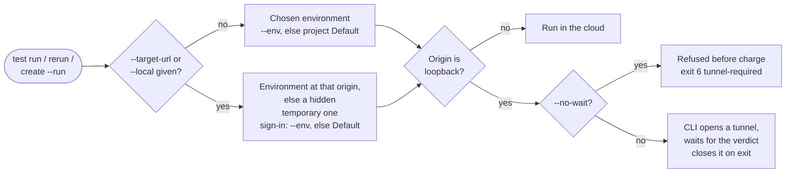

An **environment** is a named target within a project: the URL to test plus what a run needs there, such as sign-in settings and custom variables. Names are unique per project. Every run uses exactly one environment: the project's Default (`DEFAULT yes` in `project env list`) unless you pass `--env <name>`. An unknown name fails and lists available names; it never falls back to Default.

An environment whose origin is a loopback address opens a tunnel automatically; see [Testing Local Apps](/cli/core/local-apps).

## Manage environments

On a legacy-engine project, `project env` exits `7` (`environments-unsupported-on-v2`); use `project update <project-id> --url <url>` instead.

```bash
testsprite project env list <project-id>            # names, URLs, login modes, DEFAULT marker
testsprite project env get <project-id> staging     # login summary and custom variables; never passwords
testsprite project env create <project-id> --name staging --url https://staging.example.com
testsprite project env create <project-id> --name production --url https://app.example.com \
  --username tester@example.com --password-file ./test-password.txt
testsprite project env update <project-id> staging --url https://new-staging.example.com
testsprite project env set-default <project-id> staging
testsprite project env update <project-id> staging --rename preview
testsprite project env delete <project-id> staging --confirm
```

- `create` needs `--name` and exactly one of `--url` or `--local`. `--url` takes a public HTTP(S) URL or a loopback origin. Prefer `--password-file`; passwords are write-only.
- With no stored account, `--username` and `--password-file` go together (exit `5` otherwise).
- Repeatable `--var KEY=VALUE` sets custom variables for frontend runs; `update` merges by key. Values are shown in plain text, so do not store secrets in them. Keys start with a letter or underscore and use letters, digits, and underscores (up to 64 characters); up to 50 variables, 4096 bytes per value.
- `--clear-credentials` removes the stored username and password and turns off account sign-in; it cannot be combined with `--username`, `--password`, or `--password-file`.
- Delete is soft: the name can be reused and history keeps the old name. Change the Default before deleting it.

## Sign-in modes

Sign-in is a property of the environment. Read or change it with `project sign-in` (without `--env`, the Default environment):

```bash
testsprite project sign-in get <project-id> --env staging
testsprite project sign-in set <project-id> --env staging --mode account \
  --username tester@example.com --password-file ./test-password.txt
```

| Mode | Aliases | What runs do |
| :--- | :--- | :--- |
| `public` | `none` | Test the app without signing in. |
| `account` | `credentials` | Sign in with the stored test-account username and password. |
| `otp` | | Sign in with one-time codes sent to an inbox or phone number TestSprite provisions. Chosen at creation (`project env create --sign-in otp`, channels with `--otp-channel email,sms`); to change it, create a new environment and set it as Default. |
| `manual` | `sso` | A person logs in once in a live browser and runs reuse that session. |

- For `manual`, log in once in the Portal under **Project, Settings, Environments, the environment name, Log in**. The CLI warns when no session is captured. `--session-ttl` takes 1 to 2592000 seconds, or `never`. Selecting SSO needs a feature flag on your account; without it the command exits `13` (`FEATURE_GATED`).
- SSO and OTP environments keep no username or password: `project env update --username` on one exits `6`.
- Loopback environments support only `public` and `account`. A temporary environment has no settable sign-in.

## Plan limits

Free and Starter allow **one environment per project** (the Default counts), Standard **3**, Pro and Enterprise unlimited; temporary environments do not count. Going over fails with exit `13` (`FEATURE_GATED`). On one environment, change the Default's URL with `project update <project-id> --url <url>`, or use `--target-url` for a single run.

## Choose an environment for a run

```bash
testsprite test run <test-id> --env staging --wait
testsprite test rerun <test-id> --env staging --wait
testsprite test create --plan-from plan.json --run --env staging --wait
```

`test run --all`, `test create`, and `test create-batch` take `--env` too; without it they use Default.

A backend test picks up an environment's URL only if its code uses the environment URL placeholder; a URL written into the code stays as written. Check backend targets before using `--env` as a staging gate.

<Card>

</Card>

### Ad-hoc targets and temporary environments

`--target-url <url>` runs a frontend test against an address that is not saved as an environment, such as a pull-request preview. `--local <port>` does the same for a port on your machine; the two cannot be combined. The **temporary** environment (see the diagram above) is removed when the run finishes. See [Running Tests](/cli/core/running-tests#run-against-a-url-without-creating-an-environment).

- **Sign-in** comes from `--env <name>` if given (`--env staging --local 5173` is allowed; the CLI notes it on stderr), else from the Default (same test account or one-time-code setup).
- **Results keep the run's address** as `targetUrl` (userinfo removed), even after the environment's URL changes.
- **A recorded session is not cloned.** A Default that signs in with a recorded session (manual or SSO) only works on its own origin. An ad-hoc target on another origin without `--env` is refused before any charge: exit `6`, `frontend-auth-target-origin-mismatch`. Pass `--env <name>` for an environment that can sign in at the target, or save the address as an environment. A named environment is refused on another origin when it uses a recorded session, a one-time code, or a login-once step; a test-account environment is not.
- **Temporary environments are hidden** from `project env list` and `statusByEnvironment`, and do not count toward the plan limit. They appear in `test result --history`.

<Warning>
Changing an environment's URL keeps test IDs, code versions, and history, but does not rewrite hosts written into a test's steps. A hard-coded host that no longer belongs to any of the project's environments keeps pointing at the old site. Review steps with `testsprite test get <test-id>` and fix them with `testsprite test plan put <test-id> --steps <file>`.
</Warning>

## Runs follow their own environment

If a test's steps name one of the project's environments (for example `Navigate to https://staging.example.com`) and you run it on another saved environment, TestSprite points those steps at the run's environment at dispatch; the stored plan is unchanged. Tunnel runs and cross-origin target overrides repoint navigation the same way. A URL that belongs to none of the project's environments is left as written.

## Status per environment

`test list` and `test get` show each test's latest result in the Default environment. JSON keeps `status` and adds `statusByEnvironment` (saved environments only); the text table has an `ENV` column. To read another environment:

```bash
testsprite test list --project <project-id> --env staging
testsprite test result <test-id> --history --env staging
```

A test with no result there shows `ready`.

Schedules follow environments too; see [Test Lists & Schedules](/cli/integrations/test-lists-and-schedules#run-on-a-schedule).

For every flag, see [Command Reference](/cli/reference/command-reference).
