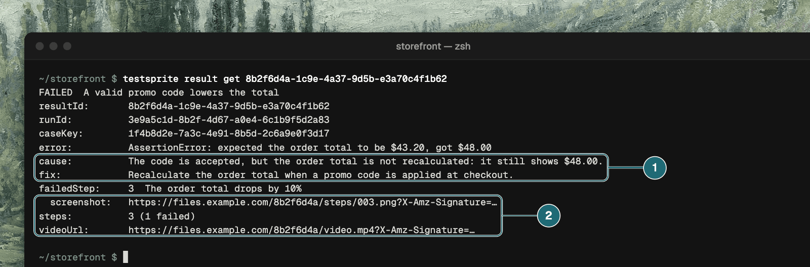

## Find the result you need

| What you have | What to read |
| :--- | :--- |
| A run ID from `runs[].runId` | `testsprite result list --run "$RUN_ID"` lists outcomes for that execution. |
| A saved test ID | `testsprite result list --test "$TEST_ID" --limit 1` lists its latest result. |
| A result ID from `results[].resultId` | `testsprite result get "$RESULT_ID"` reads that particular outcome. |

`test get` describes the saved test and its steps. `result get` shows what actually happened on one attempt. In the results list, `caseKey` identifies the saved test. Use it to run the case again.

<Frame>
  
</Frame>

## Pinning to a specific run

In CI, use the run ID from the launch you are investigating. Filtering by execution keeps the evidence tied to that run even if another build or a schedule runs the same test afterward.

```bash
testsprite result list --run "$RUN_ID" --status failed,blocked --output json
```

Copy a `resultId` from `results[]` and inspect the outcome. JSON includes the verdict (`testStatus`), `error`, `blockedReason`, `cause`, `fix`, and the recorded steps when available. `failedStep` can include its screenshot. For a backend test, inspect `trace` and `apiOutput` for the Python traceback and captured output. Text mode abbreviates long traces and output. JSON returns the complete fields.

```bash
testsprite result get "$RESULT_ID" --output json
```

`result list` and `result get` normally exit `0` when the read succeeds, including for a failed test. Use `run --wait` or `run wait` to gate on the execution verdict. [Running Tests](/cli/core/running-tests)

## History by environment

```bash
testsprite result list --test "$TEST_ID" --env staging --limit 10
testsprite result list --test "$TEST_ID" --status cancelled
```

Test history is newest first. `--env` and `--limit` apply to `--test`, with a default limit of 20 and a range of 1–100. `--status` accepts `passed`, `failed`, `running`, `blocked`, and `cancelled`. Include `cancelled` explicitly to see cancelled results. To read the latest cancelled or non-cancelled result, supply all five statuses with `--limit 1`.

## Download the evidence

```bash
testsprite result get "$RESULT_ID" --out ".testsprite/results/$RESULT_ID" --failed-only
```

Use one directory per result. The CLI creates it and writes `result.json` plus available media, such as `video.mp4`, `steps/001.png`, and `steps/001.html`. A result blocked at sign-in can have an additional `sign-in/` directory. `--failed-only` downloads failed steps and one on either side, or all steps if none failed. Omit it for the full sequence.

Downloading again replaces the managed result files in that directory. If a file fails to download, the CLI writes the rest, reports the failed file, and exits `10`. Retry the same download to get fresh links. If an earlier copy of that file from the same result was kept, the download summary marks it `kept: true`. Keep downloaded HTML and screenshots private when they include application data.
