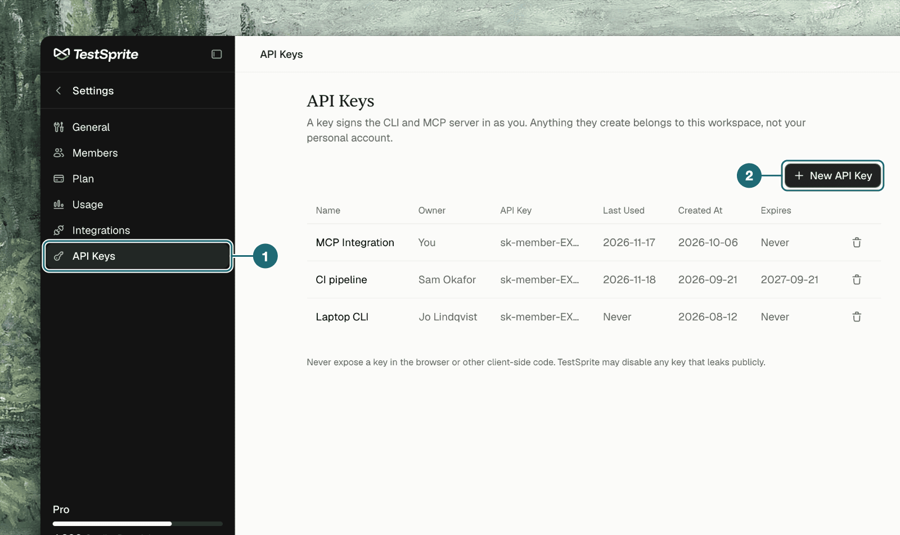
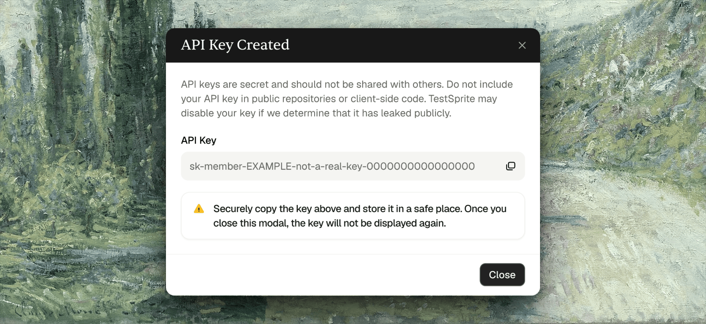

## Install

Use Node.js **20.19 or later in the 20.x line**, **22.13 or later in the 22.x line**, or **24 and above**. Install the CLI with npm, then check the installed version.

```bash
node --version
npm install -g @testsprite/testsprite-cli
testsprite --version
```

For a one-off command, use `npx @testsprite/testsprite-cli --version`.

## Get your API key

1. Sign in to TestSprite and select the workspace that owns the tests. If you need an account, [sign up here](https://www.testsprite.com/auth/cognito/sign-up).
2. Open **Workspace Settings → Connections → API Keys**, then select **New API Key**. [Open API Keys](https://www.testsprite.com/dashboard-v3/settings/apikey).

<Frame>
  
</Frame>

3. Copy the key when the dialog opens. You can revoke it and create a replacement if you lose it. [API key management](/web-portal/admin/api-keys).

<Frame>
  
</Frame>

## Sign in

Run setup in the root of your repository, paste your key at the prompt, then verify the workspace.

```bash
testsprite setup
testsprite auth status
```

Setup validates the key, saves it to your local profile and installs skills for the coding agents it detects. With no detected agents it defaults to Claude Code. Check the `org` and `scopes` lines in the status output before creating a project or starting a run. See [Authentication](/cli/core/authentication).

To specify one agent, run `testsprite setup --agent codex`. For credentials only, use `testsprite setup --no-agent`. You can install additional targets later with `testsprite agent install cursor codex`. [Supported agents and skill updates](/cli/core/agent-integration).

## Using it in CI

Expose the workspace key as the CI secret `TESTSPRITE_API_KEY`. Commands read it from the environment. Check the identity before starting the job's tests.

```bash
testsprite auth status --output json
```

<Columns cols={2}>
  <Card title="Quickstart" href="/cli/getting-started/quickstart" icon="play">
    Set up your first project, plan a test and run it.
  </Card>
  <Card title="CI/CD integration" href="/cli/integrations/ci-cd" icon="github">
    Run pull-request checks against a preview deployment.
  </Card>
</Columns>
