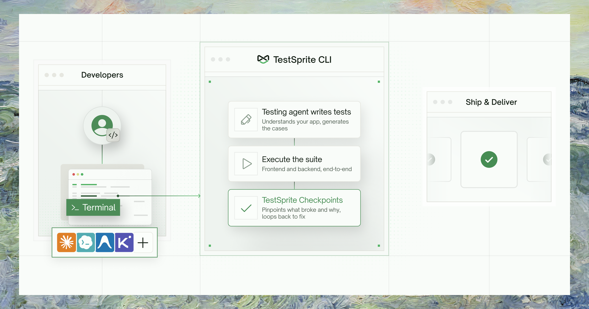

## What is the TestSprite CLI?

TestSprite tests frontend and backend software in the cloud, against the live product, not mocks. The CLI puts that platform in your coding agent's hands: structured output it can parse, exit codes it can branch on, and one failure bundle it can act on.
<Frame>
<iframe
  className="w-full aspect-video rounded-xl"
  height="400"
  src="https://www.youtube.com/embed/Le3ZvawrTuI?si=rLM9Y65WmgFRiWzJ"
  frameBorder="0"
  allow="accelerometer; clipboard-write; encrypted-media; gyroscope; picture-in-picture"
  allowFullScreen
></iframe>
</Frame>
The CLI shares the same backend, projects, and tests as the [Web Portal](/web-portal/getting-started/overview) and the [MCP Server](/mcp/getting-started/introduction). A test you create from the terminal shows up in the dashboard, and vice versa. The `--output json` shape and exit codes are a stable contract for agents and CI.

### Why a CLI for coding agents?

Without it, you run the app, screenshot the result, and paste it back to the agent. With it, the agent triggers a real cloud run and reads the verdict itself.
<Frame>
  
</Frame>

What broke comes back as **one self-consistent failure bundle**, all anchored to the same snapshot; the CLI never stitches data from two runs:

| In the bundle | What it contains |
| :--- | :--- |
| <kbd>Failing step</kbd> | The exact step that broke, plus its neighbors for context. |
| <kbd>DOM snapshots</kbd> | The DOM at the point of failure — your agent can read it without a vision model. |
| <kbd>Fix guidance</kbd> | A root-cause hypothesis and a recommended fix target. |

<Tip>
Prepend `--dry-run` to any command to see a canned sample in the real response shape, with no API key.
</Tip>

## The verification loop

<Steps>
  <Step title="Install and onboard">
    ```bash
    npm install -g @testsprite/testsprite-cli
    testsprite setup --agent AGENT
    ```

    `setup` stores your API key and installs the verification skill into your agent's project, so the agent knows when and how to run tests. See [Installation](/cli/getting-started/installation).
  </Step>
  <Step title="Create and run a test">
    Describe the behavior as a plan file, then one command creates the test, runs it in the cloud against your live app, and blocks until a verdict. Exit 0 means passed, 1 means failed.

    ```bash
    testsprite test create \
      --project proj_8f0f6 --type frontend \
      --plan-from ./checkout-flow.plan.json \
      --run --wait --output json
    ```
  </Step>
  <Step title="On failure, read the bundle">
    ```bash
    mkdir -p .testsprite
    testsprite test failure get test_3a9f21c7 --out ./.testsprite/failure
    ```
  </Step>
  <Step title="Fix and rerun">
    ```bash
    testsprite test rerun test_3a9f21c7 --wait
    ```

    Every pass is banked into the durable suite, so the next change reruns rather than recreates. See [Rerun & Auto-Heal](/cli/core/rerun-and-auto-heal).
  </Step>
</Steps>

## Who It's For

| Audience | What they get |
| :--- | :--- |
| <kbd>AI coding agents</kbd> <br/> _Primary_ | Claude Code, Codex, Cursor, Cline, Antigravity, Windsurf, Copilot, and more — the agent drives the loop without a human in the middle. |
| <kbd>Developers at a terminal</kbd> | The same surface, with predictable commands, consistent flags, and machine-readable output. |
| <kbd>CI pipelines</kbd> | Stable `--output json` contract, stable exit codes, and non-interactive `--from-env` auth. |

## One Platform, Three Surfaces

All three share the same tests, projects, and runs:

<Tabs>
  <Tab title="Web Portal">
    For humans: visual project setup, PRD uploads, dashboards, scheduling, billing and member management. Not scriptable.

    <Card title="Go to Web Portal docs" href="/web-portal/getting-started/overview" icon="browser" horizontal />
  </Tab>
  <Tab title="MCP Server">
    Lives in your IDE; the agent calls it as a tool during a session, including for local frontend testing. Session-scoped, not scriptable, not CI-compatible.

    <Card title="Go to MCP Server docs" href="/mcp/getting-started/introduction" icon="plug" horizontal />
  </Tab>
  <Tab title="CLI">
    The scriptable, agent-safe, CI-compatible surface: structured JSON, stable exit codes, non-interactive operation and durable run artifacts. Billing management uses the Portal. To test an app on your own machine, see [Environments](/cli/core/local-apps).
  </Tab>
</Tabs>

| Capability | Web Portal | MCP Server | CLI |
| :--- | :--- | :--- | :--- |
| Create and run tests | <Icon icon="check" /> | <Icon icon="check" /> | <Icon icon="check" /> |
| Visual dashboards | <Icon icon="check" /> | — | — |
| Scheduling | <Icon icon="check" /> | — | <Icon icon="check" /> |
| `localhost` targets via tunnel | — | <Icon icon="check" /> | <Icon icon="check" /> * |
| Agent-driven | — | <Icon icon="check" /> | <Icon icon="check" /> |
| Scriptable / CI | — | — | <Icon icon="check" /> |
| Structured failure bundles | — | <Icon icon="check" /> | <Icon icon="check" /> |
| Billing & org management | <Icon icon="check" /> | — | — |

<Note>
\* Frontend runs against loopback addresses; see [Environments](/cli/core/local-apps).
</Note>

## Where to Go Next

<Columns cols={2}>
  <Card title="Installation" href="/cli/getting-started/installation" icon="download">
    Install the CLI and sign in in under 2 minutes
  </Card>
  <Card title="Quickstart" href="/cli/getting-started/quickstart" icon="play">
    Create a test, run it, and read what broke — end to end
  </Card>
  <Card title="Key Terms" href="/cli/concepts/key-terms" icon="book">
    Projects, tests, runs, and the concepts behind them
  </Card>
  <Card title="Command Reference" href="/cli/reference/command-reference" icon="terminal">
    Every command, flag, and exit code
  </Card>
</Columns>
