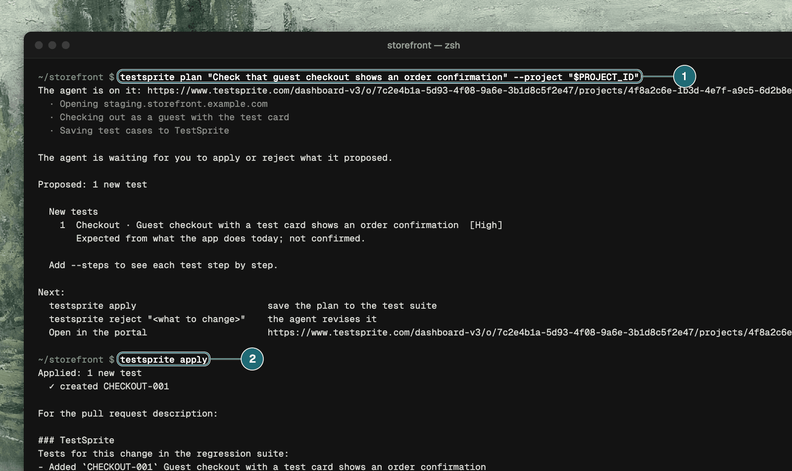

TestSprite runs browser and API tests against your application. Use the CLI to ask your project's TestSprite agent for coverage, review what it proposes, and run saved tests from your terminal, coding agent or CI.

<Note>
If you're using CLI 0.16.0, see the [command guide for that release](https://github.com/TestSprite/testsprite-cli/blob/v0.16.0/DOCUMENTATION.md).
</Note>

## The verification loop

Suppose a change touches checkout. If a saved test already covers it, run its test ID against the deployment that contains the change. For new coverage, describe the expected outcome to the project's agent. It proposes the steps so you can check what a pass would actually prove.

| What you want to do | Command |
| --- | --- |
| Ask for a checkout test | `testsprite plan "Check that guest checkout shows an order confirmation" --project <project-id> --steps` |
| Save a reviewed test plan | `testsprite apply` |
| Run one saved test and get its verdict | `testsprite run <test-id> --wait` |
| See the results from the execution | `testsprite result list --run <run-id>` |
| Inspect one test's failed step and available evidence | `testsprite result get <result-id>` |

A **test ID** identifies the saved case. Each execution has a **run ID** and each case executed in it has a **result ID**. After a fix, run the same test ID again to get a new result.

<Frame>
  
</Frame>

## One platform, three surfaces

The [Web Portal](/web-portal/getting-started/overview) lets you review your project's tests and results visually. The [MCP Server](/mcp/getting-started/introduction) connects TestSprite tools to your IDE. The CLI exposes commands, JSON and exit codes for shell scripts, coding agents and [CI pipelines](/cli/integrations/ci-cd).

<Columns cols={2}>
  <Card title="Installation" href="/cli/getting-started/installation" icon="download">
    Install the CLI and connect a workspace.
  </Card>
  <Card title="Quickstart" href="/cli/getting-started/quickstart" icon="play">
    Go from an empty project to a test verdict.
  </Card>
  <Card title="Coding agent integration" href="/cli/core/agent-integration" icon="robot">
    Install and refresh skills for your coding agent.
  </Card>
  <Card title="Command reference" href="/cli/reference/command-reference" icon="terminal">
    Find a command and its options.
  </Card>
</Columns>
