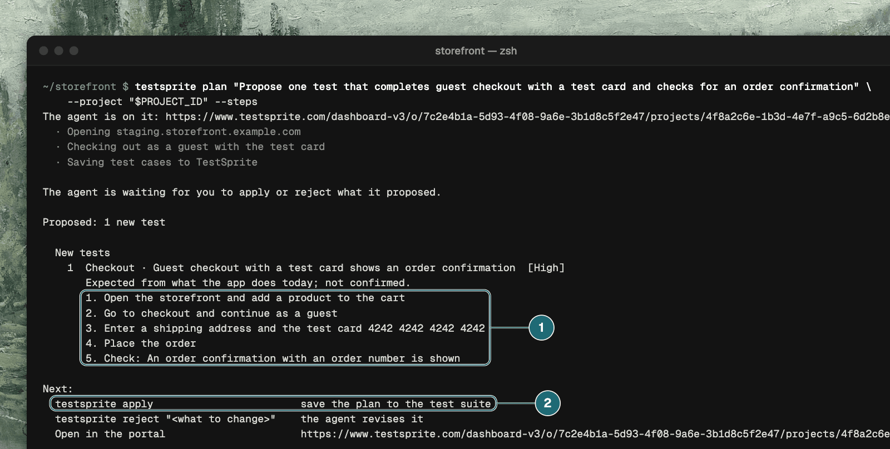

Have your workspace API key and the staging URL of a deployed frontend ready. Substitute a user journey that works in your app wherever the example uses guest checkout.

## Install and set up

From your repository root, install the CLI, paste your key into the setup prompt and confirm the workspace. If you're already set up, start with `auth status`. [Installation](/cli/getting-started/installation).

```bash
npm install -g @testsprite/testsprite-cli
testsprite setup
testsprite auth status
```

## Find or create a project

```bash
testsprite project list
```

Reuse an existing frontend project or create one and copy the returned `projectId`.

```bash
testsprite project create --type frontend --name "Checkout" --output json
```

A new project starts empty. Set the variables below to your project ID and application URL, then add the first environment. It becomes the project default. For an existing project, `testsprite project env list "$PROJECT_ID"` shows the saved names you can use.

```bash
PROJECT_ID='your-project-id'
APP_URL='https://staging.example.com'
testsprite project env create "$PROJECT_ID" --name staging --url "$APP_URL"
```

The example assumes a publicly reachable checkout. For a test account, see [Environments](/cli/core/environments). For a frontend on your machine, [Local apps](/cli/core/local-apps) covers planning from a diff and running through a tunnel. For an API, use a backend project and attach its API specification when requesting tests. [Creating tests](/cli/core/creating-tests).

## Request and review a plan

Ask the project's TestSprite agent to propose one test. `--env staging` selects the environment for this conversation. `--steps` shows what the proposed test would do and assert.

```bash
testsprite plan "Propose one test that completes guest checkout with a test card and checks for an order confirmation" \
  --project "$PROJECT_ID" --env staging --steps
```

<Frame>
  
</Frame>

If the agent asks a question in a chat message, answer with `testsprite reply "your answer"`. If it needs more time, follow it with `testsprite status --wait --steps`. Review the proposed actions and expected outcome. To request a revision, use `testsprite reject "what should change"`.

When the conversation shows the **test plan** you want to save, apply it from the same directory. The JSON field `applied.tests` contains the saved test IDs.

```bash
testsprite apply --output json
```

## Run the saved test

Copy the test ID from `applied.tests`. Start the test against staging and wait for the verdict.

```bash
TEST_ID='your-saved-test-id'
testsprite run "$TEST_ID" --env staging --wait --output json
```

In the JSON output, `runs[].runId` identifies the execution. Each test that produced a result has its own `results[].resultId`. A completed passing run exits `0`. A completed failed run exits `1` and still prints the results. If your wait times out, use `testsprite run wait <run-id>` to resume following the execution. [Running tests](/cli/core/running-tests).

## Inspect the result

Use the run ID to list the execution's results. Copy the result ID for the case you want to examine.

```bash
RUN_ID='your-run-id'
testsprite result list --run "$RUN_ID"
```

```bash
RESULT_ID='your-result-id'
testsprite result get "$RESULT_ID" --output json
```

These fields are an excerpt from the CLI's offline sample. You can reproduce it with `testsprite --dry-run result get res_dryrun0001 --output json`.

```json
{
  "resultId": "res_dryrun0001",
  "runId": "run_dryrun0001",
  "caseKey": "test_8f2a4d10",
  "title": "Checkout happy path",
  "testStatus": "FAILED",
  "error": "AssertionError: expected the order confirmation heading to be visible",
  "fix": "Fill the card number before submitting the checkout form."
}
```

A successful `result get` means the CLI read the result. Check `testStatus` for the verdict. Use `--out` to keep the detail and available video, screenshots and page snapshots for this result.

```bash
testsprite result get "$RESULT_ID" --out ".testsprite/results/$RESULT_ID"
```

If the application failed the expected behavior, fix it, deploy that build to staging, and run the same test ID again. If the assertion was wrong, ask the project's agent for a correction, review it and apply the revised plan.

<Columns cols={2}>
  <Card title="Coding agent integration" href="/cli/core/agent-integration" icon="robot">
    Give your coding agent the same verification workflow.
  </Card>
  <Card title="Reading results" href="/cli/core/reading-results" icon="clipboard-list">
    Find earlier results and inspect sign-in or API failures.
  </Card>
</Columns>
