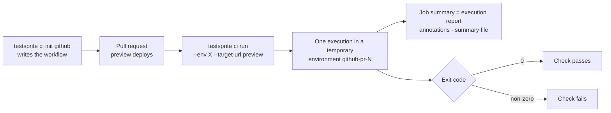
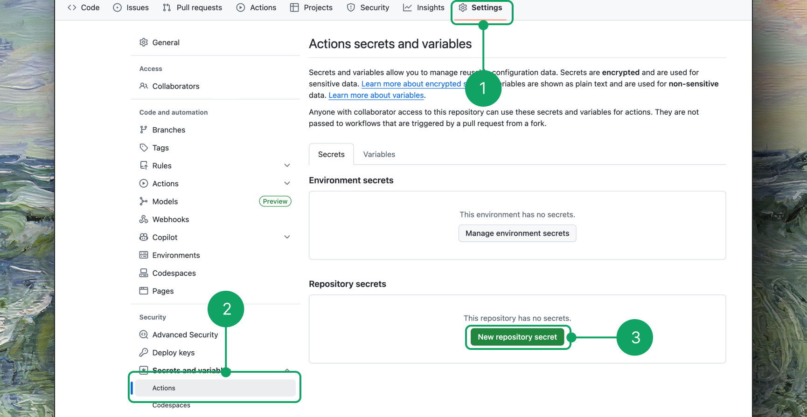

`testsprite ci run` runs a project's tests, waits for the verdict, and exits non-zero if any test does not pass. `testsprite ci init github` writes a GitHub Actions workflow that runs it against each pull request's preview.

<Card>

</Card>

## Set up the pull-request gate

<Steps>
  <Step title="Add your API key as a repository secret">
    Mint the key in the workspace the project belongs to. It is tied to the member who minted it and stops working if they leave or are removed from the workspace, so mint it from an account that will stay. Save it as the `TESTSPRITE_API_KEY` secret under <kbd>Settings → Secrets and variables → Actions</kbd>, or pass `--set-secret` in the next step to set it through `gh`.

    <Frame>
      
    </Frame>
  </Step>
  <Step title="Generate the workflow">
    ```bash
    testsprite ci init github --project proj_xxxxxxxx --env staging
    ```

    This writes `.github/workflows/testsprite.yml`. `--env` is the environment whose sign-in every pull-request run uses; an unknown name is refused. `--project` can be left out when the workspace has only one project, and `--dry-run` prints the file without writing it. The workflow skips fork and draft pull requests and fails if a selected test never ran.
  </Step>
  <Step title="Tell it where the preview is">
    The file has one placeholder step, marked `REPLACE ME`. Replace it to match how your pull requests get a public preview:

    - **Your platform deploys every pull request** (Vercel or Netlify): change the trigger to `on: deployment_status` and delete the placeholder.
    - **Your workflow deploys**: keep `on: pull_request`, put your deploy commands in the placeholder, and end it with `echo "url=<preview address>" >> "$GITHUB_OUTPUT"`.

    The finished workflow for each case:

    <Tabs>
      <Tab title="A — platform deploys every PR">
        ```yaml
        name: TestSprite
        on:
          deployment_status:
        permissions:
          contents: read
          pull-requests: read
        jobs:
          testsprite-tests:
            concurrency:
              group: testsprite-${{ github.event.pull_request.number || github.event.deployment.sha }}
              cancel-in-progress: true
            if: >-
              github.event_name == 'deployment_status' &&
              github.event.deployment_status.state == 'success' &&
              !github.event.deployment.production_environment &&
              github.event.deployment.environment != 'production'
            runs-on: ubuntu-latest
            timeout-minutes: 45
            env:
              TESTSPRITE_API_KEY: ${{ secrets.TESTSPRITE_API_KEY }}
              GITHUB_TOKEN: ${{ github.token }}
            steps:
              - uses: actions/setup-node@v4
                with:
                  node-version: '22'
              - run: npm i -g @testsprite/testsprite-cli@latest
              - name: Run TestSprite tests on this PR's preview
                env:
                  PREVIEW_URL: ${{ github.event.deployment_status.environment_url }}
                run: >-
                  testsprite ci run
                  --project "proj_xxxxxxxx"
                  --env "default"
                  --target-url "$PREVIEW_URL"
                  --fail-on-skipped
                  --summary-file testsprite-summary.json
              - name: Upload TestSprite report
                if: always()
                uses: actions/upload-artifact@v4
                with:
                  name: testsprite-results
                  path: testsprite-summary.json
                  if-no-files-found: ignore
        ```
      </Tab>
      <Tab title="B — the workflow deploys (Vercel CLI shown)">
        ```yaml
        name: TestSprite
        on:
          pull_request:
            types: [opened, synchronize, reopened, ready_for_review]
        permissions:
          contents: read
          pull-requests: read
        jobs:
          testsprite-tests:
            concurrency:
              group: testsprite-${{ github.event.pull_request.number }}
              cancel-in-progress: true
            if: >-
              github.event.pull_request.head.repo.full_name == github.repository &&
              !github.event.pull_request.draft
            runs-on: ubuntu-latest
            timeout-minutes: 45
            env:
              TESTSPRITE_API_KEY: ${{ secrets.TESTSPRITE_API_KEY }}
              GITHUB_TOKEN: ${{ github.token }}
            steps:
              - uses: actions/checkout@v4
              - uses: actions/setup-node@v4
                with:
                  node-version: '22'
              - run: npm i -g @testsprite/testsprite-cli@latest
              - name: Get this PR's preview URL
                id: preview
                env:
                  VERCEL_TOKEN: ${{ secrets.VERCEL_TOKEN }}
                  VERCEL_ORG_ID: ${{ secrets.VERCEL_ORG_ID }}
                  VERCEL_PROJECT_ID: ${{ secrets.VERCEL_PROJECT_ID }}
                run: |
                  url=$(npx vercel@59 deploy --token "$VERCEL_TOKEN" --yes)
                  echo "url=$url" >> "$GITHUB_OUTPUT"
              - name: Run TestSprite tests on this PR's preview
                env:
                  PREVIEW_URL: ${{ steps.preview.outputs.url }}
                run: >-
                  testsprite ci run
                  --project "proj_xxxxxxxx"
                  --env "default"
                  --target-url "$PREVIEW_URL"
                  --fail-on-skipped
                  --summary-file testsprite-summary.json
              - name: Upload TestSprite report
                if: always()
                uses: actions/upload-artifact@v4
                with:
                  name: testsprite-results
                  path: testsprite-summary.json
                  if-no-files-found: ignore
        ```
      </Tab>
    </Tabs>

    <Warning>
    If your platform also deploys pull requests from forks, turn that off (on Vercel, require authorization for fork deployments). A `deployment_status` workflow runs with your repository's secrets, so a fork could run its own edit of it with your `TESTSPRITE_API_KEY`.
    </Warning>
  </Step>
  <Step title="Open a pull request">
    Commit the workflow, open a pull request that isn't a draft, and watch the `TestSprite / testsprite-tests` check. To block merges on it, require `testsprite-tests` in branch protection.
  </Step>
</Steps>

<Tip>
Your coding agent can do all four steps, including the test pull request: `testsprite agent install` includes a `testsprite-ci` skill. See [Coding Agent Integration](/cli/core/agent-integration).
</Tip>

<AccordionGroup>
  <Accordion title="Nothing ran on my pull request">
    - A draft pull request is skipped: the job prints `Skipping draft pull request` and passes.
    - A pull request with merge conflicts never starts `pull_request` workflows, and GitHub shows no error.
    - If none of the repository's workflows run, Actions is disabled, which is common on forks.
    - With `deployment_status`, check that a successful deployment event arrived for the commit.
  </Accordion>
  <Accordion title="One repository deploys several projects">
    The platform sends one deployment event per project for the same commit (`Preview – <project>` on Vercel). Add `&& github.event.deployment.environment == 'Preview – <project>'` to the job's `if:` to gate on one of them.
  </Accordion>
</AccordionGroup>

## What you get

- **A check on the pull request.** It fails when a test fails or is blocked (exit `1`), or when the run takes longer than `--timeout` (exit `7`, default 600 seconds). Cancelling the job doesn't stop the TestSprite run it started; that run still finishes in the Portal.
- **The execution report as the job summary**: the same content the GitHub App posts as a pull-request comment, plus an annotation for each test that didn't pass. Anyone who can read the repository can read it.
- **`testsprite-summary.json`**, uploaded as the `testsprite-results` artifact.
- **One run in the Portal**, linked to the pull request. It runs in a temporary copy of the `--env` environment pointed at the preview, named `github-pr-<N>`, which is removed when the run ends. That environment must sign in with a username and password, or not at all; a recorded (SSO) session is refused before anything is charged.

Every other exit code is in [Exit Codes](/cli/reference/exit-codes).

<Columns cols={2}>
  <Card title="Coding Agent Integration" href="/cli/core/agent-integration" icon="robot">
    Let your agent drive the verification loop
  </Card>
  <Card title="Exit Codes" href="/cli/reference/exit-codes" icon="list-ol">
    Every exit code and what to do about it
  </Card>
</Columns>
