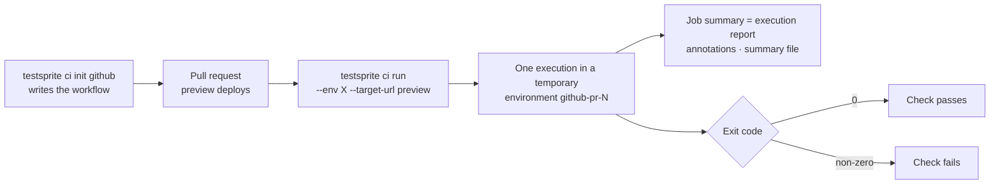
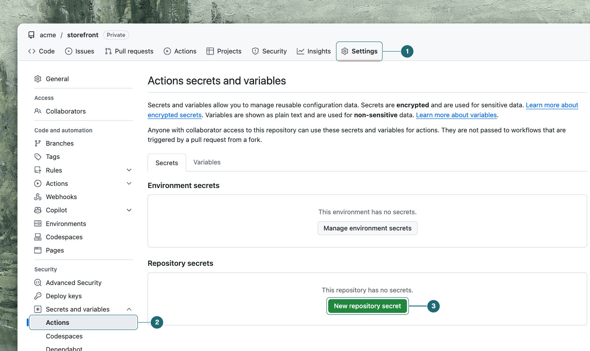

`testsprite ci run` starts one project run and waits for its verdict. A failed or blocked test, or a cancelled execution, fails the gate. Add `--fail-on-skipped` to fail when a selected test was skipped. `testsprite ci init github` writes a GitHub Actions workflow that runs it against each pull request's preview.

<Card>

</Card>

## Set up the pull-request gate

<Steps>
  <Step title="Add your API key as a repository secret">
    Mint the key in the workspace the project belongs to. It is tied to the member who minted it and stops working if they leave or are removed from the workspace, so mint it from an account that will stay. Save it as the `TESTSPRITE_API_KEY` secret under <kbd>Settings → Secrets and variables → Actions</kbd>, or pass `--set-secret` in the next step to set it through `gh`.

    <Frame>
      
    </Frame>
  </Step>
  <Step title="Generate the workflow">
    ```bash
    testsprite ci init github --project "$PROJECT_ID" --env staging
    ```

    Set `PROJECT_ID` to the ID from `testsprite project list` and replace `staging` with your saved environment name. The CLI writes both into `.github/workflows/testsprite.yml`. An unknown environment is refused. `--project` can be left out when the workspace has only one project, and `--dry-run` prints the file without writing it. The generated pull-request workflow skips fork, Dependabot and draft pull requests. It passes `--fail-on-skipped` to the gate.
  </Step>
  <Step title="Tell it where the preview is">
    The file has one placeholder step, marked `REPLACE ME`. Replace it to match how your pull requests get a public preview:

    - **Your platform deploys every pull request** (Vercel or Netlify): change the trigger to `on: deployment_status` and delete the placeholder.
    - **Your workflow deploys**: keep `on: pull_request`, put your deploy commands in the placeholder and end it with `echo "url=<preview address>" >> "$GITHUB_OUTPUT"`.
    - **Your platform only posts a check or commit status**: keep the pull-request trigger, delete the placeholder and use the status-based example below.

    These examples use the repository variable `TESTSPRITE_PROJECT_ID`. Set it under <kbd>Settings → Secrets and variables → Actions → Variables</kbd>, or keep the literal project ID from the generated workflow.

    <Tabs>
      <Tab title="A — platform deploys every PR">
        ```yaml
        name: TestSprite
        on:
          deployment_status:
        permissions:
          contents: read
          pull-requests: read
        jobs:
          testsprite-tests:
            concurrency:
              group: testsprite-preview-${{ github.workflow }}-${{ github.event.deployment.sha }}
              cancel-in-progress: true
            if: >-
              github.event_name == 'deployment_status' &&
              github.event.deployment_status.state == 'success' &&
              !github.event.deployment.production_environment &&
              github.event.deployment.environment != 'production'
            runs-on: ubuntu-latest
            timeout-minutes: 45
            steps:
              - uses: actions/setup-node@v7
                with:
                  node-version: '22'
                  package-manager-cache: false
              - run: npm i -g @testsprite/testsprite-cli@latest
              - name: Run TestSprite tests on this PR's preview
                env:
                  TESTSPRITE_PROJECT_ID: ${{ vars.TESTSPRITE_PROJECT_ID }}
                  TESTSPRITE_API_KEY: ${{ secrets.TESTSPRITE_API_KEY }}
                  GITHUB_TOKEN: ${{ github.token }}
                  PREVIEW_URL: ${{ github.event.deployment_status.environment_url }}
                run: >-
                  testsprite ci run
                  --project "$TESTSPRITE_PROJECT_ID"
                  --env staging
                  --target-url "$PREVIEW_URL"
                  --fail-on-skipped
                  --summary-file testsprite-summary.json
              - name: Upload TestSprite report
                if: always()
                uses: actions/upload-artifact@v7
                with:
                  name: testsprite-results
                  path: testsprite-summary.json
                  if-no-files-found: ignore
        ```
      </Tab>
      <Tab title="B — the workflow deploys (Vercel CLI shown)">
        ```yaml
        name: TestSprite
        on:
          pull_request:
            types: [opened, synchronize, reopened, ready_for_review]
        permissions:
          contents: read
          pull-requests: read
        jobs:
          testsprite-tests:
            concurrency:
              group: testsprite-preview-${{ github.workflow }}-${{ github.event.pull_request.number }}
              cancel-in-progress: true
            if: >-
              github.event.pull_request.head.repo.full_name == github.repository &&
              github.actor != 'dependabot[bot]' &&
              !github.event.pull_request.draft
            runs-on: ubuntu-latest
            timeout-minutes: 45
            steps:
              - uses: actions/checkout@v7
              - uses: actions/setup-node@v7
                with:
                  node-version: '22'
                  package-manager-cache: false
              - run: npm i -g @testsprite/testsprite-cli@latest
              - name: Get this PR's preview URL
                id: preview
                env:
                  VERCEL_TOKEN: ${{ secrets.VERCEL_TOKEN }}
                  VERCEL_ORG_ID: ${{ secrets.VERCEL_ORG_ID }}
                  VERCEL_PROJECT_ID: ${{ secrets.VERCEL_PROJECT_ID }}
                run: |
                  url=$(npx vercel@59 deploy --token "$VERCEL_TOKEN" --yes)
                  echo "url=$url" >> "$GITHUB_OUTPUT"
              - name: Run TestSprite tests on this PR's preview
                env:
                  TESTSPRITE_PROJECT_ID: ${{ vars.TESTSPRITE_PROJECT_ID }}
                  TESTSPRITE_API_KEY: ${{ secrets.TESTSPRITE_API_KEY }}
                  GITHUB_TOKEN: ${{ github.token }}
                  PREVIEW_URL: ${{ steps.preview.outputs.url }}
                run: >-
                  testsprite ci run
                  --project "$TESTSPRITE_PROJECT_ID"
                  --env staging
                  --target-url "$PREVIEW_URL"
                  --fail-on-skipped
                  --summary-file testsprite-summary.json
              - name: Upload TestSprite report
                if: always()
                uses: actions/upload-artifact@v7
                with:
                  name: testsprite-results
                  path: testsprite-summary.json
                  if-no-files-found: ignore
        ```
      </Tab>
      <Tab title="C — your platform posts a commit check">
        Keep the generated `pull_request` trigger and its job condition. Add `checks: read` and `statuses: read` to the workflow permissions and remove the preview placeholder. Use this step after installing the CLI. Replace `Preview Build` with the check on your PR and the URL pattern with your preview's address.

        ```yaml
        - name: Test after the preview build
          env:
            TESTSPRITE_PROJECT_ID: ${{ vars.TESTSPRITE_PROJECT_ID }}
            TESTSPRITE_API_KEY: ${{ secrets.TESTSPRITE_API_KEY }}
            GITHUB_TOKEN: ${{ github.token }}
          run: >-
            testsprite ci run
            --project "$TESTSPRITE_PROJECT_ID"
            --env staging
            --wait-for-status "Preview Build"
            --target-url-template "https://pr-{pr}.preview.example.com"
            --fail-on-skipped
            --summary-file testsprite-summary.json
        ```

        The CLI waits up to 900 seconds for readiness by default (`--status-timeout`). A failed or skipped build skips TestSprite with a notice and exit 0. Require the build check separately if it must block merges.
      </Tab>
    </Tabs>

    <Warning>
    If your platform also deploys pull requests from forks, turn that off (on Vercel, require authorization for fork deployments). A `deployment_status` workflow runs with your repository's secrets, so a fork could run its own edit of it with your `TESTSPRITE_API_KEY`.
    </Warning>
  </Step>
  <Step title="Open a pull request">
    Commit the workflow, open a pull request that isn't a draft, and watch the `TestSprite / testsprite-tests` check. To block merges on it, require `testsprite-tests` in branch protection.
  </Step>
</Steps>

<Tip>
Your coding agent can do all four steps, including the test pull request: `testsprite agent install` includes a `testsprite-ci` skill. See [Coding Agent Integration](/cli/core/agent-integration).
</Tip>

<AccordionGroup>
  <Accordion title="Nothing ran on my pull request">
    - The generated pull-request job skips drafts. A draft identified by `ci run` itself also skips testing.
    - A pull request with merge conflicts never starts `pull_request` workflows, and GitHub shows no error.
    - If none of the repository's workflows run, Actions is disabled, which is common on forks.
    - With `deployment_status`, check that a successful deployment event arrived for the commit.
  </Accordion>
  <Accordion title="One repository deploys several projects">
    The platform sends one deployment event per project for the same commit (`Preview – <project>` on Vercel). Add `&& github.event.deployment.environment == 'Preview – <project>'` to the job's `if:` to gate on one of them.
  </Accordion>
</AccordionGroup>

## What you get

- **A check on the pull request.** A failed or blocked test exits `1`. A timeout (default 600 seconds) or [unconfirmed run settings](/cli/reference/exit-codes#unconfirmed-run-settings) exit `7`. Cancelling the job leaves the TestSprite run active in the Portal.
- **A GitHub job summary and annotations.** When available, the execution report supplies the job summary. The CLI falls back to its results table if the report is unavailable. Anyone with read access to the repository can read it.
- **`testsprite-summary.json`**, uploaded as the `testsprite-results` artifact. Individual outcomes are in `.results[]`, with `resultId` and `runId` on dispatched results. The optional execution report identifies the run with `.executionReport.runId`. Use `--report junit --report-file testsprite.xml` for a JUnit sidecar.
- **One run in the Portal**, linked to the pull request. With `--env` and a preview URL, the run uses a temporary copy of that environment named `github-pr-<N>`. The copy points at the preview and is removed when the run ends. For frontend previews, use a public or username/password sign-in compatible with the preview origin.

## Test staging after deployment

Run the gate after your deployment job confirms staging is ready. Set `TESTSPRITE_API_KEY` and `TESTSPRITE_PROJECT_ID` in the job's environment. This command selects the existing staging environment:

```bash
testsprite ci run --env staging --fail-on-skipped --summary-file testsprite-summary.json
```

For backend tests, the selected environment supplies the API base URL to tests that use it. A URL written directly into test code stays as written. On a pull request, a preview clone supplies the preview URL to tests using the environment's base URL.

Every other exit code is in [Exit Codes](/cli/reference/exit-codes).

<Columns cols={2}>
  <Card title="Coding Agent Integration" href="/cli/core/agent-integration" icon="robot">
    Let your agent drive the verification loop
  </Card>
  <Card title="Exit Codes" href="/cli/reference/exit-codes" icon="list-ol">
    Every exit code and what to do about it
  </Card>
</Columns>
