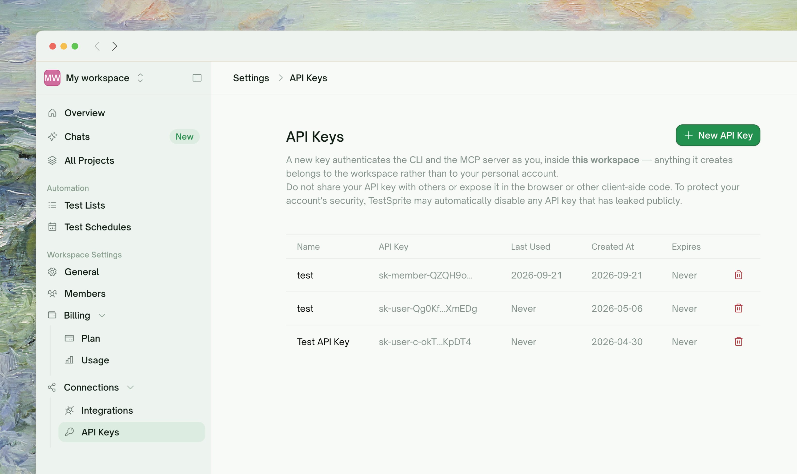
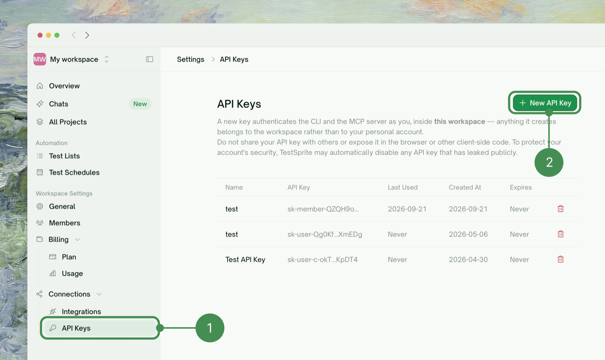
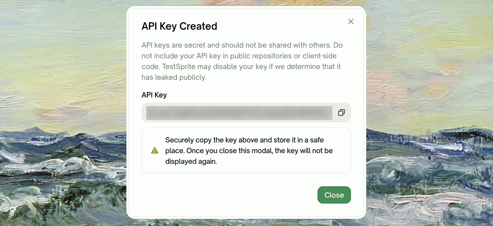
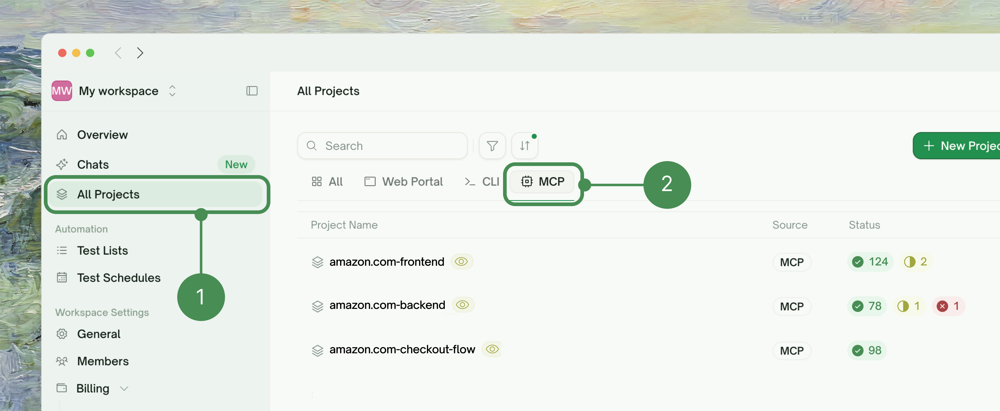
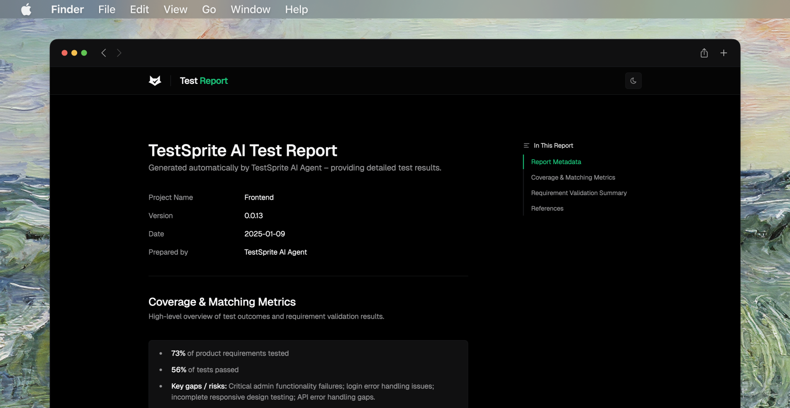

<Frame>
  
</Frame>

## How API Keys Work

An API key signs the CLI and the MCP Server in as you, inside one workspace. You mint it from that workspace's API Keys page, and it is tied to your membership there: anything the CLI or MCP Server creates with it belongs to that workspace and draws on that workspace's balance. To work in another workspace, mint a key there.

Keys are for Members and above; a [Viewer](/web-portal/admin/members-and-roles) is read-only and can't hold one. A key stops working when you leave or are removed from the workspace, and none can be minted while the workspace is paused. You can have **2 active keys per workspace**, so you can rotate one while the other stays in use — past that, revoke one first. Revoking is immediate.

<Note>
Keys that start with `sk-user-` are from before workspace keys existed. They keep working, always act in your default workspace, and are listed on its API Keys page, where you can revoke them.
</Note>

## Creating a Key

Go to <kbd>Workspace Settings → Connections → API Keys</kbd> in the workspace the key should belong to and click <kbd>New API Key</kbd>.

<Frame>
  
</Frame>

Give it a **descriptive name** (e.g., "MCP Integration") and pick an expiration: no expiry, or 30, 90, or 365 days. Without one the key doesn't expire, unless the workspace enforces a maximum lifetime: then a longer expiry is rejected, and a key created without one gets that maximum. Click <kbd>Create</kbd>, then copy the key right away.

<Warning>
  Store it securely. The full key is shown only once, at creation.
</Warning>

<Frame>

</Frame>

## Managing API Keys

| Field | Description |
| :--- | :--- |
| <kbd>Name</kbd> | Descriptive identifier |
| <kbd>API Key</kbd> | Only the leading characters (`sk-member-abcdef…`); the rest is never stored in a readable form |
| <kbd>Last Used</kbd> | When the key last authenticated a request |
| <kbd>Created At</kbd> | When generated |
| <kbd>Expires</kbd> | The expiration set at creation, or "Never" |

<kbd>Revoke</kbd> disables a key immediately; requests using it are rejected. Members see and revoke their own keys; Admins and the Owner see every member's keys in the workspace and can revoke any of them.

## Viewing MCP Test Results

Projects created through the MCP Server in your IDE show up under <kbd>All Projects > MCP</kbd>.
      <Frame>
    
    </Frame>

| Field | Description |
| :--- | :--- |
| <kbd>Project Name</kbd> | The project the MCP Server created |
| <kbd>Source</kbd> | Where the project was created (**MCP** here) |
| <kbd>Status</kbd> | Pass/fail/blocked counts from its latest results |
| <kbd>Type</kbd> | Frontend or Backend |
| <kbd>Creator</kbd> / <kbd>Created At</kbd> | Who created it, and when |

### Test Reports

Click a project to see its execution logs, per-test results, errors, and performance metrics.
<Frame>
  
</Frame>
 
<Card title="View Example Test Report" icon="file" href="../../learn/mcp-demo#test-report-example">
  A full example report, with execution logs and performance metrics
</Card>

## Next Steps

<CardGroup cols={2}>
  <Card title="Workspaces" icon="users" href="/web-portal/admin/workspaces">
    What a workspace is, plans, and pausing
  </Card>
  <Card title="CLI Quickstart" icon="terminal" href="/cli/getting-started/quickstart">
    Use your key with the TestSprite CLI
  </Card>
  <Card title="MCP Server Installation" icon="download" href="/mcp/getting-started/installation">
    Use your key with the MCP Server
  </Card>
  <Card title="MCP Server Overview" icon="square-terminal" href="/mcp/getting-started/overview">
    The complete MCP Server guide
  </Card>
</CardGroup>
