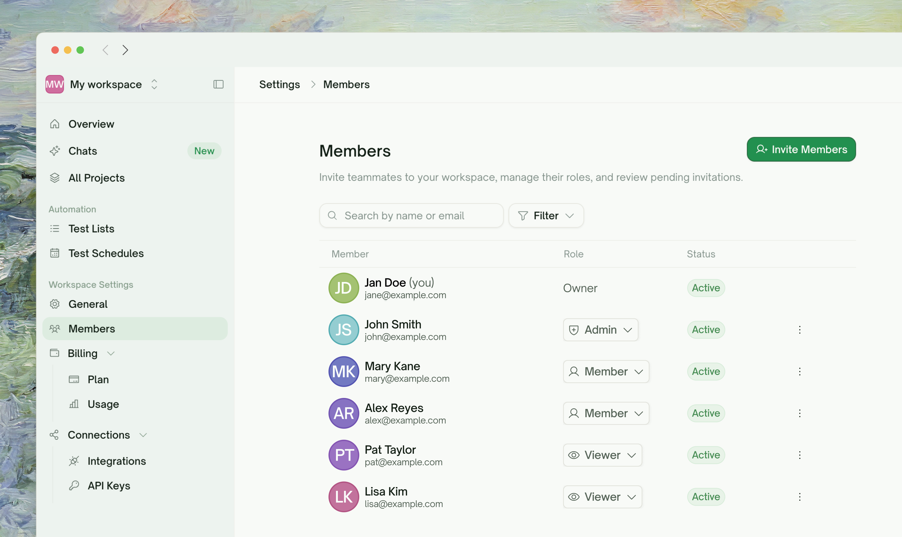
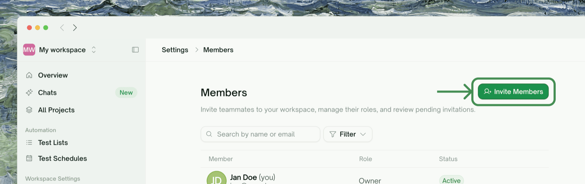
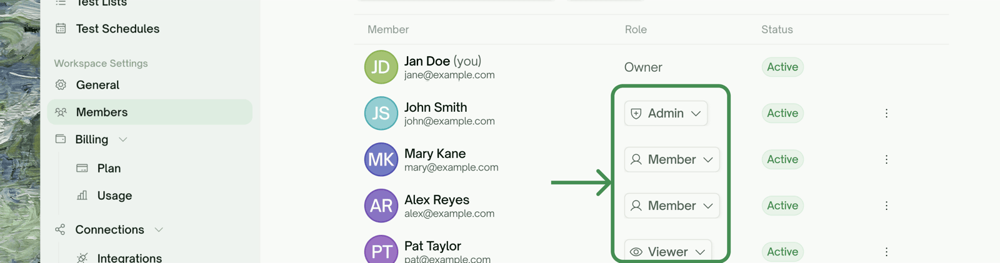
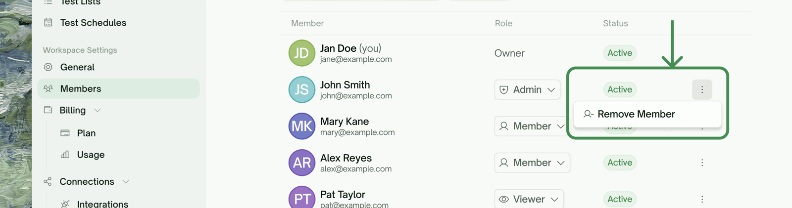

## The Four Roles

<Frame>
  
</Frame>

Every member of a workspace has exactly one role. Roles are per-workspace — the same person can be an Admin in one workspace and a Viewer in another.

| Role | What they do |
| :--- | :--- |
| **Owner** | Owns the workspace: everything an Admin can do, plus changing the plan, transferring ownership, and deleting the workspace. One per workspace — whoever created it, or the person it was transferred to. |
| **Admin** | Manages the team and the day-to-day: invites and removes members, changes roles, connects integrations, buys credits. |
| **Member** | Does the testing: creates projects, generates and edits tests, runs them. No people or billing management. |
| **Viewer** | Read-only. Opens every project, report, and recording — changes nothing. |

Seats follow the plan, not the role. On a paid plan, the Owner, Admins, and Members each hold a paid seat, billed to the Owner; the subscription starts with the Owner's seat, and each invitation adds one. Viewers are free on every plan. A Free workspace has no paid seats at all: it is the Owner plus Viewers, which is why Member and Admin need Starter or higher.

### Permission matrix

| Can they… | Viewer | Member | Admin | Owner |
| :--- | :-: | :-: | :-: | :-: |
| Open projects, reports, recordings | ✅ | ✅ | ✅ | ✅ |
| See the workspace's credit balance | ✅ | ✅ | ✅ | ✅ |
| Create / edit / run / delete tests and projects | ❌ | ✅ | ✅ | ✅ |
| Mint API keys and manage their own | ❌ | ✅ | ✅ | ✅ |
| See and revoke every member's API keys | ❌ | ❌ | ✅ | ✅ |
| Invite members, copy or revoke invitation links | ❌ | ❌ | ✅ | ✅ |
| Change a member's role, remove a member | ❌ | ❌ | ✅ | ✅ |
| Rename the workspace | ❌ | ❌ | ✅ | ✅ |
| Connect / disconnect integrations (GitHub, Slack, Jira…) | ❌ | ❌ | ✅ | ✅ |
| Buy extra credits, view usage breakdowns and invoices | ❌ | ❌ | ✅ | ✅ |
| Change the plan, manage the subscription and payment method | ❌ | ❌ | ❌ | ✅ |
| Transfer ownership | ❌ | ❌ | ❌ | ✅ |
| Delete the workspace | ❌ | ❌ | ❌ | ✅ |
| Leave the workspace | ✅ | ✅ | ✅ | ❌ (transfer or delete instead) |

<Note>
A Viewer who opens a create or edit page sees a **Read-only access** notice instead, and the API Keys and Billing entries are hidden from them. Viewers are the right way to loop in a PM, a manager, or a client who needs to see results but shouldn't touch tests.
</Note>

## Inviting Someone

Invitations live in <kbd>Workspace Settings → Members</kbd>, or use the <kbd>Invite members</kbd> shortcut in the workspace switcher. Both are for Admins and the Owner.

<Frame>
  
</Frame>

<Steps>
  <Step title="Enter their email and pick a role">
    An invitation is for one email address at a time. The role picker appears once you've typed an address — **Member** is the sensible default for a teammate who'll work on tests; pick **Viewer** for someone who only needs to see results. In a Free workspace only Viewer can be picked; Member and Admin are greyed out with <kbd>Starter and up</kbd>.
    <Frame>
      
    </Frame>
  </Step>
  <Step title="Confirm the seat (paid roles only)">
    Admin and Member invitations take a paid seat. If the workspace already has an unused seat this cycle, the invitation is created right away. Otherwise a <kbd>Confirm changes</kbd> summary shows the prorated amount, <kbd>Continue to Payment</kbd> takes you to Stripe, and the invitation appears under pending invitations as soon as the payment goes through. **Viewer invitations skip this step entirely: viewer seats are free.**
  </Step>
  <Step title="Send them the link">
    TestSprite doesn't email invitations. Clicking <kbd>Create Invitation Link</kbd> opens an **Invitation link ready** dialog with the link; copy it and send it yourself, in Slack, a DM, or your own email. After a Stripe payment there is no dialog: copy the link from the invitation's pending row in the roster (<kbd>Copy invitation link</kbd>), which works any time.

    The link is **bound to the invited email address**: the recipient must sign in with that exact email to accept, then click <kbd>Join workspace</kbd>. Links expire after **7 days**; the roster shows the time left on each pending invitation. If a link expires or is lost, use <kbd>New invitation link</kbd> on that row — the old one stops working.
  </Step>
</Steps>

<AccordionGroup>
  <Accordion title="What if they're already in the workspace?">
    The dialog refuses the address with "already a member of this workspace" or "already has a pending invitation". To change an existing member's role, use the roster instead; for someone who hasn't accepted yet, copy the link again from their pending row, or issue a fresh one with <kbd>New invitation link</kbd>.
  </Accordion>
  <Accordion title="Can I invite someone as Owner?">
    No. Ownership can't be assigned by invitation or role change. The current Owner can transfer it to an Admin or Member from that person's row menu in the roster (<kbd>Transfer ownership</kbd>); you type their email to confirm and become an Admin yourself. The default workspace, the one created at signup, can't be transferred.
  </Accordion>
  <Accordion title="Is there a limit on Viewers?">
    Yes, per plan: 10 on Free, 25 on Starter, 50 on Standard, 100 on Pro, unlimited on Enterprise. Pending Viewer invitations count toward it. Past the cap, inviting fails with "Viewer limit reached" until you revoke an invitation, remove a Viewer, or upgrade.
  </Accordion>
  <Accordion title="Why are Member and Admin greyed out?">
    The workspace is on the Free plan, which supports **Viewers only** — read-only guests are free and need no subscription. Member and Admin seats need Starter or higher: the Owner can upgrade from <kbd>Settings → Plan</kbd>, or create a new workspace on a paid plan.
  </Accordion>
</AccordionGroup>

## Changing a Member's Role

Admins and the Owner can change any member's role from the <kbd>Role</kbd> dropdown in <kbd>Workspace Settings → Members</kbd>, except the Owner's, which is fixed. In a Free workspace there is nothing to change: everyone besides the Owner is a Viewer, and promoting someone needs a paid plan.

<Frame>
  
</Frame>

Switching between Admin and Member is immediate and free. Crossing the Viewer boundary moves a seat too:

- **Member/Admin → Viewer** frees their paid seat after you confirm. The freed seat stays usable until the end of the current billing cycle.
- **Viewer → Member/Admin** needs a paid seat first. If an empty paid seat exists it's used automatically; otherwise you pay for one on Stripe, and the role changes once that's done.

## Removing a Member — and Leaving

<Frame>
  
</Frame>

- **Admins and the Owner** can remove anyone except the Owner, from the roster's row menu. Removal takes effect immediately: the person loses access, and any API keys they minted in this workspace stop working. A paid seat stays paid through the current cycle and stops billing from the next one.
- **Anyone except the Owner can leave** — use <kbd>Leave Workspace</kbd> on your own row, whatever your role. Afterwards, pick another workspace from the switcher; your default workspace is always there.
- **The Owner can't leave or be removed.** To step away, the Owner transfers ownership first (becoming an Admin), or deletes the workspace.

## Where to Go Next

<Columns cols={2}>
  <Card title="Workspaces" href="/web-portal/admin/workspaces" icon="users">
    Free vs. paid workspaces, switching, and deletion
  </Card>
  <Card title="Sharing a Project" href="/web-portal/admin/sharing" icon="share-nodes">
    The fast path for showing one project to someone new
  </Card>
  <Card title="API Keys" href="/web-portal/admin/api-keys" icon="key">
    Keys are bound to your membership in a workspace
  </Card>
</Columns>
