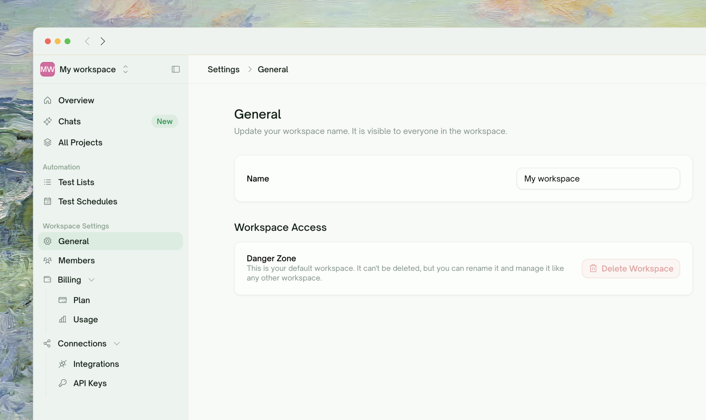
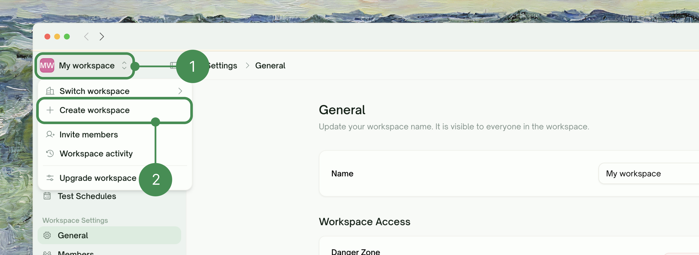
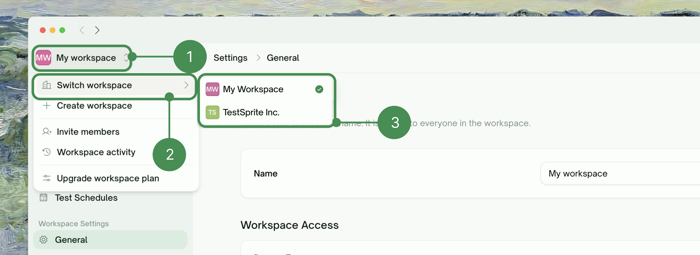
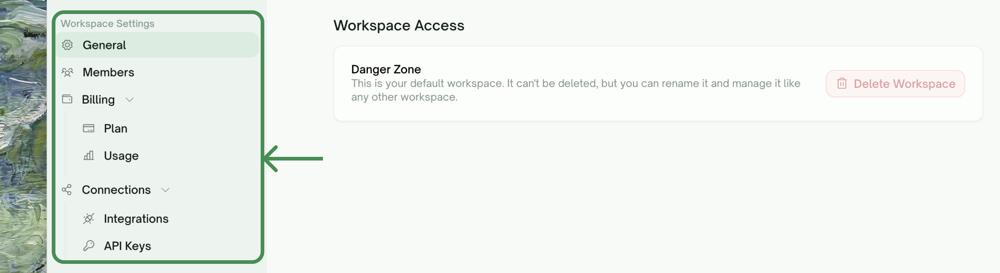
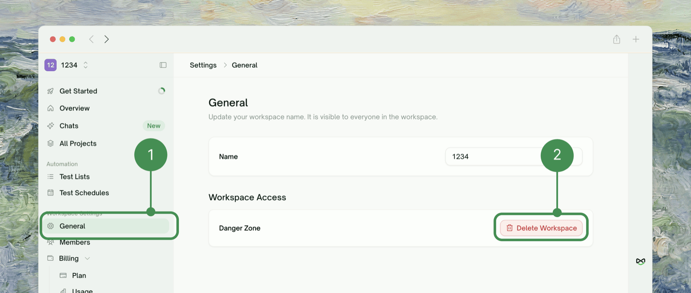

## What a Workspace Is

<Frame>
  
</Frame>

Everything you do in TestSprite (projects, tests, runs, and API keys) belongs to a **workspace**. One workspace is created for you at signup, your **default workspace** (it shows as "My workspace" to you, and as "*Your Name*'s workspace" to teammates, until you rename it), and you can create more or be invited into other people's. Every workspace works the same way: it has its own members and roles, its own plan (Free or paid), and its own credit balance.

The active workspace decides where new work lands: projects you create and keys you mint belong to that workspace, not to you individually. Access is workspace-wide too: everyone in a workspace can open its projects and tests, and what each person can *do* depends on their role (see [Members & Roles](/web-portal/admin/members-and-roles)).

## Creating a Workspace

<Steps>
  <Step title="Open the workspace switcher">
    Click the workspace name at the top of the left sidebar, then choose <kbd>Create workspace</kbd>.
    <Frame>
      
    </Frame>
  </Step>
  <Step title="Name it">
    Enter a workspace name. The name appears in the switcher and on the page people see when they accept an invitation, and you can change it later.
    <Frame>
      
    </Frame>
  </Step>
  <Step title="Pick a plan">
    **Free** creates the workspace right away, as long as you don't already own a Free workspace (the tile shows <kbd>Limit reached</kbd> if you do). Paid plans are billed per seat, monthly or yearly: <kbd>Continue to payment</kbd> takes you to the Stripe-hosted checkout, the workspace is created as soon as the payment goes through, and you land back in the portal inside it. A first-time subscriber choosing Starter monthly gets the first month free.
  </Step>
</Steps>

You are the workspace's **Owner**, the role that can manage its subscription and, if it comes to that, delete it. You can transfer ownership to an Admin or Member later, from their row menu in <kbd>Workspace Settings → Members</kbd>.

## Switching Workspaces

The workspace switcher lives at the **top of the left sidebar**. Click it and choose <kbd>Switch workspace</kbd> to see every workspace you belong to — your default workspace first, then the rest alphabetically, with a checkmark on the active one. The same menu holds <kbd>Create workspace</kbd>, <kbd>Invite members</kbd> (Admins and the Owner), and <kbd>Workspace activity</kbd>.

<Frame>
  
</Frame>

Switching changes three things at once:

- **Where you are** — you land on the selected workspace's dashboard, and the URL updates to that workspace.
- **What you see** — projects, tests, runs, schedules, and settings all come from the new workspace.
- **What you can do** — your role is per-workspace, so someone who is an Admin in one workspace may be a Viewer in another.

<Tip>
Check the switcher before starting new work. A project created in the wrong workspace can't be moved — and its runs draw on that workspace's balance.
</Tip>

## Workspace Settings

<kbd>Workspace Settings</kbd> inside a workspace collects everything that is workspace-scoped:

<Frame>
  
</Frame>

| Section | What's there | Who sees it |
| :--- | :--- | :--- |
| <kbd>General</kbd> | Workspace name (rename is autosaved) and the Danger Zone | Everyone; rename: Owner and Admins; delete: Owner |
| <kbd>Members</kbd> | Roster, pending invitations, role changes, ownership transfer | Everyone; management actions are role-gated |
| <kbd>Billing → Plan</kbd> | Current plan, plan changes, subscription and payment method | Owner only |
| <kbd>Billing → Usage</kbd> | Credit usage breakdowns, extra credits, invoices | Admins and the Owner |
| <kbd>Connections → Integrations</kbd> | GitHub, Slack, Jira, Linear, Figma connections | Admins and the Owner |
| <kbd>Connections → API Keys</kbd> | Keys minted in this workspace | Members and above: your own keys; Admins and the Owner see every member's |

## Plans and Pausing

Every workspace has its own plan. On **Free**, the workspace is you plus read-only Viewers. Member and Admin seats need a paid plan (Starter, Standard, or Pro), billed per seat, and every paid seat adds a monthly credit allowance. The Owner picks or changes the plan from <kbd>Settings → Plan</kbd>. You can own only one Free workspace, and the default workspace counts.

When a paid subscription ends, the workspace moves to Free if nothing in it needs a paid plan: no paid seats besides the Owner, and within Free limits. Otherwise it is **paused**: read-only for everyone, nothing runs, and the credit balance is frozen. The Owner resolves it from <kbd>Settings → Plan</kbd> by renewing, choosing another plan, or downgrading to Free, which turns Admins and Members into Viewers. A paused workspace can still be deleted.

## Deleting a Workspace

Only the **Owner** can delete a workspace, and only from <kbd>Workspace Settings → General</kbd>. The default workspace can't be deleted — the button is there but disabled — so you always keep at least one.

<Frame>
  
</Frame>

<Warning>
Deletion is permanent and cascades: **all projects, tests, results, schedules, members, invitations, and API keys in the workspace are removed and cannot be recovered.** A paid subscription is canceled immediately as part of the deletion, so nothing keeps billing afterward. Download any invoices you still need from <kbd>Settings → Usage</kbd> first.
</Warning>

The portal asks you to type the workspace name to confirm before anything is deleted.

## Where to Go Next

<Columns cols={2}>
  <Card title="Members & Roles" href="/web-portal/admin/members-and-roles" icon="user-plus">
    Invite teammates and understand the four roles
  </Card>
  <Card title="Sharing a Project" href="/web-portal/admin/sharing" icon="share-nodes">
    Show a project to someone outside the roster
  </Card>
  <Card title="API Keys" href="/web-portal/admin/api-keys" icon="key">
    Workspace keys and legacy personal keys, creation, expiry, and revocation
  </Card>
</Columns>
