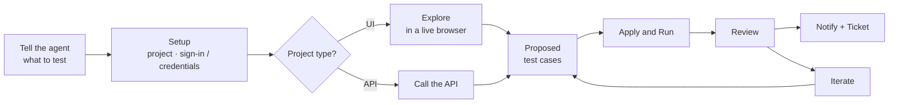

Every project moves through the same phases, in one conversation with the agent. Either way the tests are grounded in how your product actually behaves: for a web app the agent **explores** it in a browser, and for an API it **calls** it for real.

<Card>

</Card>

## The Phases

| Phase | What happens | Learn more |
| :--- | :--- | :--- |
| **Setup** | Click <kbd>New Project</kbd> and tell the agent what to test. It asks for what only you know, then proposes a project with its environment and sign-in; you create it. Add sources as you go: your PRD (**strongly recommended**), your repository, and for API projects your API docs | [Setup](/web-portal/core/ui/agent-setup), [Credentials Setup](/web-portal/core/api/agent-credentials) |
| **Explore** | UI: the agent walks your live app in a browser you can watch. API: it makes real calls to your endpoints. What it learns goes into the project's notes, which every later session starts from | [Exploration & Notes](/web-portal/core/ui/agent-exploration), [API Calls](/web-portal/core/api/agent-api-calls) |
| **Plan** | The agent proposes test cases, grouped by use case. You keep, leave out, or edit each one. Nothing changes until you apply | [Proposed Test Cases](/web-portal/core/ui/agent-plan) |
| **Run** | You start the run from a card; tests run in the cloud on the environment you pick | [UI](/web-portal/core/ui/ui-test-gen), [API](/web-portal/core/api/endpoint-tests) |
| **Review** | A verdict per test, with recordings (UI) or requests and responses (API). Ask the agent to look, and it judges each failure: the app is wrong, the test is wrong, or something got in the way | [Test Report](/web-portal/results/test-report) |
| **Notify** | Post run summaries to Slack and turn failures into tickets | [Slack](/web-portal/integrations/slack-notifications), [Ticketing](/web-portal/integrations/ticketing) |
| **Iterate** | Ask the agent for more coverage or a fix, edit a test yourself, or re-run a single test to confirm a fix | [Managing Test Cases](/web-portal/core/working-with-test/managing-test-cases) |

The phases aren't a fixed pipeline. The agent goes back to exploring whenever it needs to, such as when you ask about a new feature or a failure needs a closer look.

## UI vs API: What's Different

| Phase | UI Testing | API Testing |
| :--- | :--- | :--- |
| **Exploration** | The agent walks your live app in a cloud browser, shown live on the **Exploration** tab | The agent sends real requests, the same way a run does; the **Exploration** tab lists each call and its status |
| **Plan grounding** | Real screens and copy the agent saw, plus your docs and code | Real responses from your API, plus your API docs and code. Each proposed test's code has already passed once |
| **Execution artifacts** | Video recordings, step-by-step screenshots, console output | HTTP requests/responses, status codes, response bodies |
| **Authentication** | Sign-in to your app: a test account, a one-time-code login with a TestSprite-managed account, or a saved sign-in for SSO such as Google | Credentials on the requests: a token, an API key, or a sign-in flow TestSprite renews before each run |
| **Failure analysis** | Cause-and-fix with a screenshot of the failing step | Cause-and-fix with the offending request and response |

## Where to Go Next

<Columns cols={2}>
  <Card title="UI Quickstart" href="/web-portal/core/ui/quickstart" icon="window-maximize">
    The UI flow, step by step
  </Card>
  <Card title="API Quickstart" href="/web-portal/core/api/quickstart" icon="terminal">
    The API flow, step by step
  </Card>
</Columns>
