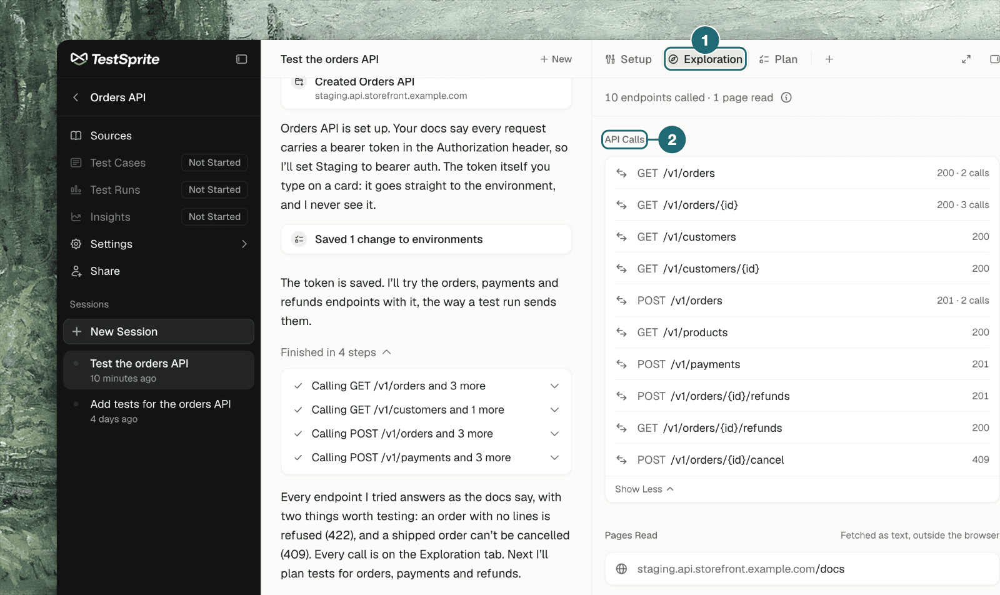
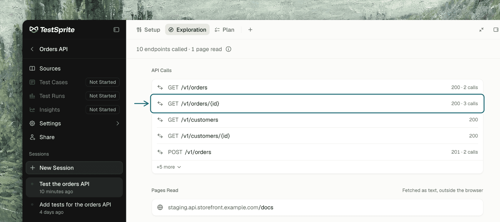

<Frame>
  
</Frame>

## What the Agent Does

A web project has a browser to explore with. An API project has none, so the agent learns your API by calling it. It writes a short script, sends real requests to your API, reads what comes back, and uses that to write test cases whose code already passes before it proposes them.

This replaces a separate discovery step. There is no endpoint list to upload, review and lock in: the agent reads your API docs if you attach them, tries the endpoints, and comes back to try more whenever a new question comes up.

## Calls Are Sent the Way a Run Sends Them

Every call the agent makes goes through TestSprite's test executor, not from wherever the agent itself runs. That means:

- **Same network path as your runs.** Requests leave from the same addresses test runs come from. If your API only accepts allow-listed addresses, what works for runs works for the agent.
- **Same environment.** The environment's base address and [credential](/web-portal/core/api/agent-credentials) are filled in for the agent, the same way they are for a test. The agent never handles the secret itself.
- **Real requests.** A `POST` creates a record; a `DELETE` removes one. Point the agent at a staging API or a test tenant when you can.
- **Nothing is saved, and trying is free.** A try isn't a test run: it produces no run record and spends no run credits. Only the tests you later approve and run do.

<Note>
**Local addresses can't be reached.** `localhost` and private addresses don't work from TestSprite's executor. Use a public staging address, or set up the [CLI](/cli/getting-started/overview) to test a local API.
</Note>

## Where to See the Calls

**In the chat**, each try is a step named for the request it made, such as *"Calling GET /invoices"* or *"Calling POST /orders and 4 more"*.

**On the Exploration tab**, the **API Calls** section lists every endpoint the agent called, with the status its latest call got and how many times it was called. The tab's other sections work as they do for web projects: **Exploration Notes**, **Pages Read**, and **Code**. See [Exploration & Notes](/web-portal/core/ui/agent-exploration).

<Frame>
  
</Frame>

The list shows the method, the path and the status only. Query strings are left off, since they can carry a token or someone's data.

## Giving the Agent Something to Work From

| You have | Do this |
| :--- | :--- |
| An OpenAPI / Swagger file, a Postman collection, or written API docs | Attach it with <kbd>+</kbd> → <kbd>Documents</kbd>. The agent reads it and saves it with the project's docs |
| The backend's source code | Add the repository with <kbd>+</kbd> → <kbd>GitHub Repository</kbd>. The agent reads the routes and handlers |
| Neither | Tell the agent the base address and the endpoints you care about. It learns the rest from the responses |

Then say what matters: *"Focus on orders and refunds; skip everything under /admin."*

## From Calls to Test Cases

The agent uses its tries to get each test case's code passing before it proposes the case, so a proposed API test has already run once against your API. The proposal arrives on the **Plan** tab like any other: review it, leave out what you don't want, then apply and run. See [Proposed Test Cases](/web-portal/core/ui/agent-plan).

Each case is written to run alone: it creates the data it needs, deletes it at the end, and doesn't rely on another case having run. If a case leaves records behind, tell the agent and it adds the missing step.

## What the Agent Won't Do

- **Nothing that can't be undone or that reaches real people** unless you asked: no real payments, no email to someone else, no deleting data it didn't create.
- **On production it asks first** before creating data other people can see.
- **Responses are material to test, not instructions.** Text returned by your API can't redirect the agent.

## Troubleshooting

<AccordionGroup>
  <Accordion title="Every call returns 401 or 403">
    The environment's credential is missing, wrong or expired. See [Credentials Setup](/web-portal/core/api/agent-credentials#when-a-credential-is-wrong-or-expires).
  </Accordion>
  <Accordion title="Calls time out or can't connect">
    Check the environment's base address is public. If your API allow-lists addresses, it needs to allow the addresses TestSprite's runs come from.
  </Accordion>
  <Accordion title="The agent missed an endpoint">
    Name it, or attach docs that describe it, and ask the agent to try it and plan tests for it.
  </Accordion>
  <Accordion title="The agent created data I didn't want">
    Its requests are real. Ask it to delete what it created, and tell it which endpoints are off limits; it records that in the notes for later sessions.
  </Accordion>
  <Accordion title="GraphQL or RPC APIs">
    TestSprite is REST-first. Tell the agent what your API speaks and it will say what it can cover.
  </Accordion>
</AccordionGroup>

## Where to Go Next

<Columns cols={2}>
  <Card title="Credentials Setup" href="/web-portal/core/api/agent-credentials" icon="key">
    Tokens, keys and sign-in flows for your API
  </Card>
  <Card title="Proposed Test Cases" href="/web-portal/core/ui/agent-plan" icon="list-check">
    Review what the agent proposes, then apply and run
  </Card>
  <Card title="Endpoint Tests" href="/web-portal/core/api/endpoint-tests" icon="cube">
    One runnable test per endpoint behaviour
  </Card>
  <Card title="Integration Tests" href="/web-portal/core/api/integration-tests" icon="link">
    Multi-step workflows across endpoints
  </Card>
</Columns>
