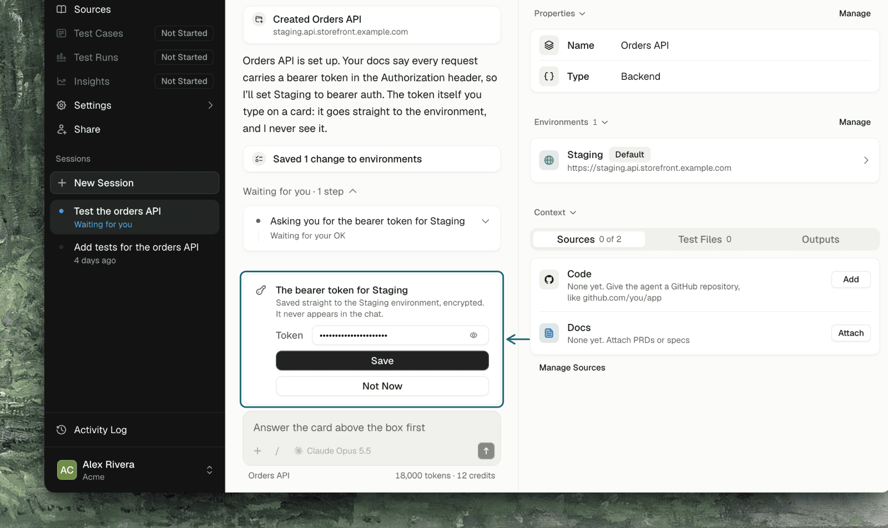
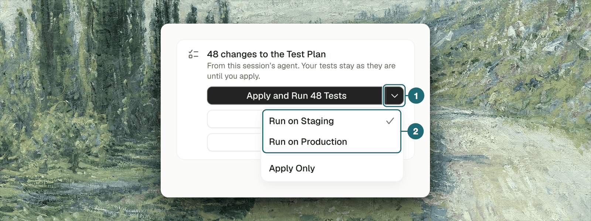

<Frame>
  
</Frame>

## How It Works

For an API project, an environment is your API's base address plus how to authenticate against it. The agent sets that up with you in the chat:

<Steps>
  <Step title="Tell the agent how your API authenticates">
    Say it in plain words (*"Bearer token in the Authorization header"*, *"POST /auth/login with email and password, the token is at data.access_token"*), or attach your API docs and let it read them.
  </Step>
  <Step title="Confirm the environment">
    The agent writes the environment with everything except the secrets. A card asks: **Save N changes to environments?** Click <kbd>Save</kbd>.
  </Step>
  <Step title="Type each secret on its card">
    For every secret the environment needs, a card named for it appears with a password field. Type the value and click <kbd>Save</kbd>.
  </Step>
  <Step title="The agent checks it">
    For a sign-in flow, saving the secret tries the sign-in once, and the agent hears whether it worked. It then [calls your API](/web-portal/core/api/agent-api-calls) with the credential in place.
  </Step>
</Steps>

## Secrets Never Go Through the Chat

A secret typed on a card is **saved straight to the environment, encrypted. It never appears in the chat**, and the agent never sees it: it learns only whether the secret was saved and, for a sign-in, whether signing in works now.

<Warning>
**Don't paste a token, key or password into a message.** If you do, a card stops it before it is sent: *"This looks like a key or a password."* Click <kbd>Edit Message</kbd>, remove it, and give it on the secret card instead.
</Warning>

## Supported Auth Types

| Auth | Use it when | What the agent sets | What you type on a card |
| :--- | :--- | :--- | :--- |
| **None** | The API is open | Nothing | Nothing |
| **Bearer** | A long-lived token goes in `Authorization: Bearer …` | The auth type | The token |
| **Basic** | HTTP basic auth | The auth type | The credential |
| **API key** | A static key | The auth type | The key |
| **Login** | The API hands out a token from a login endpoint | Login URL, method (`POST` or `PUT`), content type (JSON or form), the request body with `{{username}}` and `{{password}}` placeholders, the username, and the token's JSONPath in the response | The password |
| **Refresh token** | An OAuth-style refresh flow | Token URL, client ID, scope | The client secret and the refresh token |
| **AWS Cognito** | Tokens come from a Cognito user pool | Region, client ID | The client secret and the refresh token |

For **Login**, **Refresh token** and **AWS Cognito**, the agent also sets where the fresh token goes on each request: as a bearer token, in a named header, or in a named cookie. These three are [Auto-Auth](/web-portal/core/api/auto-auth) flows, so TestSprite fetches a fresh token before every run, and they follow Auto-Auth's plan availability.

### Headers

An environment can also carry headers sent with every request, such as `x-org-id`. The agent sets ordinary header values itself. A header whose name looks like a secret (a token, key, secret, auth, session, password, signature or cookie) is treated as one: its value is collected on a card and shows only as set or unset afterwards.

## When a Credential Is Wrong or Expires

- If a call comes back `401` or `403`, the agent checks the auth setup and, when the secret is the problem, asks for it again with a new card.
- If a sign-in flow fails, the environment records the error, and the agent reads it to work out what to fix.
- You can also change a credential yourself: open the environment from the **Setup** tab, or go to **Settings → Environment**. See [Environments](/web-portal/setup/environments).

<Tip>
Give TestSprite a long-lived credential for a dedicated test account with access to the whole API. The agent's calls and every test run use it.
</Tip>

## More Than One Environment

Each environment has its own base address and its own auth. The agent works on the project's default environment unless you name another, and a run's card shows the environment it will use and lets you pick a different one.

<Frame>
  
</Frame>

## Troubleshooting

<AccordionGroup>
  <Accordion title="No secret card appeared">
    Secrets are asked for after the environment is saved. Confirm the **Save N changes to environments?** card first; only one card waits at a time.
  </Accordion>
  <Accordion title="I saved the token but calls still return 401">
    Check the auth type matches how your API reads the credential (a bearer token sent as an API key won't work), then ask the agent to ask for the secret again.
  </Accordion>
  <Accordion title="The login flow can't find the token">
    The token's path in the response is probably wrong. Tell the agent where it is (*"the token is at `data.session.jwt`"*) and it updates the environment.
  </Accordion>
  <Accordion title="My API needs request signing or mutual TLS">
    These aren't auth types the agent can set up. Tell the agent what your API requires; it will say what it can and can't cover.
  </Accordion>
</AccordionGroup>

## Where to Go Next

<Columns cols={2}>
  <Card title="API Calls" href="/web-portal/core/api/agent-api-calls" icon="terminal">
    How the agent uses the credential to learn and test your API
  </Card>
  <Card title="Auto-Auth" href="/web-portal/core/api/auto-auth" icon="arrows-rotate">
    Keep tokens fresh on every run
  </Card>
  <Card title="Environments" href="/web-portal/setup/environments" icon="layer-group">
    Addresses, credentials and headers per environment
  </Card>
  <Card title="Setup (UI)" href="/web-portal/core/ui/agent-setup" icon="sliders">
    The web-app equivalent: test accounts and saved sign-ins
  </Card>
</Columns>
