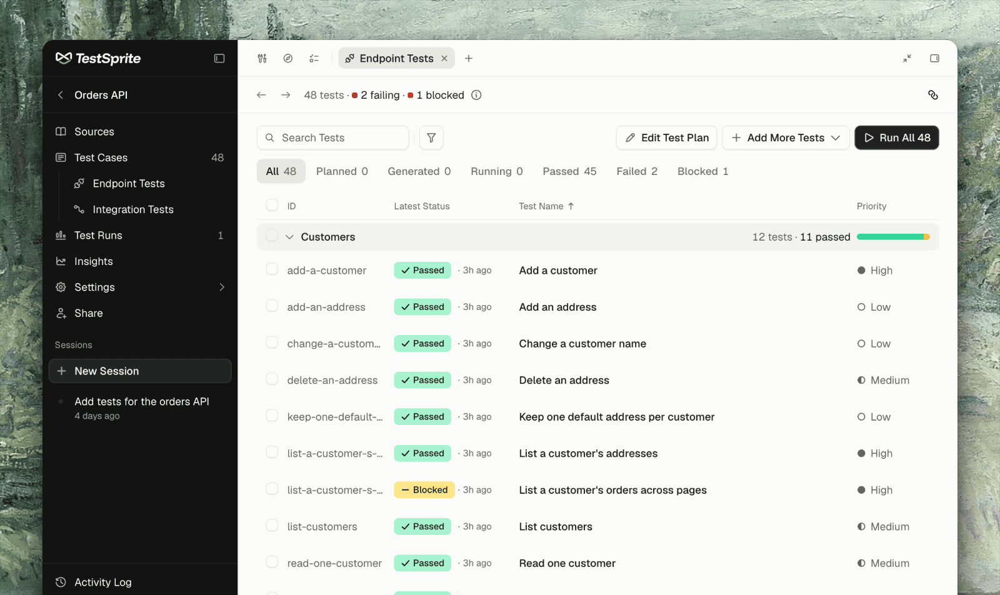
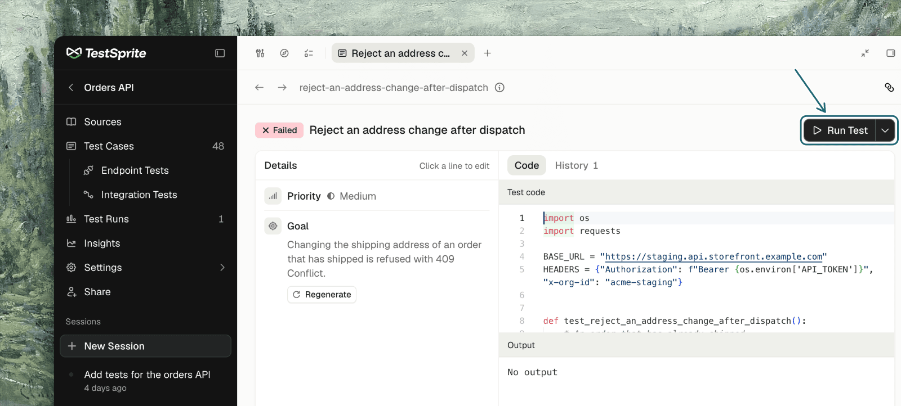
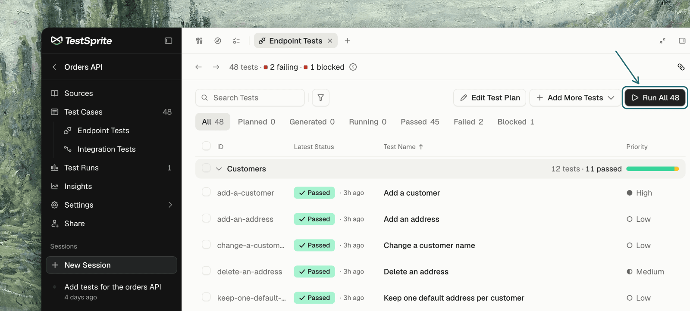
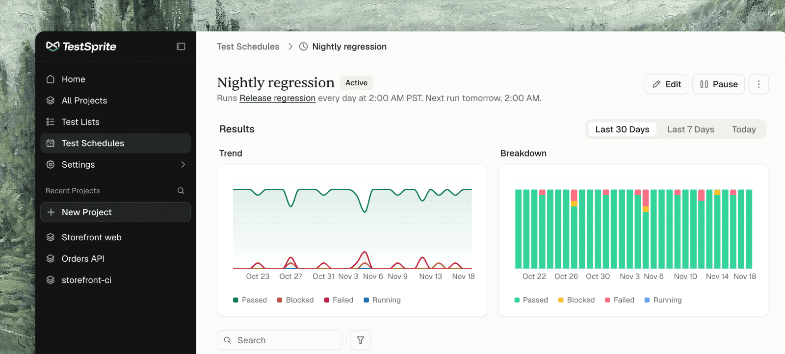

<Frame>
  
</Frame>

## Three Rerun Surfaces

| Surface | What it does | When to use |
| :--- | :--- | :--- |
| <kbd>Single test rerun</kbd> | Re-execute one test | Confirm a fix on a specific failing test |
| <kbd>Run all</kbd> (batch) | Re-execute every test in the project | After API change, dep upgrade, or environment update |
| <kbd>Scheduled rerun</kbd> | Auto-run on cadence | Continuous monitoring of API health |

<Info>
**Auto-Heal is UI-only**, because UIs drift in ways HTTP APIs don't. For API tests, [Auto-Auth](/web-portal/core/api/auto-auth) is what keeps long-running schedules healthy by keeping tokens fresh.
</Info>

## Single Test Rerun

From a test's detail page, click **Run test**.

<Frame>
  
</Frame>

Each test runs on its own: it creates the data it needs and doesn't rely on another test having run.

## Rerun All (Batch)

On the project's test list, **Run all** (top right) re-executes every test in the project.

<Frame>
  
</Frame>

## Scheduled Reruns

Schedules run on a cadence (hourly, daily, weekly, monthly). For API projects, each scheduled run uses [Auto-Auth](/web-portal/core/api/auto-auth) when it's configured. Set one up in [Test Schedules](/web-portal/maintenance/monitoring).

<Frame>
  
</Frame>

## Rerun Outcomes

After a rerun, the test row shows the new outcome. The previous run is kept under <kbd>Test Runs</kbd>, so you can compare the two.

| Outcome on rerun | What it means | What you do |
| :--- | :--- | :--- |
| Was Failed → now Passed | Your fix worked, or the flake resolved | Move on |
| Was Passed → now Failed | Regression; either your fix broke something else, or the API changed | Investigate via test detail page |
| Still Failed (same error) | Fix didn't take | Refine more, or ask the agent to look |
| Still Failed (different error) | You fixed one bug and uncovered another | Tackle the new error |

## Edge Cases & Troubleshooting

<AccordionGroup>
  <Accordion title="Rerun shows a different result than the same code did the first time">
    Usually one of: a real flake in your API, captured state that changed between runs (a record was modified), or an auth token that expired between runs ([use Auto-Auth](/web-portal/core/api/auto-auth)).
  </Accordion>
  <Accordion title="The rerun button is disabled">
    The test is probably still Queued or Running. Wait until it shows Passed or Failed.
  </Accordion>
</AccordionGroup>

## Where to Go Next

<Columns cols={2}>
  <Card title="Auto-Auth" href="/web-portal/core/api/auto-auth" icon="arrows-rotate">
    Token refresh keeps reruns alive
  </Card>
  <Card title="Insights" href="/web-portal/results/project-overview" icon="gauge">
    Regressions and quality trends across runs
  </Card>
  <Card title="Test Schedules" href="/web-portal/maintenance/monitoring" icon="clock">
    Set up automated reruns on a cadence
  </Card>
</Columns>
