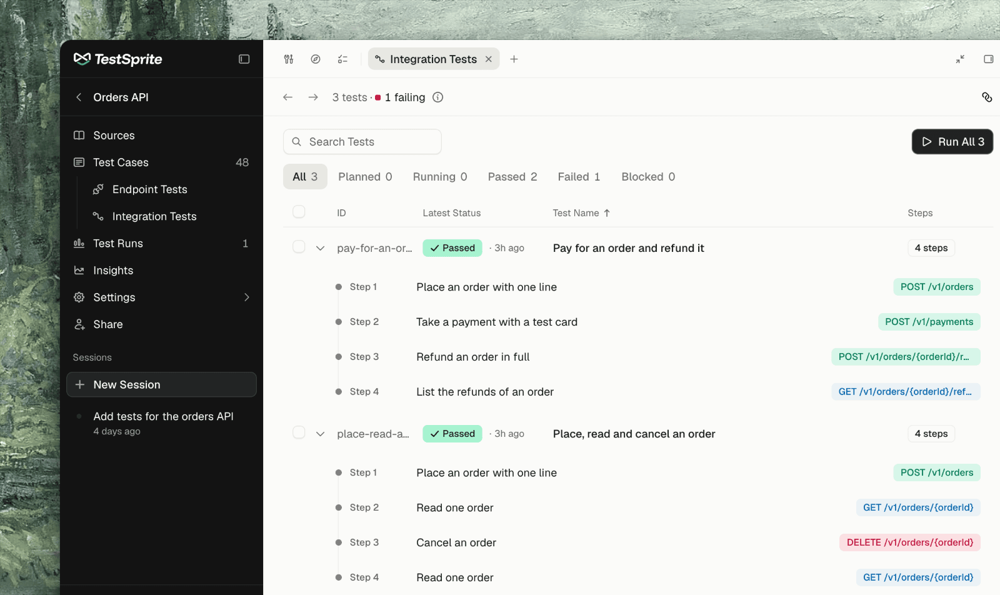
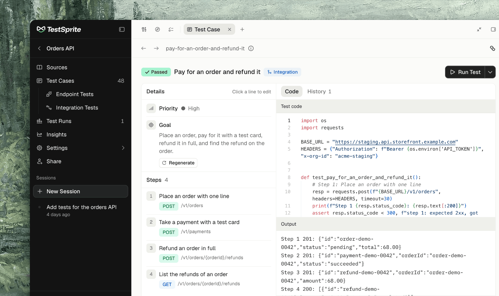
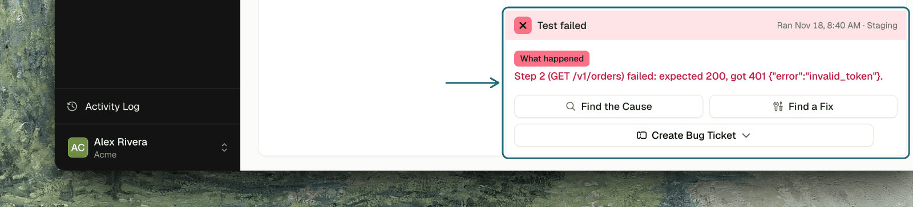

<Frame>
  
</Frame>

## What Integration Tests Are

An integration test runs a **sequence of endpoints** as one workflow, with each step using data from the one before:

```
POST /users        → create a user, capture user_id
POST /orders       → create an order for that user, capture order_id
GET  /orders/{id}  → confirm the order is retrievable
DELETE /orders/{id}→ cancel the order, confirm 204
```

TestSprite identifies these handoffs and runs the chain end to end as a single test.

## Where Integration Tests Live in the UI

Integration tests have their own sidebar row, **Test Cases → Integration Tests**, next to **Endpoint Tests**. From there you can:

- Browse the chains and open any one to see its steps
- **Run all** chains from the toolbar, or open a chain and rerun it on its own
- Ask the agent to refine a chain (add a step, drop a step, change the sequence)

## Why Integration Tests Matter

Endpoint tests verify each step in isolation; integration tests verify the **handoffs**. They catch the "individual endpoints work but the system doesn't" bugs:

| Failure mode | Caught by |
| :--- | :--- |
| GET /users returns a user with id `42` but POST /users created id `42a`-format strings | Integration |
| POST /orders silently strips the `metadata` field that GET /orders/{id} expects to round-trip | Integration |
| DELETE works, but the GET that follows still returns the record (eventual consistency bug) | Integration |
| The `order_id` field in POST /orders' response is named differently than what GET /orders/{id} needs as path param | Integration |

## Per-Chain View

Click into an integration test to see its detail page:

<Frame>
  
</Frame>

| Section | What you see |
| :--- | :--- |
| <kbd>Step list</kbd> | Each step with its method and path |
| <kbd>Stdout</kbd> | The full HTTP detail of each step's call, once the chain has run |
| <kbd>Chain-level error</kbd> | If the chain failed, where it broke and why |

## When a Chain Fails

Chains fail in two distinguishable ways:

<Frame>
  
</Frame>

| Failure shape | Meaning | Where to look |
| :--- | :--- | :--- |
| <kbd>Step N failed assertion</kbd> | Step N's HTTP call returned, but the assertion failed | Check step N's request/response in **Stdout** → refine or fix the API |
| <kbd>Step N TEST BLOCKED</kbd> | An upstream step (M before N) failed, so step N couldn't run | Fix step M first; step N runs automatically on rerun |

See [Endpoint Tests](/web-portal/core/api/endpoint-tests#test-outcomes) for how Blocked differs from Failed.

UI testing has the same idea, a use case with multiple steps, but runs browser actions instead of HTTP calls. See [UI Testing](/web-portal/core/ui/ui-testing).

## Edge Cases & Troubleshooting

<AccordionGroup>
  <Accordion title="No integration tests were detected">
    Common when your API is mostly read-only or the agent had little to go on. Ask it for specific multi-step flows: "Add integration tests that exercise create → read → update → delete on /orders".
  </Accordion>
  <Accordion title="A chain looks wrong — wrong order, missing steps">
    Tell the agent the right shape: "The right order is POST /users → POST /sessions → POST /orders, not /users → /orders directly". It fixes the chain and proposes the change.
  </Accordion>
  <Accordion title="My chain runs faster than my API can handle (eventual consistency)">
    Ask the agent to add a wait: "After the POST step, wait 250ms before the GET".
  </Accordion>
  <Accordion title="A step passes on its own, but breaks the chain">
    The step has a side effect the chain didn't account for, such as leaving a session active. Refine the step to clean up after itself, or add an explicit cleanup step: "After the GET step, DELETE the session created in step 2".
  </Accordion>
</AccordionGroup>

## Where to Go Next

<Columns cols={2}>
  <Card title="Endpoint Tests" href="/web-portal/core/api/endpoint-tests" icon="cube">
    The single-call tests that chains are built from
  </Card>
  <Card title="API Calls" href="/web-portal/core/api/agent-api-calls" icon="terminal">
    How the agent tries your endpoints before it proposes a test
  </Card>
</Columns>
