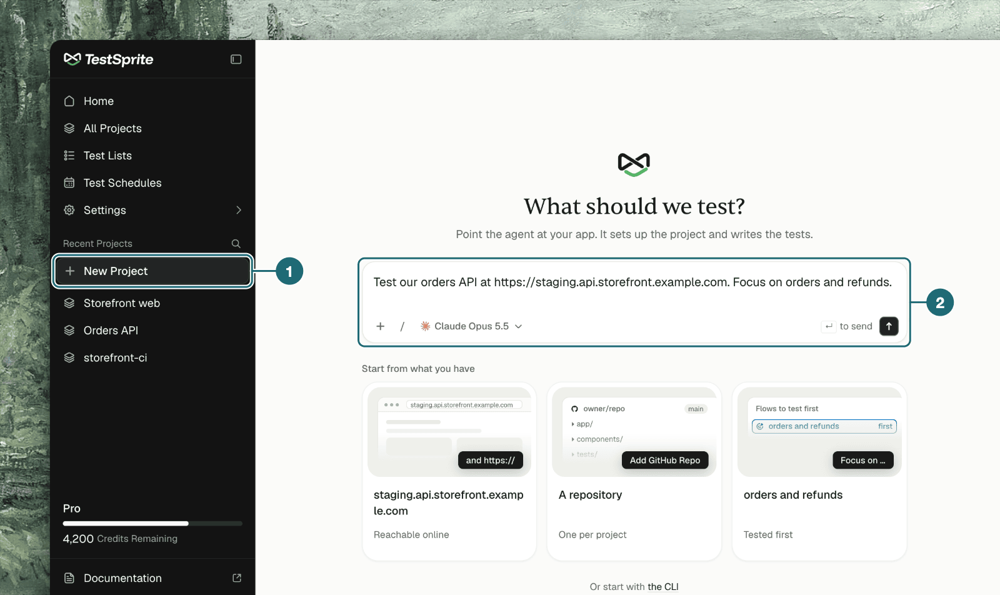
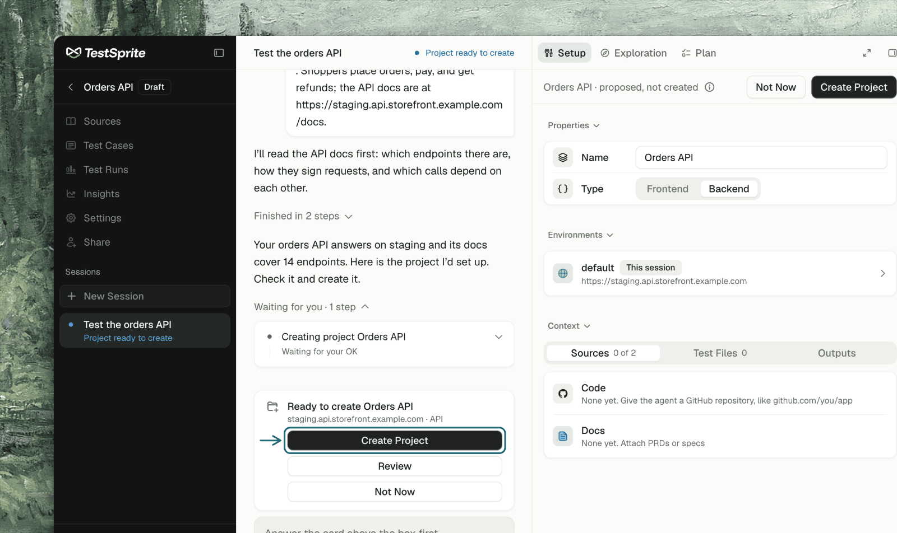
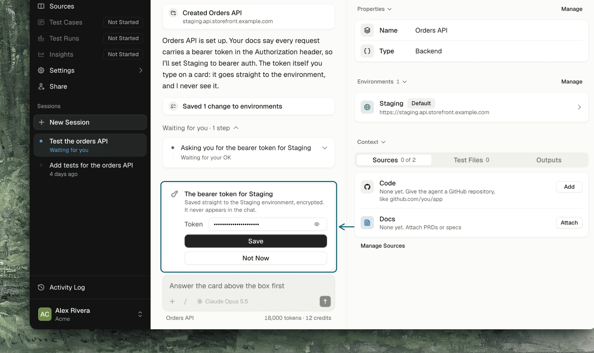
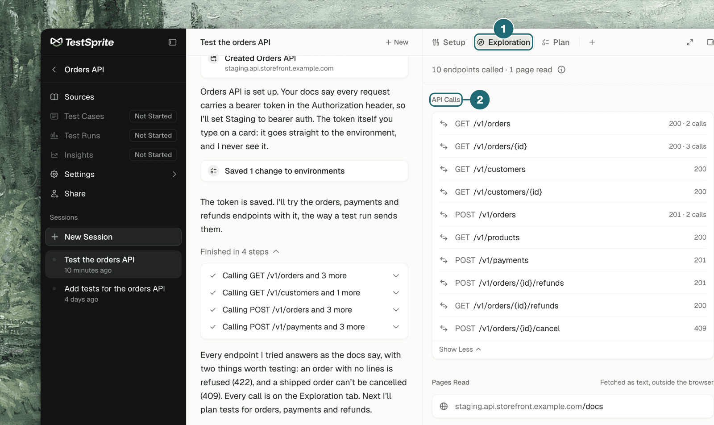
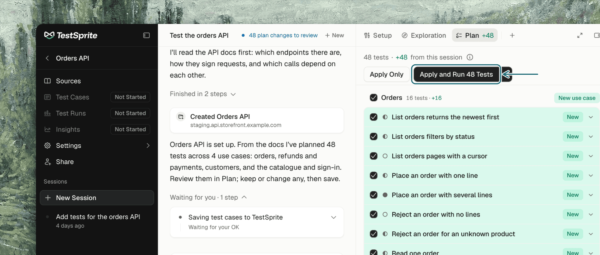
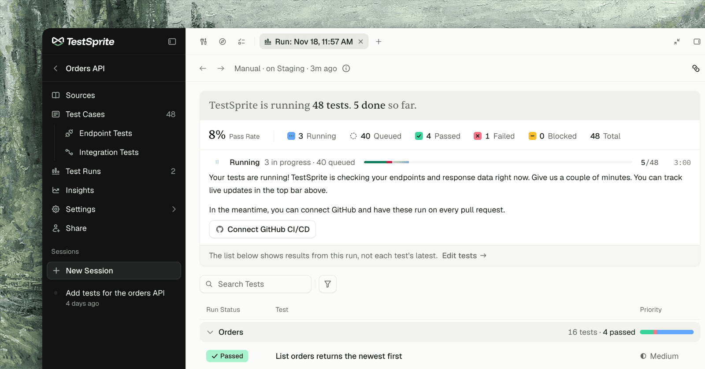
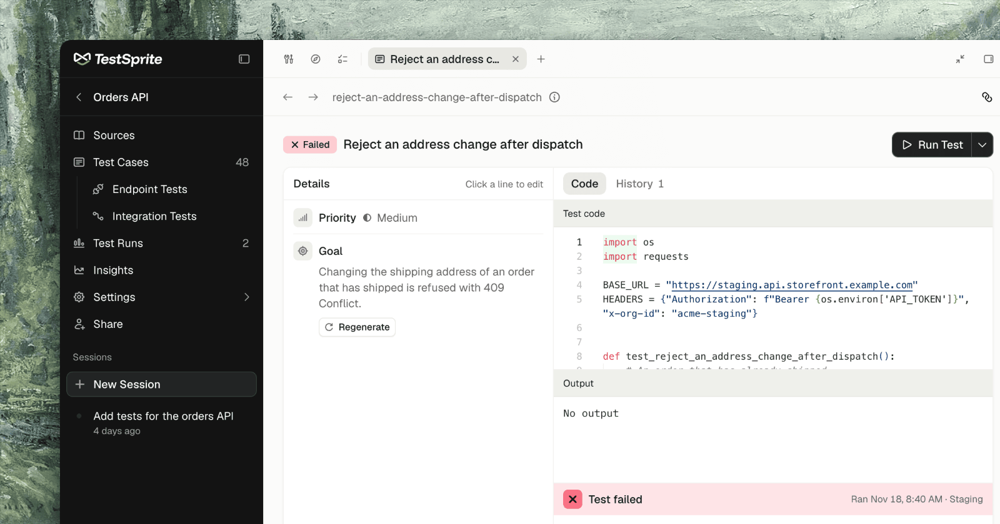
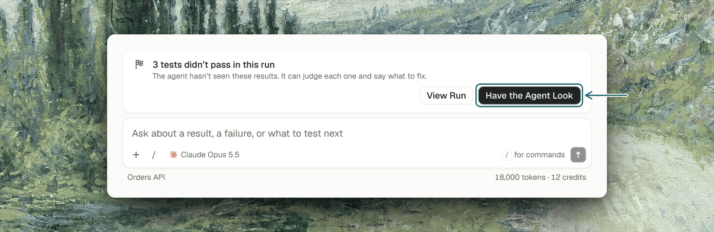
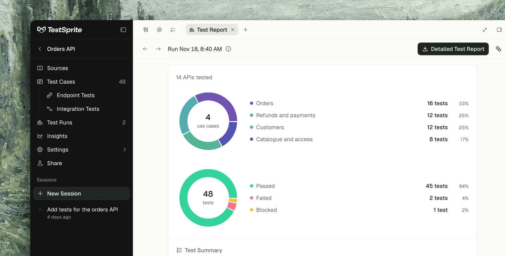

By the end of this guide you'll have an API project the agent has learned, planned, written as Python tests, and run against your live API, with every request and response captured. No code on your side.

<Info>
**Doing UI testing instead?** See the [UI Quickstart](/web-portal/core/ui/quickstart).
</Info>

## Step 1: Tell the Agent About Your API

Click <kbd>New Project</kbd>. The page asks **"What should we test?"** Give the agent your API's base address and say it is an API.

```text
Test our orders API at https://api.staging.example.com. Focus on orders and refunds.
```

<Frame>
  
</Frame>

Use the <kbd>+</kbd> menu to give it more to work from:

| Add | Why |
| :--- | :--- |
| <kbd>Documents</kbd> | An OpenAPI / Swagger file, a Postman collection, written API docs, or a PRD |
| <kbd>GitHub Repository</kbd> | The agent reads the routes and handlers in your backend's code |

<Tip>
**A PRD isn't only for UI.** It lets the agent test what each endpoint is *for*, not just its shape: the order-placement scenarios your product supports, not just `POST /orders`.
</Tip>

## Step 2: Create the Project

The agent asks once for what only you know: whether this is production, how the API authenticates, and what to cover first. Then a card reads **Ready to create {name}**. Click <kbd>Review</kbd> to check it on the **Setup** tab, and <kbd>Create Project</kbd> when it looks right.

<Frame>
  
</Frame>

## Step 3: Set Up Credentials

Tell the agent how your API authenticates. It writes the environment and asks you to confirm it, then asks for each secret on its own card. Type the token, key or password there: it is saved straight to the environment, encrypted, and never appears in the chat.

<Frame>
  
</Frame>

<Warning>
Don't paste a token or password into a message. Use the card.
</Warning>

<Card title="Credentials Setup" href="/web-portal/core/api/agent-credentials" icon="key">
  Every auth type the agent supports, and what you type for each
</Card>

## Step 4: Watch It Call Your API

The agent learns your API by calling it for real, the same way a test run does. Each try shows in the chat as a step like *"Calling GET /orders and 3 more"*, and the **Exploration** tab lists every endpoint it called with the status that came back.

<Frame>
  
</Frame>

<Card title="API Calls" href="/web-portal/core/api/agent-api-calls" icon="terminal">
  How the calls are sent, and what the agent won't do
</Card>

## Step 5: Review the Proposed Test Cases

When the plan is ready, a card reads **N changes to the Test Plan**. Click <kbd>Review Changes</kbd> to open it on the **Plan** tab, grouped by use case. The tests cover what fits your API: happy paths, authorization, error handling and edge cases, and multi-step workflows. Each one's code has already passed once against your API.

Untick any test you don't want, or edit one before it is saved. **Your tests stay as they are until you apply.**

<Frame>
  
</Frame>

<Card title="Proposed Test Cases" href="/web-portal/core/ui/agent-plan" icon="list-check">
  Reviewing, editing, rejecting and applying a proposal
</Card>

## Step 6: Apply and Run

Click <kbd>Apply and Run N Tests</kbd>. The run docks under the chat box; click <kbd>Watch</kbd> to open it. Each test shows <kbd>Queued</kbd>, <kbd>Running</kbd>, then <kbd>Passed</kbd>, <kbd>Failed</kbd>, or <kbd>Blocked</kbd>.

<Frame>
  
</Frame>

## Step 7: Review the Results

Click any test to open its detail page: the generated **Code**, its **Stdout** (the HTTP calls and what your API returned), the **error trace** where an assertion failed, and an **AI cause-and-fix** suggestion.

<Frame>
  
</Frame>

When tests fail, click <kbd>Have the Agent Look</kbd> on the card above the chat box. The agent judges each failure: your API is wrong, the test is wrong (it fixes the test and says what it changed), or something got in the way, such as an expired token.

<Frame>
  
</Frame>

The run's **Test Report** rolls up pass / fail / blocked counts with cause-and-fix highlights, ready to share with the team.

<Frame>
  
</Frame>

## Step 8: Rerun and Schedule

To run again, use <kbd>Run test</kbd> on a single test or <kbd>Run all</kbd> on the **Test Cases** toolbar. See [Rerun](/web-portal/core/api/api-rerun), and set up [Auto-Auth](/web-portal/core/api/auto-auth) so tokens refresh before every run.

## Where to Go Next

<Columns cols={2}>
  <Card title="Endpoint Tests" href="/web-portal/core/api/endpoint-tests" icon="cube">
    What a generated API test looks like
  </Card>
  <Card title="Integration Tests" href="/web-portal/core/api/integration-tests" icon="link">
    Multi-step workflows that chain endpoints
  </Card>
  <Card title="Auto-Auth" href="/web-portal/core/api/auto-auth" icon="arrows-rotate">
    Keep tokens fresh on every run
  </Card>
  <Card title="Test Schedules" href="/web-portal/maintenance/monitoring" icon="clock">
    Run on a cadence to catch regressions
  </Card>
</Columns>
