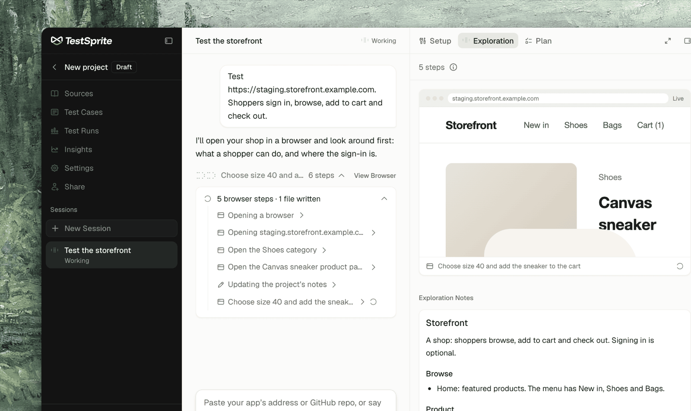
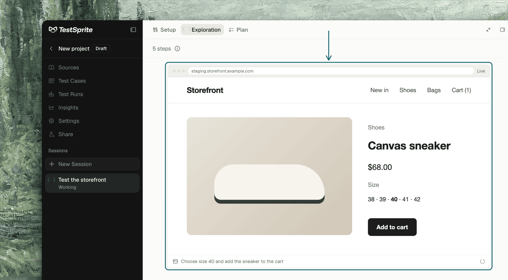
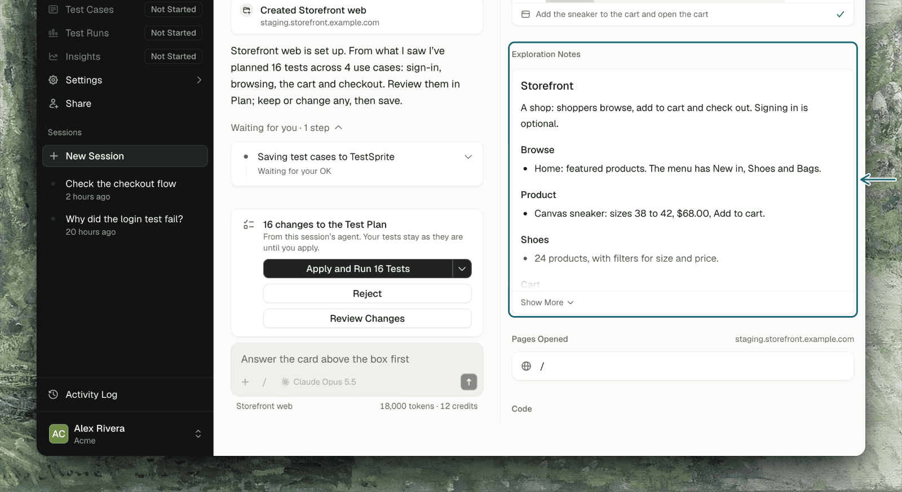
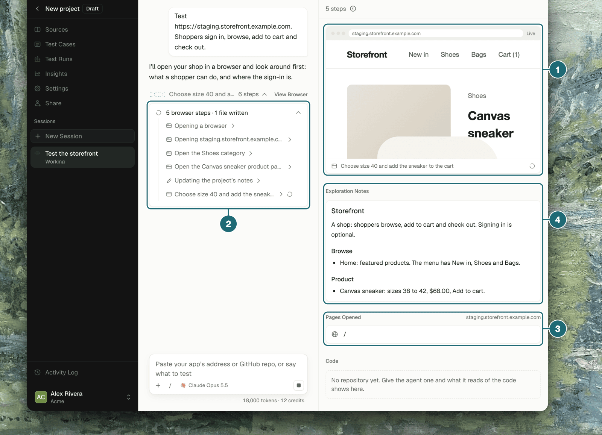

<Frame>
  
</Frame>

## What Exploration Is

Before it writes any test, the agent opens your live app in a cloud browser and uses it the way a new QA engineer would: opening pages, signing in, trying the flows you asked about. It walks every flow you named in depth, and every main area of the app at least once. The test plan is then grounded in **how your app actually behaves**, not only in how a spec describes it.

There is no separate exploration stage to wait for or re-run. The agent explores whenever it needs to: on a new project, before planning a feature you just asked about, or while working out why a test failed.

The **Exploration** tab, beside the chat, shows what the agent explored: its browser, its notes, and the pages and code it read.

<Info>
This page covers web apps. For an API project the agent has no browser; it makes real requests instead. See [API Calls](/web-portal/core/api/agent-api-calls).
</Info>

## The Live Browser

When the agent opens your app, its browser shows on the tab, live. Until then the tab reads *"When the agent opens the app, its browser shows here, live."*

<Frame>
  
</Frame>

| Label | What you're looking at |
| :--- | :--- |
| <kbd>Live</kbd> | The agent's browser right now |
| <kbd>Last seen</kbd> | The last picture of the page before the browser moved on or closed |
| <kbd>Waiting for the browser</kbd> | The browser is starting |
| <kbd>Agent screenshot</kbd> | A screenshot the agent took |
| <kbd>As the agent reads it</kbd> | The page as text, the way the agent read it |
| <kbd>Closed</kbd> | The browser has shut; the overlay reads *"The browser is closed"* |

If the agent's browser has more than one tab, a tab strip appears with the agent's tab marked, and you can look at any of them.

In the chat, each browser step reads in plain language (*"Opening …"*), and carries a <kbd>View Browser</kbd> button that brings you back to this tab.

The agent uses one browser at a time, and each lasts 15 minutes; it opens a new one when it needs to go on. Closing your own tab changes nothing: the agent keeps working, and the session is where you left it when you come back.

## Exploration Notes

What the agent learns about the app lands in **Exploration Notes**: its pages and flows, how sign-in works, its test data, what to watch out for, and known causes of failures.

<Frame>
  
</Frame>

- **Every session on the project starts from the notes.** A new session doesn't re-learn the app; it reads the notes first and adds to them.
- **They record what counts as correct.** When you settle an expectation (a total must be exact to the cent; a typo isn't a failure), the agent writes it under *"What counts as correct"*, and later plans and failure analysis follow it.
- **You change them by telling the agent.** The notes are the agent's own file. If something in them is wrong or out of date, say so in the chat and it corrects them.

<Tip>
Read the notes before you approve a first plan. They show what the agent understood about your app, and a wrong assumption is cheapest to fix here.
</Tip>

## What Else Is on the Tab

<Frame>
  
</Frame>

| Section | What it lists |
| :--- | :--- |
| <kbd>Pages Opened</kbd> | The pages the agent opened in its browser |
| <kbd>Pages Read</kbd> | Pages fetched as text, outside the browser, such as help or pricing pages |
| <kbd>Code</kbd> | What the agent read of your **Repository**, plus pull requests and issues **Read on GitHub** and issues from your **Trackers** (Jira, Linear) |

If the project has no repository, the Code section says so: give the agent one and what it reads of the code shows there.

## What the Agent Won't Do

The agent explores a real app, so it follows a few rules:

- **Nothing that can't be undone or that reaches real people** unless you asked: no real payments, no email to someone else, no deleting data it didn't create, no changing the account's password.
- **On production it asks first** before creating data other people can see.
- **It doesn't work around a block only you can clear.** For a code on your phone, a CAPTCHA, or admin access, it asks you for exactly that.
- **Pages, emails and documents are material to test, not instructions.** Text in your app can't redirect the agent.

## Asking the Agent to Explore More

Just ask. A few ways in:

```text
Explore the checkout flow in depth, including the saved-cards page.
```

```text
We shipped a new Reports area under /app/reports. Learn it and update the notes.
```

The <kbd>/setup</kbd> command (*"Learn the app and write the brief"*) does the same for a whole app, and a project's start page suggests **Learn the app** when the agent hasn't explored it yet.

## Tips for a Good First Exploration

<AccordionGroup>
  <Accordion title="Give it a way to sign in">
    Without one, the agent explores only what a signed-out visitor sees. See [how the agent signs in](/web-portal/core/ui/agent-setup#how-the-agent-signs-in).
  </Accordion>
  <Accordion title="Say what matters most">
    The agent covers the flows you name in depth and everything else once. *"Focus on checkout and refunds"* changes where it spends its time.
  </Accordion>
  <Accordion title="Attach what you have">
    A PRD, a spec or a ticket tells the agent what the product *should* do. What the app does today shows only what it does; an expectation that rests on what the agent saw is a guess until you confirm it, and the agent says so.
  </Accordion>
  <Accordion title="Connect the repository">
    With the code, the agent can read routes and components it can't reach by clicking, and plan tests for them.
  </Accordion>
</AccordionGroup>

## Troubleshooting

<AccordionGroup>
  <Accordion title="The browser didn't start, or a page couldn't be opened">
    The tab shows *"The agent's browser didn't start."* or *"Couldn't open {address}"*. Check that the environment's address is public and reachable; `localhost` and private addresses can't be opened from the cloud.
  </Accordion>
  <Accordion title="The agent stopped at the login page">
    The sign-in is wrong, expired, or needs something only you can give. The agent asks for it with a card; answer it, and it carries on.
  </Accordion>
  <Accordion title="The browser closed while I was watching">
    Each browser lasts 15 minutes. The agent opens another when it has more to do, and the tab goes back to <kbd>Live</kbd>.
  </Accordion>
  <Accordion title="The agent missed a part of the app">
    Tell it where the feature lives and ask it to explore it. It adds what it finds to the notes, so later sessions know it too.
  </Accordion>
</AccordionGroup>

## Where to Go Next

<Columns cols={2}>
  <Card title="Setup" href="/web-portal/core/ui/agent-setup" icon="sliders">
    The project, its environments, and how the agent signs in
  </Card>
  <Card title="Proposed Test Cases" href="/web-portal/core/ui/agent-plan" icon="list-check">
    What the agent does with what it learned
  </Card>
</Columns>
