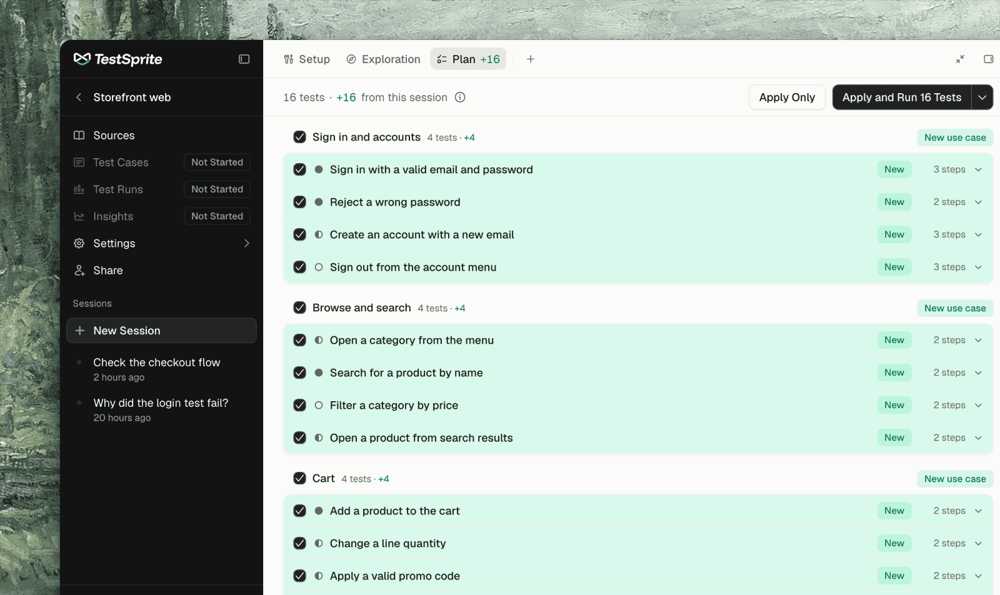
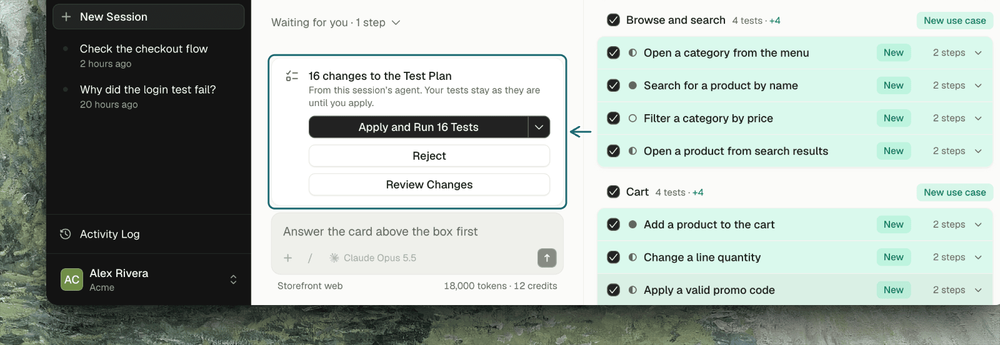
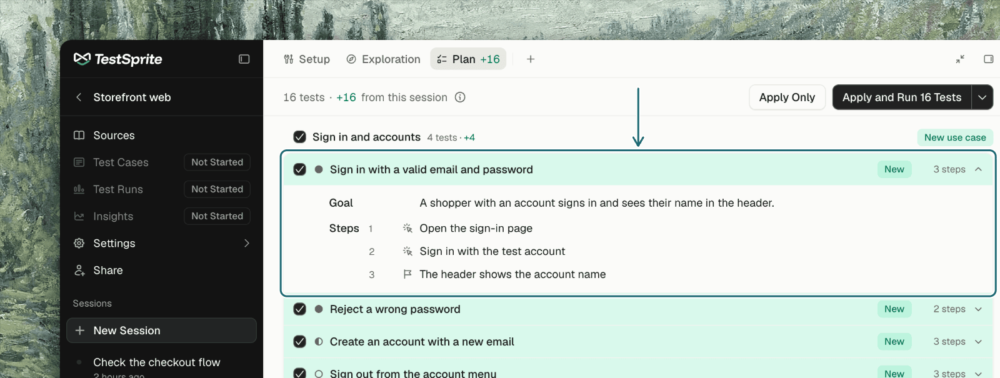
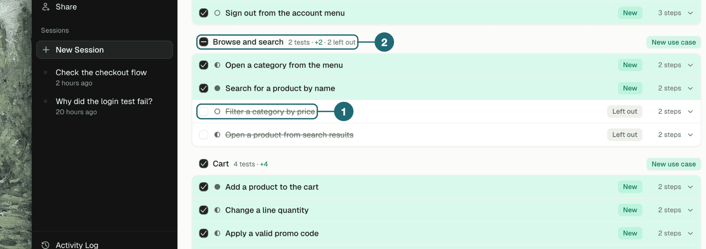
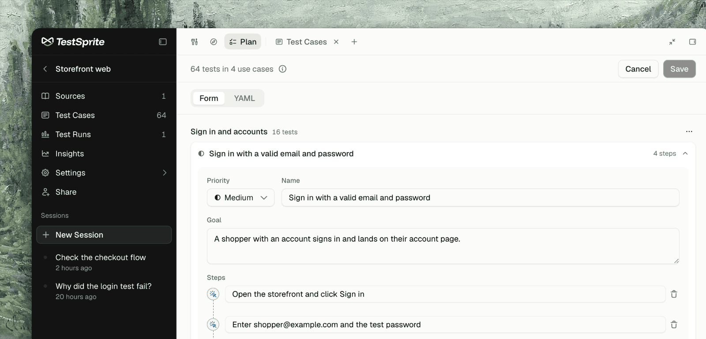
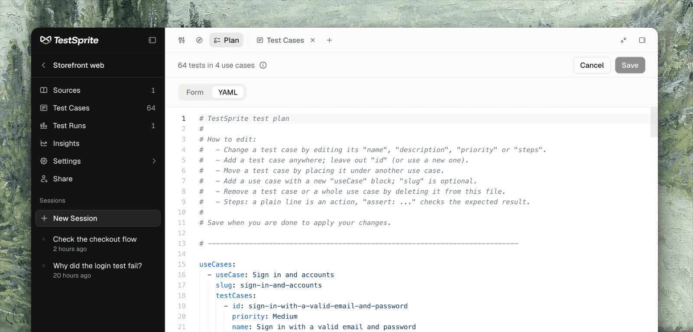
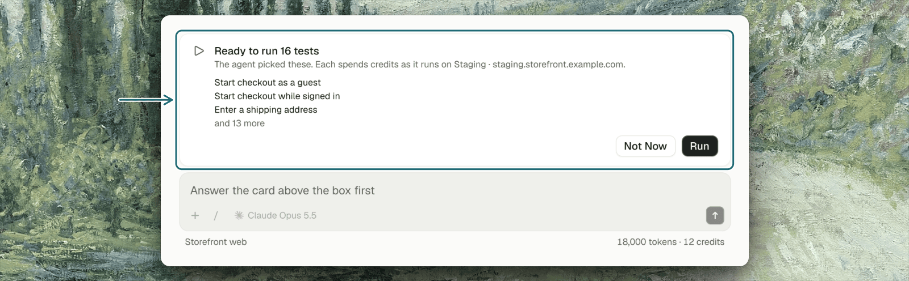

<Frame>
  
</Frame>

## How a Plan Comes About

After the agent has [explored your app](/web-portal/core/ui/agent-exploration), it writes a test plan: test cases grouped by use case, each with a title, steps, and a priority set by how much a failure would hurt your customers. A first plan covers each area with the flows that matter there and leaves the long tail for later.

The plan arrives as a **proposal**. The **Plan** tab, beside the chat, shows the project's test plan, and changes the agent proposes show there first. **Nothing changes on TestSprite until you apply it.**

You can ask for a plan at any time:

- Type <kbd>/plan</kbd> in the chat box, with notes if you like (*"/plan the billing settings page"*).
- Click <kbd>Plan the Tests</kbd> on an empty Plan tab.
- Click <kbd>Add Tests with AI</kbd> on **Test Cases**. The request goes to the agent, and the tests come back as a proposal here.

## The Proposal Card

When a proposal is ready, a card appears above the chat box: **N changes to the Test Plan**. *"From this session's agent. Your tests stay as they are until you apply."*

<Frame>
  
</Frame>

| Button | What it does |
| :--- | :--- |
| <kbd>Review Changes</kbd> | Opens the proposal on the Plan tab |
| <kbd>Apply and Run N Tests</kbd> | Saves the changes you kept and starts a run of those tests |
| <kbd>Apply Only</kbd> | Behind the arrow: saves the changes without running |
| <kbd>Reject</kbd> | Discards the proposal and undoes the agent's unsaved edits |

With its message, the agent says what it left for later and which expectations it is unsure of. Read that before you apply: an expectation the agent took from what the app does today is a guess until you confirm it.

## Reviewing the Changes

The Plan tab shows the whole plan by use case, with the proposal's changes marked where they are. The counts in the header read like a diff: **+** new, **~** changed, **−** removed.

<Steps>
  <Step title="Open a changed test">
    Each test that changes carries a badge and opens to show what changes: its use case, priority, and steps. Tests the proposal leaves alone sit folded under **Unchanged**.
    <Frame>
      
    </Frame>
  </Step>
  <Step title="Untick what you don't want">
    Every change has a tick. Untick one and it is marked **Left out**: it isn't applied, and the rest still are.
    <Frame>
      
    </Frame>
  </Step>
  <Step title="Edit before you apply">
    Click <kbd>Edit Test Plan</kbd> to change titles, steps, priorities or use cases yourself. The editor has a **Form** tab and a **YAML** tab. Your edits stay yours until you save them.
    <Frame>
      
    </Frame>
    <Frame>
      
    </Frame>
  </Step>
  <Step title="Apply">
    <kbd>Apply and Run</kbd> saves the plan and starts the run; <kbd>Apply</kbd> only saves.
  </Step>
</Steps>

<Tip>
**Not happy with the proposal as a whole?** Reject it and say what to change (*"too many negative cases on login; cover password reset instead"*). The agent rewrites it rather than you pruning it row by row.
</Tip>

## Running the Tests

A run always waits for you. If you applied without running, or ask the agent to run something later, a card reads **Ready to run N tests**, lists them, and names the environment. Each test spends credits as it runs.

<Frame>
  
</Frame>

- If the project has more than one environment, pick the one to run on from the card.
- Click <kbd>Run</kbd> to start, or <kbd>Not Now</kbd> to hold off.

Runs dock under the chat box with their progress and a <kbd>Watch</kbd> or <kbd>View Run</kbd> button. The agent doesn't see the results on its own: when a run has failures, click <kbd>Have the Agent Look</kbd> (or type <kbd>/failures</kbd>) and it judges each one. It sorts every failure into one of three: the app is wrong, the test is wrong, or something got in the way.

## Changing the Plan Later

| To… | Do this |
| :--- | :--- |
| Add coverage | Ask in the chat: *"Add tests for the new export feature"*. The additions arrive as a new proposal |
| Change a test | Ask the agent, or use <kbd>Edit Test Plan</kbd> and save |
| Remove tests | Ask the agent, or delete them in the editor. The agent deletes a test only when you asked |
| Review tests made elsewhere | Tests created from the CLI or MCP wait on **Test Cases**: *"N new tests wait to be reviewed."* Click <kbd>Review</kbd> |

The agent never changes what a test expects just to make it pass. If it can't tell whether your app or the test is wrong, it asks.

## What a Good Test Case Looks Like

The agent writes each case so it can run alone:

- **It creates what it needs** and deletes it at the end.
- **It doesn't rely on another case having run.**
- **On production**, it avoids steps that could save real data.

Keep these in mind when you edit a case by hand.

## Troubleshooting

<AccordionGroup>
  <Accordion title="The Plan tab says 'The plan comes after setup'">
    The project isn't created yet, or the agent hasn't explored it. Finish [Setup](/web-portal/core/ui/agent-setup), then click <kbd>Setup Is Done, Plan the Tests</kbd>.
  </Accordion>
  <Accordion title="An obvious feature has no test cases">
    The agent may not have reached it. Check the [Exploration tab](/web-portal/core/ui/agent-exploration), tell the agent where the feature lives, and ask it to plan tests for it.
  </Accordion>
  <Accordion title="A test asserts on something that isn't there">
    Tell the agent what the app really shows (*"the button is labelled Save, not Submit"*). It fixes the test and says what it changed.
  </Accordion>
  <Accordion title="The tests are too generic for our product">
    Attach a PRD or spec, or tell the agent your rules (*"orders move pending → confirmed → shipped"*). It records them in the notes under what counts as correct, and plans against them.
  </Accordion>
  <Accordion title="I applied a plan and want to undo it">
    Applying saves the test cases to the project. Ask the agent to remove or revert the ones you don't want, or delete them on **Test Cases**.
  </Accordion>
</AccordionGroup>

## Where to Go Next

<Columns cols={2}>
  <Card title="Test Generation & Execution (UI)" href="/web-portal/core/ui/ui-test-gen" icon="cube">
    What happens when the tests run
  </Card>
  <Card title="Step-by-Step Replay" href="/web-portal/core/ui/ui-step-by-step" icon="list-check">
    What you'll see for each test in a run
  </Card>
  <Card title="Managing Test Cases" href="/web-portal/core/working-with-test/managing-test-cases" icon="pen">
    Editing and organizing cases after they exist
  </Card>
</Columns>
