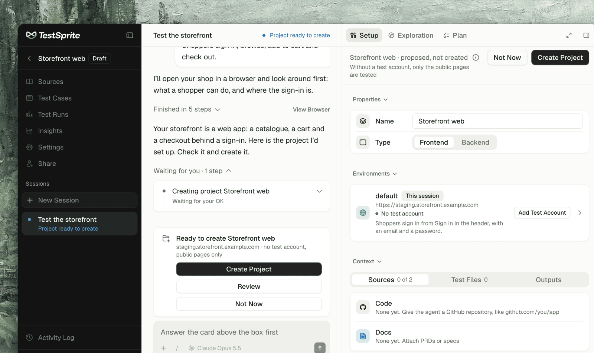
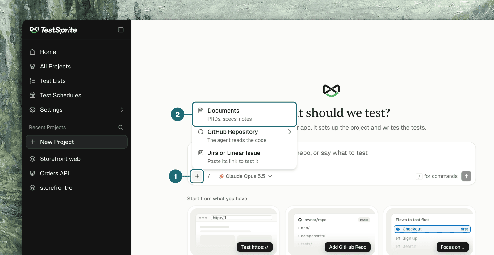
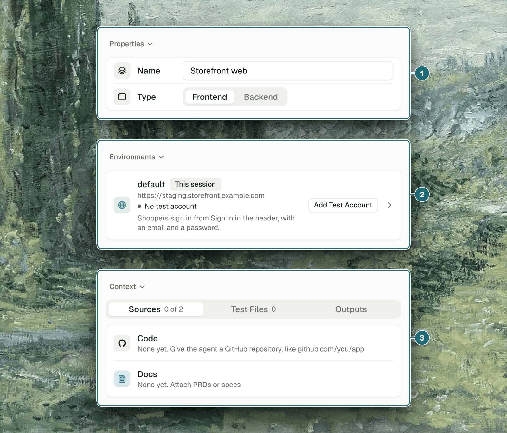
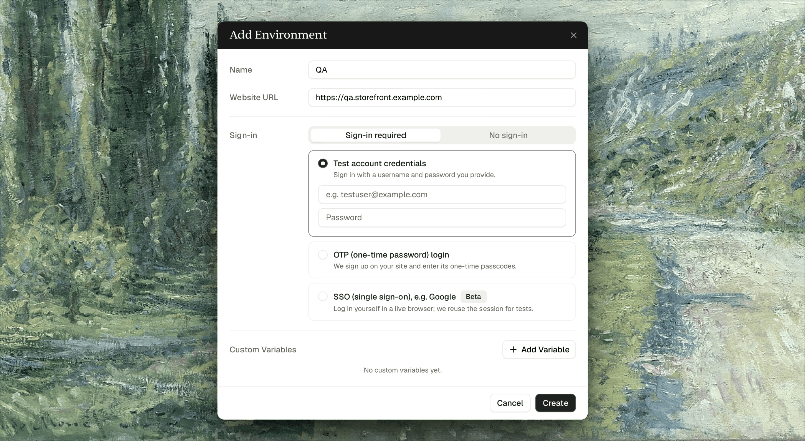
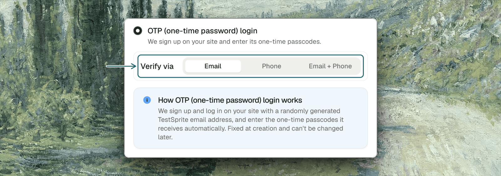
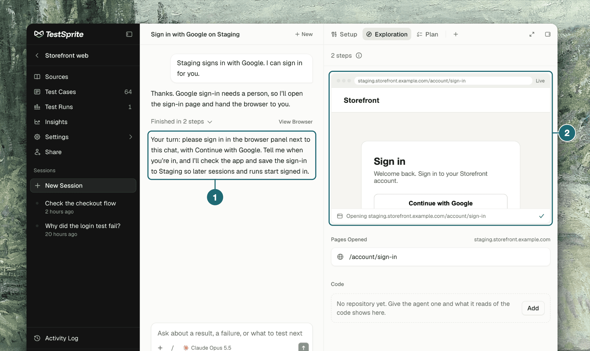
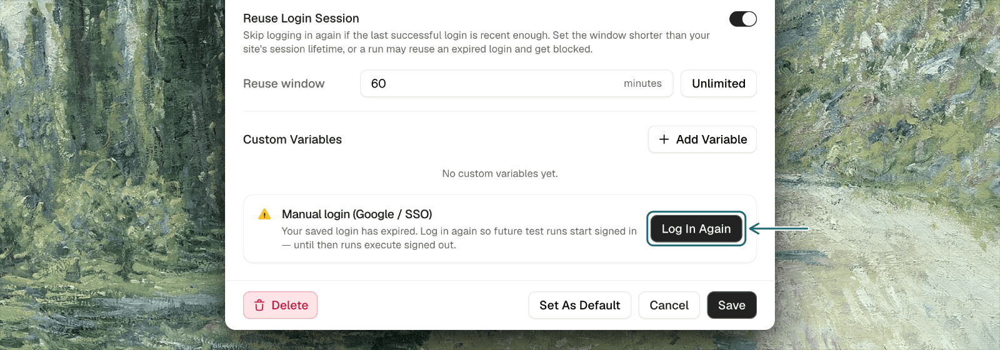
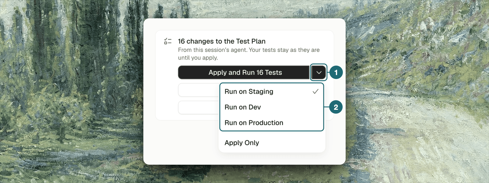

<Frame>
  
</Frame>

## What the Setup Tab Is

A project starts as a conversation. You tell the agent which app to test, it asks for what only you know, and it proposes a project. The **Setup** tab, beside the chat, shows that proposal: what the agent works from, and what it knows.

**Nothing is created until you create it.** While the project is a proposal it is a **Draft**: it shows in **Recent Projects** and **All Projects** with a <kbd>Draft</kbd> badge, and the Setup tab reads *"{name} · proposed, not created"*.

## Starting a Project

<Steps>
  <Step title="Open New Project">
    Click <kbd>New Project</kbd> in the sidebar. The page asks **"What should we test?"**
  </Step>
  <Step title="Point the agent at your app">
    Paste your app's address in the chat box, or say what to test. Use the <kbd>+</kbd> menu to add **Documents** (PRDs, specs, notes; up to 50 MB each), a **GitHub Repository**, a **Jira or Linear Issue**, or a **Test Account**.
    <Frame>
      
    </Frame>
  </Step>
  <Step title="Answer the agent's questions">
    Before it explores, the agent asks once for what it can't find out on its own: the URL and whether it is production, how to sign in, what material you have, and what to cover first.
  </Step>
  <Step title="Review and create">
    A card above the chat box reads **Ready to create {name}**. Click <kbd>Review</kbd> to check it on the Setup tab, <kbd>Create Project</kbd> to create it, or <kbd>Not Now</kbd> to keep talking.
  </Step>
</Steps>

Once the project exists, the chat shows **Setup confirmed**, and the agent goes on to [explore the app](/web-portal/core/ui/agent-exploration) and [propose test cases](/web-portal/core/ui/agent-plan).

<Info>
The repository and issue-tracker items in the <kbd>+</kbd> menu appear only when integrations are available to your workspace.
</Info>

## What's on the Tab

<Frame>
  
</Frame>

| Group | What it holds | What you can do |
| :--- | :--- | :--- |
| <kbd>Properties</kbd> | The project's **Name** and **Type** (Frontend or Backend) | Edit both until the project is created |
| <kbd>Environments</kbd> | Where the app runs: each environment's address and how to sign in there | Open an environment to change its address or test account; <kbd>Manage environments</kbd> opens the full [Environments](/web-portal/setup/environments) page |
| <kbd>Context</kbd> → <kbd>Sources</kbd> | **Code** (the GitHub repository) and **Docs** (PRDs and specs) | Add code, attach docs, or open [Sources](/web-portal/setup/project-sources) |
| <kbd>Context</kbd> → <kbd>Test Files</kbd> | Files a test uploads into your app | Attach files |
| <kbd>Context</kbd> → <kbd>Outputs</kbd> | What the agent wrote: the **Brief**, the **Test plan**, and any **Files** it made for you | Read and download them |

## How the Agent Signs In

Without a way to sign in, the agent can only explore and test what a signed-out visitor sees, so it never guesses: it asks. Each environment signs in one way, and the agent's browser and every test run on that environment sign in the same way.

<Frame>
  
</Frame>

| Sign-in | Best for | What you provide |
| :--- | :--- | :--- |
| **Test account** | A username and password login | The username and password of an account made for testing |
| **One-time code** | Logins and signups that email a code or a sign-in link | Nothing: the agent makes a TestSprite-managed account with its own email inbox, and reads the codes your app sends there |
| **Saved sign-in** (manual login) | Google and other single sign-on, or a sign-in only a person can finish (a phone prompt, an approval) | You sign in once yourself in the agent's browser; TestSprite saves it so later sessions and runs start signed in |
| **No sign-in** | Parts of the app that work without an account | Nothing |

<Warning>
**Use an account made for testing, never a real one.** The agent's browser and the project's test runs sign in with it, and they perform real actions while signed in.
</Warning>

### Giving the agent a test account

Add the account with <kbd>+</kbd> → <kbd>Test Account</kbd> in the chat box, or <kbd>Add Test Account</kbd> under **Environments** on the Setup tab. Don't type a password into a message. If you do, a card stops it before it is sent: *"This looks like a password. Use the test account for it, and only a test login."* Choose <kbd>Test Account</kbd> to enter it properly.

<Frame>
  
</Frame>

When the agent needs a secret it doesn't have, it asks with a card named for the secret. You type it there, and it is saved straight to the environment, encrypted. It never appears in the chat.

### When the agent makes its own account

If the environment has no sign-in and you gave none, the agent can register a TestSprite-managed account: a TestSprite email address and a generated password. It then saves that account as the environment's sign-in, so the next session signs in with it instead of making another. A managed account can't use Google, GitHub or other single sign-on.

<Frame>
  
</Frame>

### Saved sign-ins (manual login)

For Google and other single sign-on, or any sign-in only you can finish, you sign in yourself and the agent saves it:

<Frame>
  
</Frame>

<Steps>
  <Step title="Tell the agent you'll sign in yourself">
    For example: *"I can sign in for you, it needs Google login."* The agent opens your app's sign-in page in its browser and hands over: *"Your turn: please sign in in the browser panel next to this chat."*
  </Step>
  <Step title="Sign in in the browser panel">
    The live browser on the **Exploration** tab takes your clicks and typing. Sign in there as you normally would.
  </Step>
  <Step title="Tell the agent you're in">
    Send a message such as *"I'm logged in, can you check?"* The agent confirms it can see your signed-in app.
  </Step>
  <Step title="Let it save the sign-in">
    The agent saves the signed-in session to the environment while the browser is still open; confirm the card if it asks. The chat then shows **Saved 1 change to environments**.
  </Step>
</Steps>

From then on, later sessions start their browser already signed in, and so do test runs.

<Note>
**Sign in soon after the agent asks.** Each browser lasts about 15 minutes. If it times out before you finish, the agent opens a new one and you sign in again.
</Note>

A saved sign-in lasts as long as your app keeps that session alive. When it expires, sign in again the same way, or from the environment's dialog.

<Frame>
  
</Frame>

A few changes stay in the environment's settings instead of the chat: switching an existing environment to or from one-time-code sign-in, leaving a saved sign-in, and changing a managed account's inbox. See [Environments](/web-portal/setup/environments).

## Environments

A project can have several environments (staging and production, an admin and a member account). The agent works on the project's default environment unless you name another, and says which one it used. When a run is ready to start, its card shows the environment and lets you pick another.

<Frame>
  
</Frame>

<Note>
**Local addresses can't be reached.** The agent's browser runs in the cloud, so `localhost` and private addresses don't work. Use a public staging address, or set up the [CLI](/cli/getting-started/overview) to test a local app.
</Note>

## Who Can Do What

Asking the agent needs edit access to the project. Viewers can browse projects and results, but can't create a project, message the agent, or confirm its cards.

## Troubleshooting

<AccordionGroup>
  <Accordion title="The agent tested my app signed out">
    The environment has no sign-in. Add a test account (<kbd>+</kbd> → <kbd>Test Account</kbd>), or tell the agent how users sign in and let it set the environment up.
  </Accordion>
  <Accordion title="My login sends a one-time code">
    Tell the agent. It signs in with a TestSprite-managed account and reads the code from that account's inbox. If the code goes somewhere only you can read, such as your phone, the agent asks you for it.
  </Accordion>
  <Accordion title="My app signs in with Google or another SSO">
    A stored username and password can't drive these, and a TestSprite-managed account can't use them. Use a [saved sign-in](#saved-sign-ins-manual-login): sign in once yourself in the browser panel, tell the agent, and sessions and runs reuse it until it expires.
  </Accordion>
  <Accordion title="The agent is waiting and I can't send a message">
    A card above the chat box is waiting for your decision. Only one waits at a time; answer it, and the chat box opens again.
  </Accordion>
  <Accordion title="I changed my mind about the proposed project">
    Click <kbd>Not Now</kbd> and tell the agent what to change, or edit the name, type, address and test account yourself on the Setup tab before you create it.
  </Accordion>
</AccordionGroup>

## Where to Go Next

<Columns cols={2}>
  <Card title="Exploration & Notes" href="/web-portal/core/ui/agent-exploration" icon="compass">
    Watch the agent walk your app, and read what it learned
  </Card>
  <Card title="Proposed Test Cases" href="/web-portal/core/ui/agent-plan" icon="list-check">
    Review the plan the agent proposes, then apply and run it
  </Card>
  <Card title="Environments" href="/web-portal/setup/environments" icon="layer-group">
    Addresses, accounts and variables for every environment
  </Card>
  <Card title="Credentials Setup (API)" href="/web-portal/core/api/agent-credentials" icon="key">
    The API equivalent: tokens, keys and sign-in flows
  </Card>
</Columns>
