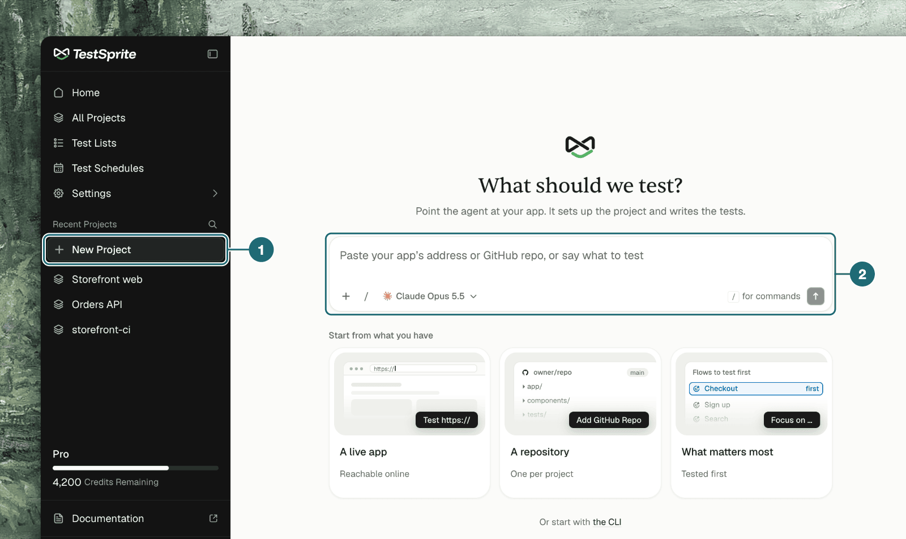
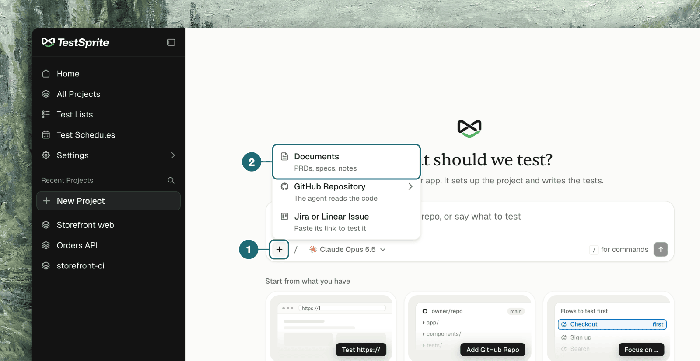
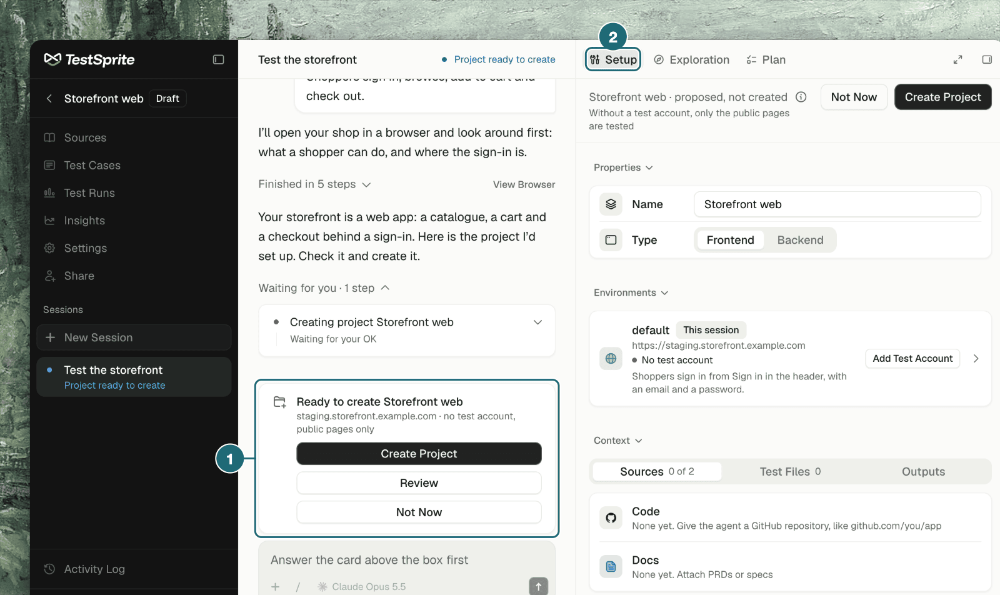
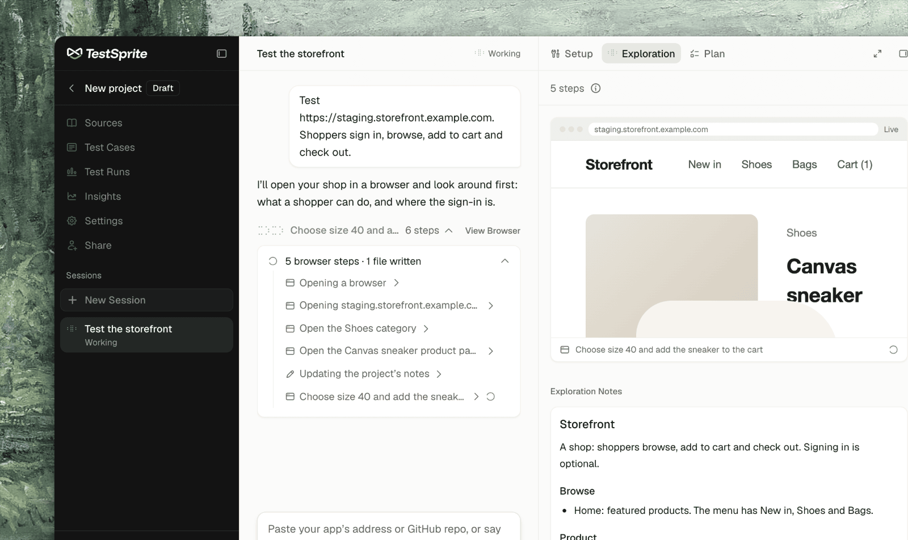
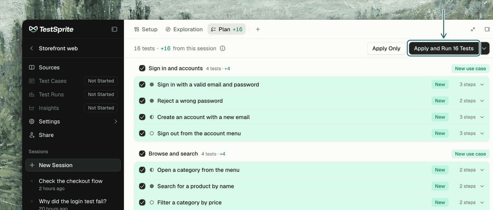
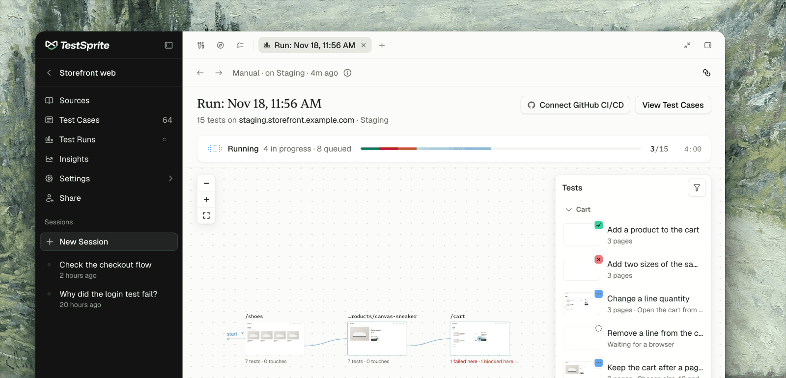
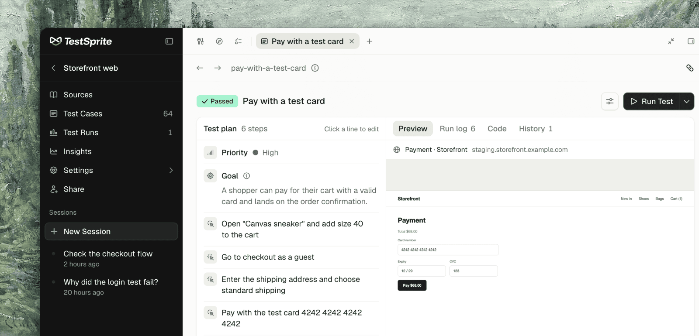
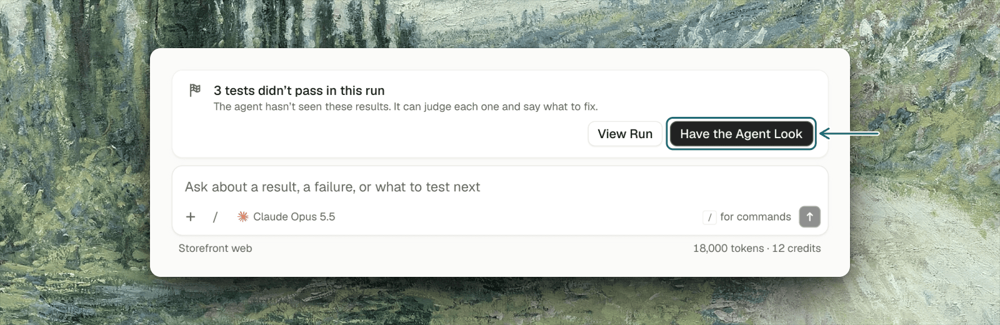
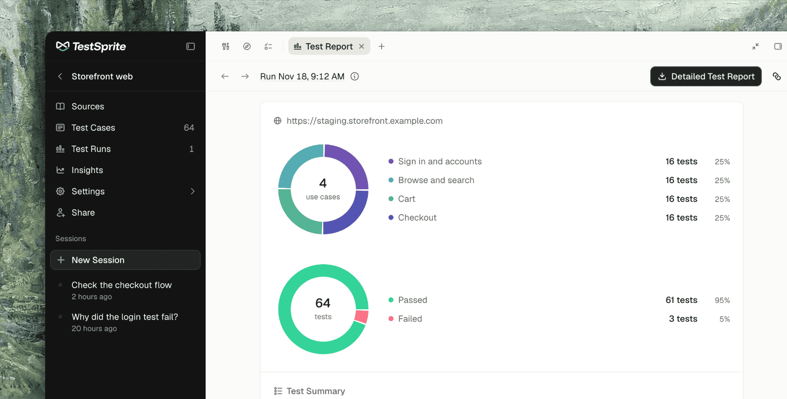

By the end of this guide you'll have a UI project the agent has explored, planned, and run against your live app, with a recorded video for every test. No code on your side.

<Info>
**Doing API testing instead?** See the [API Quickstart](/web-portal/core/api/quickstart) for the backend-flavored walkthrough.
</Info>

## Step 1: Tell the Agent What to Test

Click <kbd>New Project</kbd>. The page asks **"What should we test?"** Paste your app's address in the chat box and send it.

<Frame>
  
</Frame>

Use the <kbd>+</kbd> menu to give the agent more to work from:

<Frame>
  
</Frame>

| Add | Why |
| :--- | :--- |
| <kbd>Documents</kbd> | A PRD, spec or notes: what the product is *supposed* to do |
| <kbd>GitHub Repository</kbd> | The agent reads the code, including what it can't reach by clicking |
| <kbd>Test Account</kbd> | The account the agent's browser signs in with |

<Tip>
**Attach a PRD if you have one.** It's the biggest lever on plan quality: without it, the agent can only test against what the app does today.
</Tip>

## Step 2: Answer Its Questions and Create the Project

Before it explores, the agent asks once for what only you know: whether the address is production, how users sign in, and what to cover first. Answer in the chat. If it offers choices, they arrive on a card you can click.

Then a card above the chat box reads **Ready to create {name}**. Click <kbd>Review</kbd> to check the project on the **Setup** tab, and <kbd>Create Project</kbd> when it looks right. Nothing is created until you do.

<Frame>
  
</Frame>

<Card title="Setup" href="/web-portal/core/ui/agent-setup" icon="sliders">
  The Setup tab, environments, and every way the agent can sign in
</Card>

## Step 3: Watch It Explore

The agent opens your app in a cloud browser and walks it: every flow you asked about in depth, every main area at least once. Open the **Exploration** tab to watch the browser live and read the notes the agent keeps.

<Frame>
  
</Frame>

You don't have to stay. Closing the tab changes nothing; the session is where you left it when you come back.

<Card title="Exploration & Notes" href="/web-portal/core/ui/agent-exploration" icon="compass">
  The live browser, the notes, and what the agent won't do in your app
</Card>

## Step 4: Review the Proposed Test Cases

When the plan is ready, a card reads **N changes to the Test Plan**. Click <kbd>Review Changes</kbd> to open it on the **Plan** tab, grouped by use case. Untick any test you don't want, or edit one before it is saved. **Your tests stay as they are until you apply.**

<Frame>
  
</Frame>

<Card title="Proposed Test Cases" href="/web-portal/core/ui/agent-plan" icon="list-check">
  Reviewing, editing, rejecting and applying a proposal
</Card>

## Step 5: Apply and Run

Click <kbd>Apply and Run N Tests</kbd>. The run docks under the chat box with its progress; click <kbd>Watch</kbd> to open it. The run page tracks it live, with the pass rate and <kbd>Running</kbd> / <kbd>Passed</kbd> / <kbd>Failed</kbd> / <kbd>Blocked</kbd> counts. Switch between <kbd>Map View</kbd>, to watch the recordings, and <kbd>List View</kbd>, for a table of results.

<Frame>
  
</Frame>

## Step 6: Replay Step by Step

Click any test to open its detail page. The right pane plays the **recorded video** of the run; the **Steps** panel lists every action with a clickable snapshot per step.

<Frame>
  
</Frame>

<Card title="Step-by-Step Replay" href="/web-portal/core/ui/ui-step-by-step" icon="list-check">
  Deeper tour of the per-step replay view
</Card>

## Step 7: Have the Agent Look at Failures

The agent doesn't see a run's results on its own. When tests fail, click <kbd>Have the Agent Look</kbd> on the card above the chat box, or <kbd>Find the Cause</kbd> / <kbd>Find a Fix</kbd> on a single failed result. It judges each failure: your app is wrong (a real bug, with the step, what was expected and what happened), the test is wrong (it fixes the test and says what it changed), or something got in the way.

<Frame>
  
</Frame>

To change a test yourself, see [Managing Test Cases](/web-portal/core/working-with-test/managing-test-cases). To re-execute one, click <kbd>Run Test</kbd> on its detail page. [Auto-Heal](/web-portal/core/ui/auto-heal) absorbs UI changes that don't break the flow.

## The Final Report

When the run finishes, click <kbd>View Report</kbd> to open the **Test Report**: pass / fail / blocked counts, failures with cause-and-fix suggestions, and links into each test. This is what you share with the team.

<Frame>
  
</Frame>

## Where to Go Next

<Columns cols={2}>
  <Card title="Map View" href="/web-portal/core/ui/map-view" icon="film">
    Every recording from a run, grouped by status
  </Card>
  <Card title="Edit & Rerun" href="/web-portal/core/ui/ui-rerun" icon="arrow-rotate-right">
    Run a test again after a fix
  </Card>
  <Card title="Test Schedules" href="/web-portal/maintenance/monitoring" icon="clock">
    Run on a cadence to catch regressions
  </Card>
  <Card title="GitHub Integration" href="/web-portal/integrations/github-integration" icon="github">
    Run your tests on every pull request
  </Card>
</Columns>
