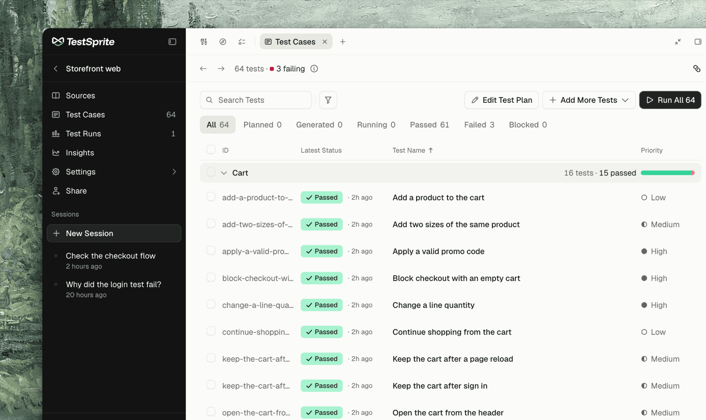
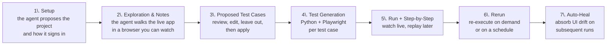
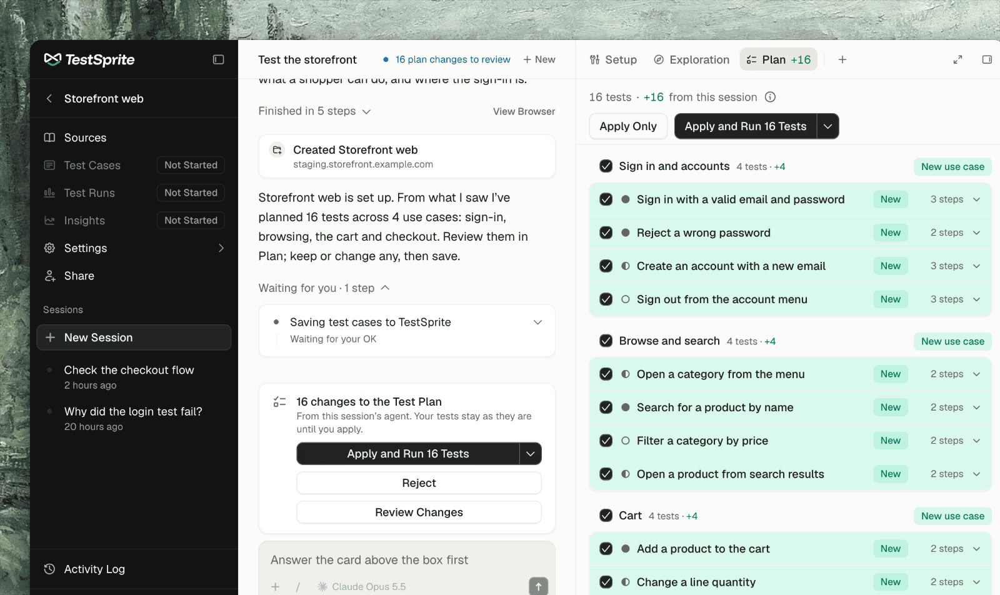

<Frame>
  
</Frame>

UI Testing takes you from "here's my web app" to a regression suite that catches UI bugs without breaking on every minor refactor.

## Key Features

| Feature | Description |
| :--- | :--- |
| <kbd>Fast Setup</kbd> | Paste your app's address and, optionally, add a test account; the agent proposes the project |
| <kbd>Multiple Sign-In Methods</kbd> | A test account, a one-time-code login with a TestSprite-managed account, or a saved sign-in for SSO such as Google |
| <kbd>Live Exploration</kbd> | The agent walks your live app in a browser you can watch, and keeps notes every later session starts from |
| <kbd>Proposed Test Cases</kbd> | A plan tailored to your real screens and flows; keep, leave out, or edit each case before it is saved |
| <kbd>Live Test Preview</kbd> | Watch tests run in real time |
| <kbd>Step-by-Step Replay</kbd> | Every run records a video and per-step screenshots |
| <kbd>Auto-Heal</kbd> | When the UI drifts, TestSprite re-decides selectors against the live DOM instead of failing the test |
| <kbd>Natural Language Refinement</kbd> | Ask the agent to add, change or fix tests in plain language, no code required |
| <kbd>Reusable Test Code</kbd> | Generated Python + Playwright tests, ready for CI/CD or regression suites |

## The UI Testing Journey

<Card>

</Card>

Each step has its own page. New to TestSprite? Start with the [Quickstart](/web-portal/core/ui/quickstart), which walks the whole journey in about 10 minutes.

<CardGroup cols={2}>
  <Card title="Setup" href="/web-portal/core/ui/agent-setup" icon="sliders">
    The project the agent proposes, its environments, and how it signs in
  </Card>
  <Card title="Exploration & Notes" href="/web-portal/core/ui/agent-exploration" icon="compass">
    Watch the agent walk your live app, and read what it learned
  </Card>
  <Card title="Proposed Test Cases" href="/web-portal/core/ui/agent-plan" icon="list-check">
    Review the plan the agent proposes; edit, leave out, apply and run
  </Card>
  <Card title="Test Generation & Execution" href="/web-portal/core/ui/ui-test-gen" icon="cube">
    Python + Playwright code per test case
  </Card>
  <Card title="Step-by-Step Replay" href="/web-portal/core/ui/ui-step-by-step" icon="list-check">
    Per-step screenshots, video, and behavior trace for one test
  </Card>
  <Card title="Map View" href="/web-portal/core/ui/map-view" icon="film">
    Every recording from a run, bucketed by status
  </Card>
  <Card title="Edit & Rerun" href="/web-portal/core/ui/ui-rerun" icon="arrow-rotate-right">
    Re-execute a single test, the whole project, or a scheduled run
  </Card>
  <Card title="Auto-Heal" href="/web-portal/core/ui/auto-heal" icon="wand-magic-sparkles">
    Recover UI tests when the page changed but the flow is fine
  </Card>
</CardGroup>

<Tip>
**Each UI test is self-contained**: sign in, do the thing, assert. Unlike API tests, no data is passed between tests, so the work is in the single test (the page, timing, and absorbing UI change).
</Tip>

## Where Things Live

Inside a project, the chat with the agent stays on the left, and the project's pages (Sources, Test Cases, Test Runs, Insights, Settings) open as tabs beside it; see the [Test Detail Page](/web-portal/core/working-with-test/test-detail) for what each does. Scheduling lives outside the project, under **Test Schedules**.

<Frame>
  
</Frame>

## Refining Tests in Natural Language

You can refine any test in plain language, by editing its description or asking the agent. For example:

```text
Add a test that signs up a new user with an invalid email and confirms the inline validation appears.
```

See [Managing Test Cases](/web-portal/core/working-with-test/managing-test-cases) for every way to do it.

## Testing an API Instead?

See [API Testing](/web-portal/core/api/api-testing). The flow mirrors this one; for an API project the agent calls your endpoints instead of walking pages, and API tests use [Auto-Auth](/web-portal/core/api/auto-auth) for token refresh rather than Auto-Heal. [Testing Lifecycle](/web-portal/concepts/testing-lifecycle) compares the two side by side.
