## What is the TestSprite Web Portal?

The TestSprite Web Portal is where you work with **TestSprite's agent**: a QA engineer that joins your project, explores your app, writes and maintains its test cases, runs them, and tells you what broke and why. You talk to it in plain language and approve what it proposes; you never write a line of test code. It complements the [TestSprite CLI](/cli/getting-started/overview) and the [MCP Server](/mcp/getting-started/overview), which bring TestSprite into your terminal, IDE, and coding agent, by giving your whole team a shared place to set up projects, run tests, and review results.

<Frame>
  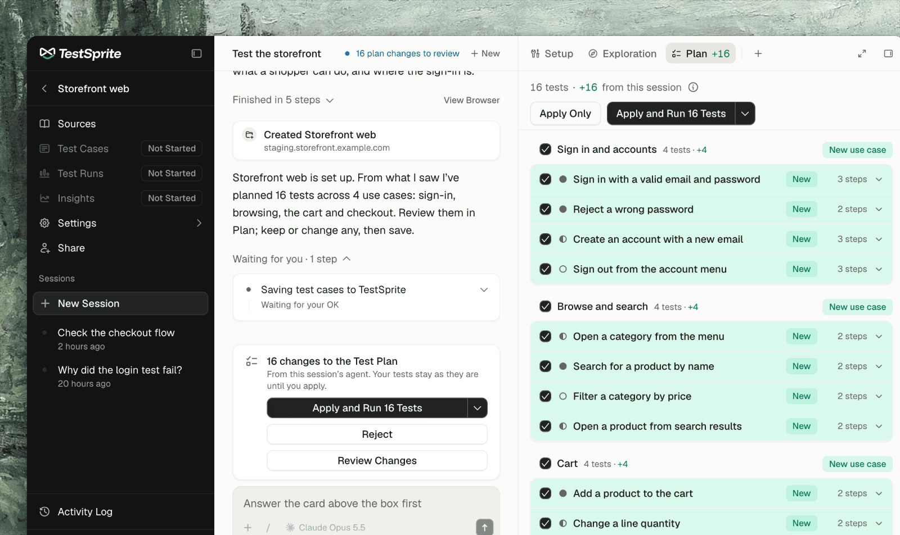
</Frame>

TestSprite is **spec-driven**: tests come from what your product is *supposed to do* (your PRD, specs, tickets) and what the live app *actually does* (what the agent sees when it explores). A PRD isn't required, but it is **strongly recommended**. It's the biggest lever on test quality.

## What It Tests

| Test type | What it covers | Planned from |
| :--- | :--- | :--- |
| <kbd>UI (frontend)</kbd> | User journeys, forms, visual states, auth flows, UI error handling | Your docs and code, plus the agent's exploration of the live app in a browser |
| <kbd>API (backend)</kbd> | Functional workflows, schemas, auth, data integrity across calls, error handling, security | Your docs and code, plus real calls the agent makes to your live API |

## How It Works

<Steps>
  <Step title="Tell the agent what to test">
    Click <kbd>New Project</kbd> and paste your app's address. Attach a PRD (**strongly recommended**), add your repository, and give it a test account if your app needs sign-in.
    <Frame>
      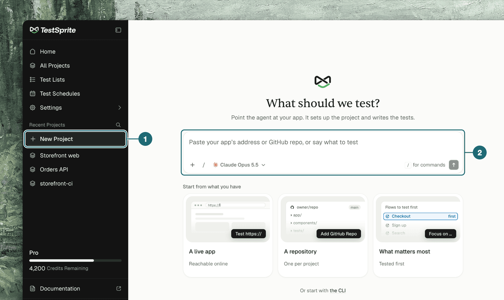
    </Frame>
  </Step>
  <Step title="Create the project">
    The agent asks for what only you know, then proposes a project on the **Setup** tab. Nothing is created until you click <kbd>Create Project</kbd>. See [Setup](/web-portal/core/ui/agent-setup).
    <Frame>
      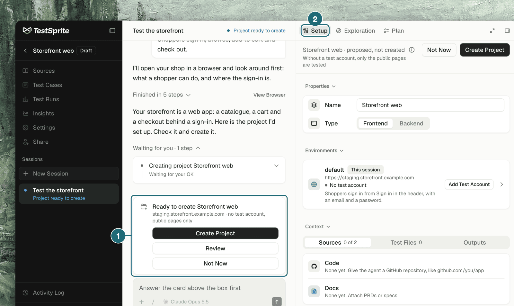
    </Frame>
  </Step>
  <Step title="Watch it explore">
    For a web app, the agent walks your live app in a browser you can watch on the **Exploration** tab. For an API, it makes real calls. What it learns goes into the project's notes. See [Exploration & Notes](/web-portal/core/ui/agent-exploration) and [API Calls](/web-portal/core/api/agent-api-calls).
    <Frame>
      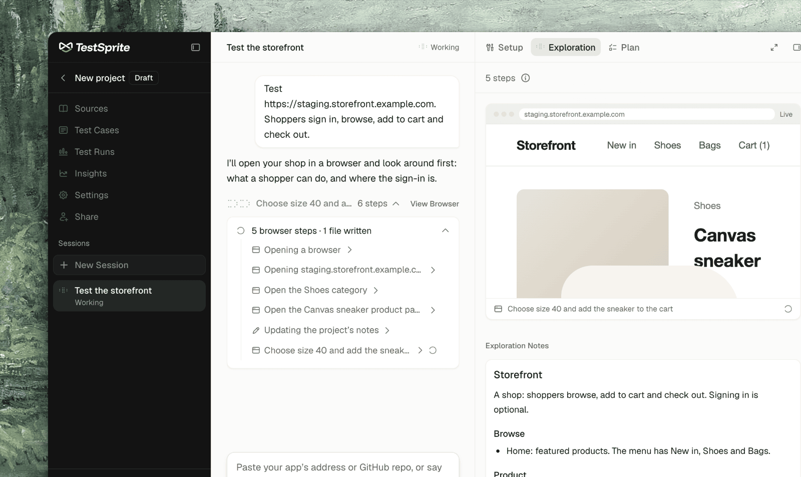
    </Frame>
  </Step>
  <Step title="Review the proposed test cases">
    The plan arrives as a proposal on the **Plan** tab. Keep, leave out, or edit each test, then click <kbd>Apply and Run</kbd>. See [Proposed Test Cases](/web-portal/core/ui/agent-plan).
    <Frame>
      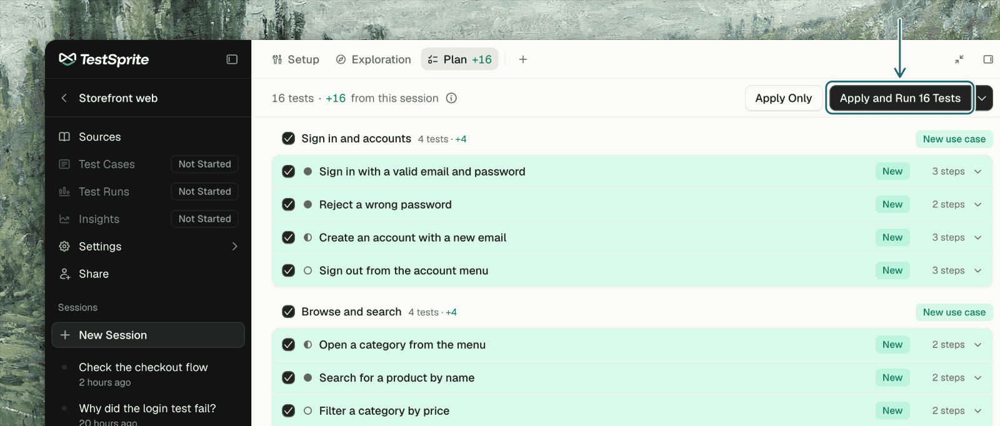
    </Frame>
  </Step>
  <Step title="Run and review">
    Tests run in the cloud. Each ends <kbd>Passed</kbd>, <kbd>Failed</kbd>, or <kbd>Blocked</kbd>, and the agent judges each failure: your app is wrong, the test is wrong, or something got in the way.
    <Frame>
      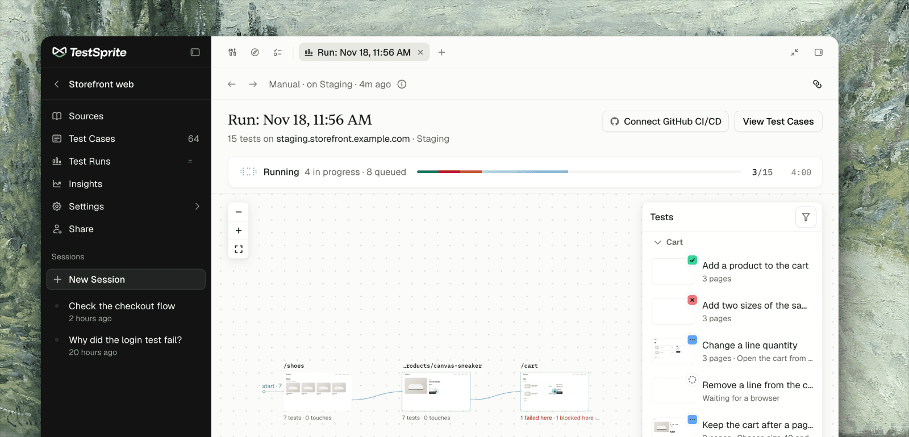
    </Frame>
  </Step>
  <Step title="Keep it running">
    Run your tests automatically to catch regressions: on every pull request or push with the [GitHub integration](/web-portal/integrations/github-integration), or on a cadence with [Test Schedules](/web-portal/maintenance/monitoring).
    <Frame>
      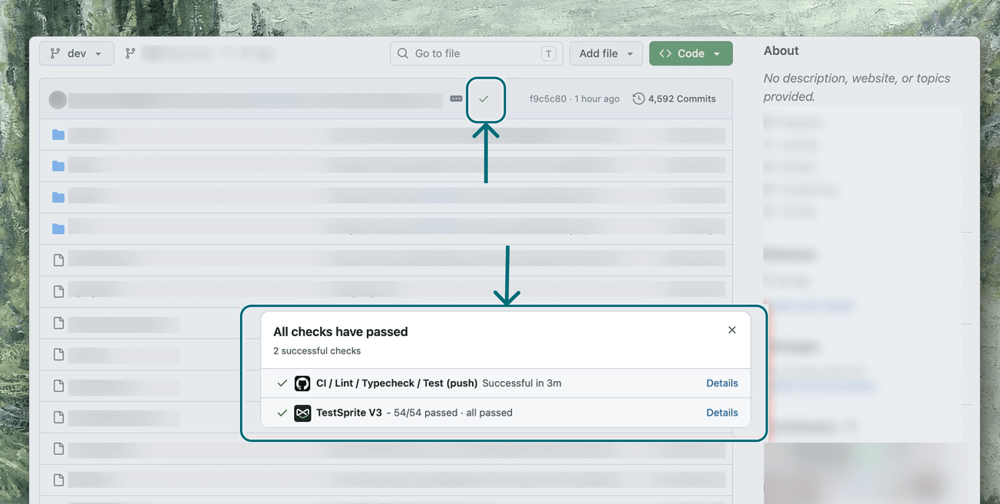
    </Frame>
  </Step>
</Steps>

For the click-by-click version, start with the quickstart for your project type:

<CardGroup cols={2}>
  <Card title="UI Quickstart" href="/web-portal/core/ui/quickstart" icon="window-maximize">
    Your first frontend project, end to end (~10 min)
  </Card>
  <Card title="API Quickstart" href="/web-portal/core/api/quickstart" icon="terminal">
    Your first backend project, end to end (~10 min)
  </Card>
</CardGroup>

## Working with the Agent

**Sessions.** Each conversation with the agent is a session, and every session belongs to one project. A project's sidebar lists its sessions; click <kbd>New Session</kbd> to start another. Sessions are yours: other members don't see them, but they do see everything the agent saved to the project. Every session starts from the project's shared notes, so a new one doesn't re-learn your app.

<Frame>
  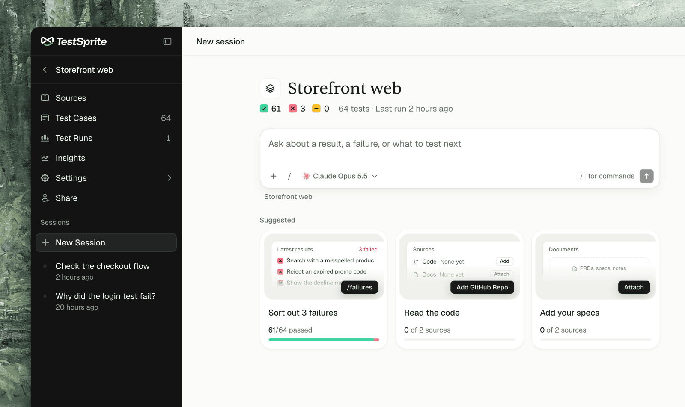
</Frame>

**It keeps working when you leave.** Closing the tab changes nothing. The session is where you left it when you come back.

**It asks before it changes anything.** The agent reads, explores and drafts on its own. Anything that changes your project or spends credits waits on a card above the chat box:

<Frame>
  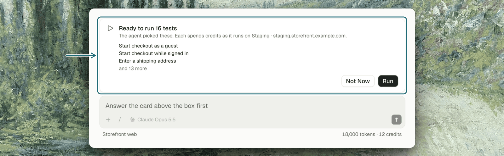
</Frame>

| Card | What it's asking |
| :--- | :--- |
| **Ready to create {name}** | Create the project it proposes |
| **Save N changes to …?** | Save its edits to the project, environments, schedules, documents or test files |
| **N changes to the Test Plan** | Apply the test cases it proposes, with or without running them |
| **Ready to run N tests** | Start a run, on the environment shown |
| A card named for a secret | Type a password, token or key; it is saved encrypted and never appears in the chat |
| **Connect GitHub / Jira / Linear?** | Connect an integration it needs |
| A question | Pick an option, or answer in your own words |

One card waits at a time. Decline one, and the agent asks what to change.

**Shortcuts.** Type <kbd>/</kbd> in the chat box for commands:

<Frame>
  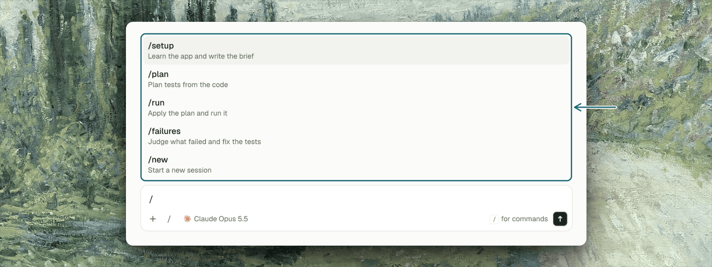
</Frame>

| Command | What it does |
| :--- | :--- |
| <kbd>/setup</kbd> | Learn the app and write the brief |
| <kbd>/plan</kbd> | Plan tests |
| <kbd>/run</kbd> | Apply the plan and run it |
| <kbd>/failures</kbd> | Judge what failed and fix the tests |
| <kbd>/new</kbd> | Start a new session |

Many pages also have buttons that ask the agent for you, such as <kbd>Find the Cause</kbd> and <kbd>Find a Fix</kbd> on a failed result.

**Model and credits.** Pick the session's model in the chat box before your first message; some models need a paid plan. The line under the chat box shows the tokens and credits the session has used. A session stops when the workspace runs out of credits, and carries on once you top up.

**Who can use it.** Asking the agent needs edit access to the project. Viewers can browse projects and results.

## Who It's For

- **Developers:** skip the test-writing boilerplate and see your changes exercised against real flows in minutes.
- **QA teams:** replace handwritten regression suites with a plan the agent derives from your live app, kept running with Test Lists and Test Schedules.
- **Engineering leads:** get reproducible reports and severity-ranked failures without building a test-writing team.

## Advanced Testing Capabilities

Beyond the core flow above:

<Tabs>
  <Tab title="UI Testing (Frontend)">
    - [Flexible sign-in](/web-portal/core/ui/agent-setup#how-the-agent-signs-in): a test account, a one-time-code login with a TestSprite-managed account, or a saved sign-in for SSO such as Google
    - [Auto-Heal](/web-portal/core/ui/auto-heal): tests recover when the page changes instead of failing
    - [Step-by-Step Replay](/web-portal/core/ui/ui-step-by-step): per-step screenshots and a video of every run
    - [Map View](/web-portal/core/ui/map-view): every recording from a run, grouped by status
    - [Reusable test code](/web-portal/integrations/github-integration#exporting-test-code-to-github): generated **Playwright + Python**, exportable to GitHub
  </Tab>
  <Tab title="API Testing (Backend)">
    - [Credentials Setup](/web-portal/core/api/agent-credentials): the agent sets up your API's auth, and secrets never pass through the chat
    - [API Calls](/web-portal/core/api/agent-api-calls): the agent learns your API with real requests, sent the way a run sends them
    - [Auto-Auth](/web-portal/core/api/auto-auth): login tokens refresh before every run
  </Tab>
</Tabs>

## What's Inside the Dashboard

<Frame>
  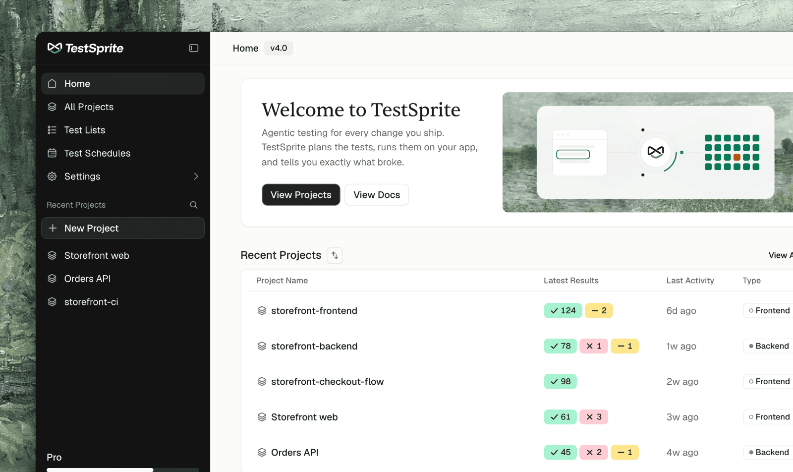
</Frame>

| Surface | What it does |
| :--- | :--- |
| <kbd>Home</kbd> | Your recent projects, test lists and schedules, and what to do next |
| <kbd>All Projects</kbd> | Every project, with run status. Projects the agent has proposed but you haven't created show as <kbd>Draft</kbd> |
| <kbd>Recent Projects</kbd> | In the sidebar: jump back into a project, or click <kbd>New Project</kbd> |
| <kbd>Test Lists</kbd> | Tests from any project, grouped into one runnable list. See [Test Lists](/web-portal/maintenance/test-lists) |
| <kbd>Test Schedules</kbd> | Run Test Lists on a cadence. See [Test Schedules](/web-portal/maintenance/monitoring) |
| <kbd>Settings</kbd> | Members and roles, plan and usage, integrations, and API keys. See [Workspaces](/web-portal/admin/workspaces) |

Inside a project, the chat stays on the left and the project's pages (Sources, Test Cases, Test Runs, Insights, Settings) open as tabs beside it. See [Test Detail Page](/web-portal/core/working-with-test/test-detail).

## Where to Go Next

<Columns cols={2}>
  <Card title="Key Terms" href="/web-portal/concepts/key-terms" icon="book">
    The core vocabulary
  </Card>
  <Card title="Testing Lifecycle" href="/web-portal/concepts/testing-lifecycle" icon="circle-nodes">
    How UI and API projects differ, phase by phase
  </Card>
  <Card title="UI Quickstart" href="/web-portal/core/ui/quickstart" icon="window-maximize">
    Your first frontend project
  </Card>
  <Card title="Join the Community" href="https://discord.gg/QQB9tJ973e" icon="comments">
    Discord for users and the team
  </Card>
</Columns>
